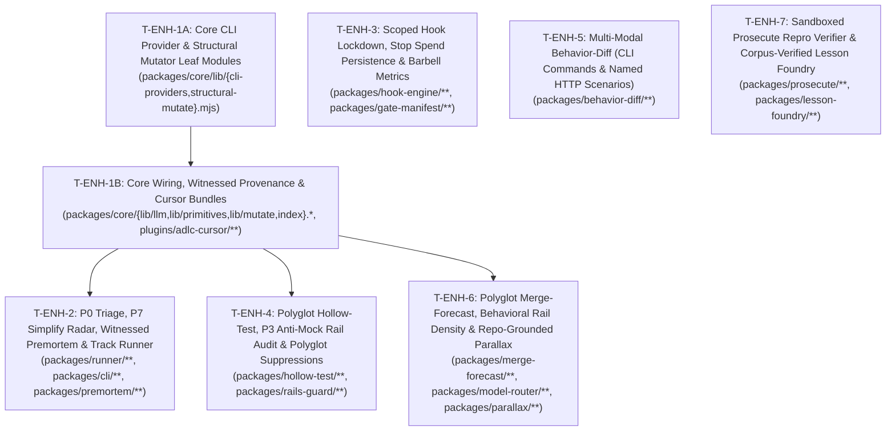

# Feature Specification: ADLC Fact-Based Reality & Polyglot Scaling Enhancements

**Base:** `feat/adlc-reality-enhancements` \
**Gate:** `{"test": "npm test"}`

--------------------------------------------------------------------------------

## 1. Overview & Objectives

Close the eight empirical gaps between ADLC's non-vibes doctrine (`ADLC.md`) and its shipped toolkit implementation so both simple changes and complex polyglot software are governed by mechanical facts rather than single-context prompts or monorepo-specific heuristics:

1. **Eliminate `--prompt-only` self-grading (`F2`/`F3`/`E4`) & weak line-only mutators (`F5`):** Add zero-API-key headless subscription CLI providers (`claude-cli`, `codex-cli` via stdin) and non-spoofable witnessed execution provenance (`onCompleteMeta`) to `@adlc/core`, wire live manifest recording into `@adlc/premortem` and `@adlc/parallax`, and add a tuning-aware structural call-site option-drop mutator in `@adlc/core/lib/structural-mutate.mjs`.
2. **Scale down cleanly to simple software (`P0 Triage`), `P7.1 Simplify` (`F7`), & end backlog rail contagion:** Add `adlc triage` (`trivial | bounded | substantial | architectural`), `adlc simplify` (`F7` structural duplication & `@adlc/core` reinvention radar), and fail-closed track/fresh-context assertions in `@adlc/runner` + `@adlc/cli`, and distinguish bound active tickets from unbound backlog shards in `@adlc/hook-engine`.
3. **Measure real harness token spend (`§6`) & break the JS-only monorepo ceiling:** Harvest and idempotently persist host-harness session token usage in `@adlc/hook-engine` `Stop` hooks + `@adlc/gate-manifest` barbell metrics; add polyglot (`Python`, `Go`, `Rust`) mutation, `--audit-rails` anti-mock checks, config-driven test mapping, and polyglot suppressions in `@adlc/hollow-test` + `@adlc/rails-guard`; add CLI command capture and multi-payload HTTP scenario IDs to `@adlc/behavior-diff`; add workspace/polyglot import & migration collision signals, assertion-weighted `railDensity`, and repo-grounded `parallax` context; and add sandboxed `adlc prosecute verify-repro` and corpus-verified `lesson-foundry --verify-checks`.
4. **CRITICAL HEADLESS BUILDER EXECUTION RULES (`agb run` Workers — READ FIRST):**
   - **NEVER run full `npm test` inside your builder session!** Full `npm test` buffers 36 workspace suites for >6 minutes and WILL kill your builder session via `agb`'s 5-minute streaming `event progress watchdog`! The `agb` orchestrator runs `npm test` automatically in its post-builder sandbox gate AFTER you reply `TICKET-DONE`.
   - Inside your builder session, verify ONLY using fast (<3 second) single-command package tests: `node --test <explicit-test-file-path>` or `npm -w @adlc/<pkg> test` (run `npm run build:cursor-mcp` only in `T-ENH-1B`).
   - **NEVER** call `update_steps` or `schedule` (denied by ADLC pre-tool hook), **NEVER** use `*` wildcard globs in shell commands (denied by frozen-rail glob filter), and **NEVER** chain shell commands with `&&` or `;` (denied by headless worker P4 policy — run one simple command per `run_command` call!). As soon as your package tests pass, output `TICKET-DONE` immediately.

## Resolved Trade-Offs

1. **Zero New Workspace Packages (`packages/*/package.json` Lockstep Preserved):** All enhancements are delivered inside existing `@adlc/*` workspace packages using already-declared workspace dependencies (`@adlc/core`, `@adlc/gate-manifest`, `@adlc/tickets`, `@adlc/build-gate`, `@adlc/flail-detector`).
2. **End-to-End Witnessed Fresh-Context Provenance (`F-001` Resolved):** `recordPromptOnlyVerdict` in `@adlc/core` unconditionally stamps `{ ...extra, promptOnly: true, executionWitnessed: false, attestationMode: 'self-context' }`. Live `complete()`/`fan()`/`fanProviders()` completions emit `onCompleteMeta({ provider, model, tier, attestationMode: provider.isCli ? 'headless-cli' : 'api', executionWitnessed: true, usage })` even when `usage === null`. `@adlc/coldstart` records `data.cache`, and `T-ENH-2` (`@adlc/premortem`) + `T-ENH-6` (`@adlc/parallax`) persist `executionWitnessed: true` + `attestationMode` into `.adlc/manifest` when `--ticket <id>` is supplied on live runs.
3. **Exact `ADLC.md §3` Triage Fidelity & `Stop` Spend Persistence (`F-002`, `F-003` Resolved):** `'trivial'` requires `['rails-check', 'hollow-test', 'p5-pass-completed']` (`ticketRequired: false`, `requiresRevision: true`), and `assertPhase` enforces `p4IntegrityErrors` on `'trivial'` and `'bounded'`. In `@adlc/hook-engine` `evaluateStop`, harvested transcript usage is idempotently persisted via `@adlc/gate-manifest` `record({ gate: 'p4', ... })` (deduplicated by `transcriptSha256`) without modifying `spend.test.mjs`'s pinned `PHASE_BY_GATE` map.
4. **Clean Separation of `P7.1 Simplify` vs `P7.2 Mine` (`F-007` Resolved):** Post-merge `F7` duplication/reinvention detection (`adlc simplify`) lives in `@adlc/runner` + `@adlc/cli` (`T-ENH-2`) rather than `@adlc/lesson-foundry` (`T-ENH-7`).
5. **Split `@adlc/core` Foundation (`T-ENH-1A` -> `T-ENH-1B`) & Streaming Scoped Gate:** `T-ENH-1` is split into `T-ENH-1A` (CLI providers & witnessed provenance, 4 files) and `T-ENH-1B` (structural mutator, `@adlc/core` barrel exports, and `npm run build:cursor-mcp` bundle sync) so no single builder turn hits `print-timeout`, and `Gate.test` uses glob-free `npm -w` across the 14 touched workspaces (~2m streaming output instead of 9m buffered `npm test`), followed by full `npm run preflight` in Phase 5.

--------------------------------------------------------------------------------

## 2. Architecture & Ticket DAG

--------------------------------------------------------------------------------

## 3. Component Details & Ticket Specifications

### Ticket 1: `T-ENH-1A` — Core CLI Provider & Structural Mutator Leaf Modules

-   **Scope**: `packages/core/lib/cli-providers.mjs`, `packages/core/test/cli-providers.test.mjs`, `packages/core/lib/structural-mutate.mjs`, `packages/core/test/structural-mutate.test.mjs`
-   **Rails**: `packages/core/lib/workspace-root.mjs`, `packages/core/test/core.test.mjs`, `packages/core/test/mutate-operators.test.mjs`, `packages/core/test/syntax.test.mjs`
-   **Edges**: `T-ENH-1A -> T-ENH-1B`
-   **Tier**: `frontier`
-   **Pool Hint**: `gemini`
-   **Objectives**:
    1.  Create `packages/core/lib/cli-providers.mjs` (<220 lines) exporting `CLAUDE_CLI_MODELS = Object.freeze({ cheap: 'claude-haiku-4-5', mid: 'claude-sonnet-4-6', frontier: 'claude-opus-4-7' })`, `CODEX_CLI_MODELS = Object.freeze({ cheap: 'gpt-5-mini', mid: 'gpt-5.1', frontier: 'gpt-5.1' })`, `normalizeCliAnthropicUsage(u)` (returning `{ inputTokens: Number(u.input_tokens ?? u.inputTokens ?? 0), outputTokens: Number(u.output_tokens ?? u.outputTokens ?? 0), cachedTokens: Number((u.cache_read_input_tokens ?? 0) + (u.cache_creation_input_tokens ?? 0) + (u.cachedTokens ?? 0)) }` when `u && typeof u === 'object'`, else `null`), `claudeCliSend(apiKey, model, system, prompt, opts = {})`, and `codexCliSend(apiKey, model, system, prompt, opts = {})`:
        -   `'claude-cli'`: resolves binary as `const bin = apiKey === '1' || apiKey === 'true' ? 'claude' : apiKey`, spawns `bin` with `['--print', '--output-format', 'json', '--model', model]` (`shell: false`, `stdio: ['pipe', 'pipe', 'pipe']`), feeds `system ? `${system}\n\n---\n\n${prompt}` : prompt` strictly via `stdin`, parses JSON `{ result, usage }` (returning `{ text: data.result, usage: normalizeCliAnthropicUsage(data.usage) }` when stdout is a valid JSON object with `typeof data.result === 'string'`, else `{ text: stdout, usage: null }`).
        -   `'codex-cli'`: resolves binary as `const bin = apiKey === '1' || apiKey === 'true' ? 'codex' : apiKey`, spawns `bin` with `['exec', '--skip-git-repo-check', '-m', model, '-']` (`shell: false`, `stdio: ['pipe', 'pipe', 'pipe']`) feeding `system ? `${system}\n\n---\n\n${prompt}` : prompt` via `stdin`, returning `{ text: stdout, usage: null }`.
        -   Strip `ADLC_MANIFEST_KEY` and any `ADLC_ADMIN_*` keys from child `env` (preserving `HOME` and `PATH` from `opts.env ?? process.env`), enforce timeout `const timeoutMs = Number.isFinite(opts?.timeoutMs) && opts.timeoutMs > 0 ? opts.timeoutMs : 120_000` (killing child with `'SIGKILL'` and rejecting on timeout or non-zero exit code), attach `child.stdin.on('error', () => {})` for `EPIPE` safety, support injectable `(opts.env ?? process.env).__adlcCliSpawn` `(bin, args, spawnOpts) => ChildProcess` when `(opts.env ?? process.env).NODE_ENV === 'test'`, and NEVER construct `['-p', prompt]` or `['--print', prompt]` argv shapes.
    2.  Create `packages/core/lib/structural-mutate.mjs` (<200 lines) importing `{ isTuningIdentifier, maskStringLiterals }` from `./mutate.mjs` (both already exported in `packages/core/lib/mutate.mjs`) and exporting `dropObjectArgKey(line)` (`(line: string) => string | null`) plus `STRUCTURAL_FALLBACK_OPERATORS = Object.freeze([Object.freeze({ name: 'object-arg-key-drop', apply: dropObjectArgKey })])` (matching `FALLBACK_OPERATORS`'s `Array<{ name: string, apply: (line: string) => string | null }>` shape in `mutate.mjs`):
        -   `dropObjectArgKey(line)` returns `null` unless `line` contains a single-line function/method call passing an object-literal argument `callee(... { k1: v1, k2: v2 } ...)` with balanced parens/braces on the line (returning `null` on `const/let/var { ... } =`, `function ...({ ... })`, `import/export { ... }`, spread `...`, or unbalanced/multi-line literals).
        -   Splits top-level properties inside `{ ... }` (`openBrace + 1` to `closeBrace`) using a bracket/paren/brace depth-aware comma scanner over `maskStringLiterals(line)`, recording each non-empty trimmed property span `{ start, end, key }` and skipping keys where `isTuningIdentifier(key)` is `true` or key is in `['encoding', 'recursive', 'force']`. Returns `null` unless the object literal has `>= 2` properties and `>= 1` non-exempt property; otherwise picks `dropIdx` as the last non-exempt property index and returns `line.slice(0, openBrace + 1) + ' ' + props.filter((_, idx) => idx !== dropIdx).map((p) => line.slice(p.start, p.end).trim()).join(', ') + ' ' + line.slice(closeBrace)`.
    3.  Add offline unit tests in `packages/core/test/cli-providers.test.mjs` and `packages/core/test/structural-mutate.test.mjs` (`t.after` inside any temp helper; zero secret-shaped literals).

**Acceptance Criteria**:
-   `claudeCliSend` and `codexCliSend` pass prompts via `stdin` with `ADLC_MANIFEST_KEY` stripped, parse JSON `{ result, usage }` or plain-text stdout, enforce timeouts, and never pass prompts in argv; verify: `node --test packages/core/test/cli-providers.test.mjs`
-   `STRUCTURAL_FALLBACK_OPERATORS` drops non-tuning call-site option keys while skipping tuning keys (`timeout`, `maxBytes`, `encoding`) and destructuring/declarations; verify: `node --test packages/core/test/structural-mutate.test.mjs`

--------------------------------------------------------------------------------

### Ticket 2: `T-ENH-1B` — Core Wiring, Witnessed Provenance & Cursor Bundles

-   **Scope**: `packages/core/lib/llm.mjs`, `packages/core/lib/primitives.mjs`, `packages/core/lib/mutate.mjs`, `packages/core/index.mjs`, `packages/core/index.d.ts`, `packages/core/test/provenance-and-core-wiring.test.mjs`, `plugins/adlc-cursor/lib/mcp-build-metadata.mjs`, `plugins/adlc-cursor/bin/adlc-mcp-wrapper.bundle.mjs`, `plugins/adlc-cursor/hooks/*.bundle.mjs`
-   **Rails**: `packages/core/lib/workspace-root.mjs`, `packages/core/test/core.test.mjs`, `packages/core/test/mutate-operators.test.mjs`, `packages/gate-manifest/lib/record.mjs`, `scripts/test/ticket-store-boundary.test.mjs`
-   **Edges**: `T-ENH-1B -> T-ENH-2`, `T-ENH-1B -> T-ENH-4`, `T-ENH-1B -> T-ENH-6`
-   **Tier**: `frontier`
-   **Pool Hint**: `gemini`
-   **Objectives**:
    1.  Wire `CLAUDE_CLI_MODELS`, `CODEX_CLI_MODELS`, `claudeCliSend`, and `codexCliSend` from `./cli-providers.mjs` (created in prerequisite `T-ENH-1A`) into `PROVIDERS` and `detectProvider` in `packages/core/lib/llm.mjs`:
        -   Register `{ name: 'claude-cli', envKey: 'ADLC_CLAUDE_CLI', isCli: true, models: CLAUDE_CLI_MODELS, send: claudeCliSend }` and `{ name: 'codex-cli', envKey: 'ADLC_CODEX_CLI', isCli: true, models: CODEX_CLI_MODELS, send: codexCliSend }` (also marking existing `'agy'` `isCli: true`), using existing `envEnabled(val)` (`Boolean(val) && val !== '0' && val !== 'false'`) + `forced === p.name ? '1' : null` in `detectProvider` for all `p.isCli === true` entries.
        -   In `complete()` (`packages/core/lib/llm.mjs`), attach `attestationMode: provider.isCli ? 'headless-cli' : 'api'` and `executionWitnessed: true` to `opts.onUsage` when `usage` is present, and invoke optional `opts.onCompleteMeta?.({ provider: provider.name, model, tier: opts.tier, attestationMode: provider.isCli ? 'headless-cli' : 'api', executionWitnessed: true, usage })` synchronously right before returning `text` (including when `usage === null`), forwarding `onCompleteMeta: opts?.onCompleteMeta` through `fan(prompts, opts)` and `fanProviders(prompt, opts)`.
    2.  In `recordPromptOnlyVerdict` (`packages/core/lib/primitives.mjs`), export `VALID_ATTESTATION_MODES = Object.freeze(['self-context', 'headless-cli', 'api'])` and unconditionally stamp `const data = { ...extra, promptOnly: true, executionWitnessed: false, attestationMode: 'self-context', usageStatus: 'unreported', verdict };` (placed AFTER `...extra` so caller `extra` cannot override them). Wire optional `{ includeStructural = false }` into `generateMutants(content, { targetLines, maxMutants = 50, includeStructural = false } = {})` in `packages/core/lib/mutate.mjs` importing `STRUCTURAL_FALLBACK_OPERATORS` from `./structural-mutate.mjs` (created in `T-ENH-1A`).
    3.  Re-export `CLAUDE_CLI_MODELS`, `CODEX_CLI_MODELS` (`./lib/cli-providers.mjs`), `VALID_ATTESTATION_MODES` (`./lib/primitives.mjs`), and `STRUCTURAL_FALLBACK_OPERATORS` (`./lib/structural-mutate.mjs`) in `packages/core/index.mjs`, update `packages/core/index.d.ts`, add tests in `packages/core/test/provenance-and-core-wiring.test.mjs`, and run `npm run build:cursor-mcp` so `plugins/adlc-cursor/**` bundles match `@adlc/core` in lockstep.

**Acceptance Criteria**:
-   `detectProvider({ ADLC_CLAUDE_CLI: '1' })` resolves `'claude-cli'`, `complete()` invokes `onCompleteMeta` with `attestationMode: 'headless-cli', executionWitnessed: true`, `generateMutants(..., { includeStructural: true })` enables `'object-arg-key-drop'`, and `recordPromptOnlyVerdict` unconditionally stamps `promptOnly: true, executionWitnessed: false, attestationMode: 'self-context'`; verify: `node --test packages/core/test/provenance-and-core-wiring.test.mjs`
-   Core exports, prompt-fencing, and regenerated Cursor bundles pass lockstep boundary tests; verify: `node --test scripts/test/ticket-store-boundary.test.mjs scripts/test/prompt-fencing.test.mjs`

--------------------------------------------------------------------------------

### Ticket 3: `T-ENH-2` — P0 Triage, P7 Simplify Radar, Witnessed Premortem & Track Runner

-   **Scope**: `packages/runner/lib/triage.mjs`, `packages/runner/lib/simplify.mjs`, `packages/runner/lib/assertions.mjs`, `packages/runner/bin/adlc.mjs`, `packages/runner/README.md`, `packages/runner/test/triage-and-tracks.test.mjs`, `packages/cli/bin/adlc.mjs`, `packages/cli/lib/help.mjs`, `packages/cli/test/triage-dispatch.test.mjs`, `packages/premortem/lib/run.mjs`, `packages/premortem/bin/premortem.mjs`, `packages/premortem/test/live-record.test.mjs`
-   **Rails**: `packages/runner/lib/p5-evidence.mjs`, `packages/runner/test/runner.test.mjs`, `packages/runner/test/reason-lines.test.mjs`, `packages/cli/lib/dispatch.mjs`, `packages/cli/lib/registry.mjs`, `packages/cli/test/mcp-server-cli-bin.test.mjs`, `packages/premortem/test/premortem.test.mjs`
-   **Edges**: `(none)`
-   **Tier**: `frontier`
-   **Pool Hint**: `gemini`
-   **Objectives**:
    1.  Create `packages/runner/lib/triage.mjs` (<250 lines) implementing `evaluateTriage({ cwd = process.cwd(), base = 'HEAD', files, linesAdded: overrideAdded, linesDeleted: overrideDeleted, dir = '.adlc' } = {})`:
        -   Classify test files via `TEST_FILE_RE = /(?:^|\/)(?:test|tests|__tests__|cli-test|adapter-test)\/|\.(?:test|spec)\.[a-z0-9]+$|(?:^|\/)test_[^/]+\.py$|_test\.(?:py|go)$/i`, code files via `CODE_EXT_RE = /\.(?:mjs|cjs|js|jsx|ts|tsx|py|go|rs|java|rb|php|cs|c|cc|cpp|h|hpp|swift|kt)$/i` (`nonTestCode` = `CODE_EXT_RE.test(f) && !TEST_FILE_RE.test(f)`), `partitions` via `Array.from(new Set(changedFiles.map((f) => { const m = f.match(/^(packages\/[^/]+|plugins\/[^/]+|apps\/[^/]+|services\/[^/]+|crates\/[^/]+)/); return m ? m[1] : (f.includes('/') ? f.split('/')[0] : '(root)'); }))).sort()`, `riskMatches` via `@adlc/core` `classifyRiskTier(changedFiles).matches`, and `contractSurfaceChanged` via `/(?:^|\/)package\.json$|\.d\.ts$|(?:^|\/)(?:drizzle|migrations|prisma\/migrations|alembic\/versions|supabase\/migrations)\/|(?:^|\/)openapi(?:\.[a-z0-9]+)?$|(?:^|\/)schema\.(?:prisma|sql|graphql|json|ya?ml)$/i.test(f)`.
        -   When `Array.isArray(files) && files.length > 0`, use `changedFiles = files.map((f) => f.trim()).filter(Boolean)` and obtain `linesAdded`/`linesDeleted` across non-test code files from `overrideAdded`/`overrideDeleted` if finite numbers, else `git diff --numstat <base> -- <...changedFiles>` inside `cwd` (falling back to `0` if `cwd` is not a git repo); when `files` is omitted, collect `changedFiles` and `linesAdded`/`linesDeleted` across non-test code files from `git diff --numstat <base>` plus untracked files from `git status --porcelain -z`. Compute `totalCodeLines = linesAdded + linesDeleted` and `codeFilesChanged = changedFiles.filter(nonTestCode).length`, and evaluate `VALID_TRACKS = ['trivial', 'bounded', 'substantial', 'architectural']` in strict top-to-bottom precedence order:
        1.  `'architectural'`: `(contractSurfaceChanged === true && partitions.length >= 2) || (partitions.length >= 3 && riskMatches.length > 0)` -> `requiredGates: TRACK_REQUIREMENTS.architectural` (`ticketRequired: true`, `requireFreshContext: true`).
        2.  `'substantial'`: `partitions.length >= 2 || totalCodeLines > 150 || riskMatches.length > 0 || contractSurfaceChanged === true` -> `requiredGates: TRACK_REQUIREMENTS.substantial` (`ticketRequired: true`, `requireFreshContext: true`).
        3.  `'bounded'`: `totalCodeLines <= 150 && partitions.length <= 1 && (totalCodeLines > 30 || codeFilesChanged > 2)` -> `requiredGates: TRACK_REQUIREMENTS.bounded` (`ticketRequired: true`, `requireFreshContext: false`).
        4.  `'trivial'`: `totalCodeLines <= 30 && codeFilesChanged <= 2` -> `requiredGates: TRACK_REQUIREMENTS.trivial` (`ticketRequired: false`, `requireFreshContext: false`).
    2.  Create `packages/runner/lib/simplify.mjs` (<240 lines) implementing `scanRepositoryBloat({ root })`: deterministically scans JS/TS source files under `root` (excluding `node_modules`, `.git`, `.worktrees`, `test`, `tests`, `dist`, `build`, `*.bundle.mjs`):
        -   Strip `/* ... */` block comments, `//` line comments, and blank lines, trim each remaining code line (`line.trim()`), hash sliding windows of `12` consecutive normalized lines via `sha256(windowLines.join('\n'))` from `@adlc/core`, and emit `duplicateBlocks: Array<{ hash: string, lineCount: 12, sample: string, locations: Array<{ file: string, startLine: number }> }>` for hashes appearing in `>= 2` distinct files.
        -   Scan files outside `packages/core/` via regex `/\b(?:export\s+)?(?:async\s+)?function\s+(writeFileAtomic|acquireDirLock|canonicalJson|redactSecrets|globMatch|resolveTrustedBinary)\b/` and `/\b(?:export\s+)?const\s+(writeFileAtomic|acquireDirLock|canonicalJson|redactSecrets|globMatch|resolveTrustedBinary)\s*=\s*(?:async\s*)?(?:\(|function\b)/` (excluding any file whose text contains an `import { ... } from '@adlc/core'` statement naming that same helper symbol), emitting `coreReinventions: Array<{ helper: string, file: string, line: number }>`.
    3.  In `packages/premortem/lib/run.mjs` and `packages/premortem/bin/premortem.mjs`, add optional `--dir <path>` (default `.adlc`), resolve `const key = opts.key ?? process.env.ADLC_MANIFEST_KEY ?? null`, and wire `onCompleteMeta` into live `complete()` calls: when `ticket` is supplied on a live (non-`promptOnlyMode`) run, record `{ gate: 'premortem', ticket, dir, key, rawData: JSON.stringify({ specPath, provider: meta.provider, model: meta.model, tier, attestationMode: meta.attestationMode, executionWitnessed: true, usageStatus: meta.usage ? 'reported' : 'unreported', ...(meta.usage ? { usage: meta.usage } : {}) }) }` via `@adlc/gate-manifest/lib/record.mjs`.
    4.  Extend `assertPhase(phase, { dir, ticket, revision, key, cwd, track, requireFreshContext } = {})` in `packages/runner/lib/assertions.mjs` (returning `{ ok, phase, missing, errors, operational? }` where `operational: true` maps to CLI `opError` `exit 1` and `operational: false` maps to CLI `gateFail` `exit 2`; keeping `allPhases()` unchanged as `['p0'..'p7']`, and exporting `TRACK_REQUIREMENTS = Object.freeze({ trivial: ['rails-check', 'hollow-test', 'p5-pass-completed'], bounded: ['rails-red', 'hollow-test', 'rails-check', 'p5-complete'], substantial: ['coldstart', 'premortem', 'rails-red', 'hollow-test', 'rails-check', 'p5-complete'], architectural: ['coldstart', 'premortem', 'parallax', 'rails-red', 'hollow-test', 'rails-check', 'p5-complete'] })` and `allTracks()` returning `['trivial', 'bounded', 'substantial', 'architectural']`):
        -   Support `phase === 'trivial'` (`TRACK_REQUIREMENTS.trivial`, `requiresTicket: false`, `requiresRevision: true` resolving live worktree HEAD revision when `--revision` is omitted, enforcing `p4IntegrityErrors` on `rails-check`, and checking at least one revision-matched `dry === true` `p5-pass-completed` entry) and `phase === 'bounded'` (`TRACK_REQUIREMENTS.bounded`, `requiresTicket: true`, enforcing `requiresRevision: true`, `p4IntegrityErrors`, `p5CompletionIntegrityErrors`, and `transcriptErrors`).
        -   If `phase` is `'trivial'` or `'bounded'` and `track` is passed with a different value, or `track` is not in `allTracks()`, return `{ ok: false, phase, missing: [], errors: ['invalid --track'], operational: true }` (`exit 1`).
        -   When `phase` is in `p0`..`p7` and `(requireFreshContext === true || track === 'substantial' || track === 'architectural')`, append `'parallax'` to `p1`'s required entry types when `track === 'architectural'`, and validate the latest `coldstart` (`p0`/`p2`), `premortem` (`p1`), and `parallax` (`p1` when `track === 'architectural'`) using a strict allowlist: pass ONLY if `entry.data?.promptOnly !== true` AND `(entry.data?.executionWitnessed === true || (typeof entry.data?.usage?.provider === 'string' && entry.data.usage.provider.length > 0) || (entryType === 'coldstart' && entry.data?.cache && typeof entry.data.cache.ticketHash === 'string' && typeof entry.data.cache.model === 'string' && Array.isArray(entry.data.cache.gaps)))`. Reject `--prompt-only`, malformed-cache, or field-less entries with `{ ok: false, operational: false }` (`exit 2`).
    5.  Wire `triage` (`--base <ref>`, `--files <csv>`, `--dir .adlc`, `--json`), `simplify` (`--root <dir>`, `--json`), and `--track` / `--require-fresh-context` into `packages/runner/bin/adlc.mjs`, forward `first === 'triage' || first === 'simplify'` via `dispatchRunner(argv)` in `packages/cli/bin/adlc.mjs`, document both in `packages/cli/lib/help.mjs`, and add tests in `packages/runner/test/triage-and-tracks.test.mjs`, `packages/cli/test/triage-dispatch.test.mjs`, and `packages/premortem/test/live-record.test.mjs`.

**Acceptance Criteria**:
-   `adlc triage --json` classifies diffs/`--files` into `trivial`, `bounded`, `substantial`, or `architectural`, and `adlc simplify --root <dir> --json` detects multi-file structural clones and reinvented `@adlc/core` helpers; verify: `node --test packages/runner/test/triage-and-tracks.test.mjs packages/cli/test/triage-dispatch.test.mjs`
-   Live `premortem <spec.md> --ticket <id>` records witnessed provenance (`executionWitnessed: true`), and `adlc run` under `--track substantial` or `--track architectural` passes on witnessed live/CLI entries while failing closed (`exit 2`) on `--prompt-only`, field-less, or forged bare `rails-check` entries; verify: `node --test packages/premortem/test/live-record.test.mjs packages/runner/test/triage-and-tracks.test.mjs`
-   All existing runner, CLI, premortem, and prompt-fencing suites pass; verify: `npm -w @adlc/runner -w @adlc/cli -w @adlc/premortem test`

--------------------------------------------------------------------------------

### Ticket 4: `T-ENH-3` — Scoped Hook Lockdown, Stop Spend Persistence & Barbell Metrics

-   **Scope**: `packages/hook-engine/lib/pretool.mjs`, `packages/hook-engine/lib/protocol-adapters.mjs`, `packages/hook-engine/lib/spend-harvest.mjs`, `packages/hook-engine/lib/stop.mjs`, `packages/hook-engine/index.mjs`, `packages/hook-engine/test/scoped-lockdown-and-spend.test.mjs`, `packages/gate-manifest/lib/spend.mjs`, `packages/gate-manifest/test/spend-barbell-metrics.test.mjs`
-   **Rails**: `packages/hook-engine/test/pretool.test.mjs`, `packages/hook-engine/test/protocol-adapters.test.mjs`, `packages/hook-engine/test/posttool-stop-session.test.mjs`, `packages/gate-manifest/lib/record.mjs`, `packages/gate-manifest/test/spend.test.mjs`
-   **Edges**: `(none)`
-   **Tier**: `frontier`
-   **Pool Hint**: `gemini`
-   **Objectives**:
    1.  In `packages/hook-engine/lib/pretool.mjs`, add `NON_FS_UI_TOOL_NAMES = new Set(['update_steps', 'todo_write', 'task_boundary', 'enter_plan_mode', 'exit_plan_mode'])` and include `boundTicket: boolean` on `readActiveTicketRails(root)` (`true` when `resolved.value !== null`; `false` when `resolved.value === null` and rails came solely from ambient uncompleted backlog shards). In `evaluatePreTool` (defaulting `boundTicket = opts.boundTicket ?? true` when caller passes an explicit `rails` array), allow `NON_FS_UI_TOOL_NAMES` ONLY when `boundTicket === false`, keeping all file-mutation, patch, shell-rail, opaque-shell, and `boundTicket === true` fail-closed denials 100% intact.
    2.  In `packages/hook-engine/lib/protocol-adapters.mjs`, extract `transcriptPath: (typeof p.transcript_path === 'string' && p.transcript_path.trim() ? p.transcript_path.trim() : null) ?? (typeof p.transcriptPath === 'string' && p.transcriptPath.trim() ? p.transcriptPath.trim() : null) ?? null` in `normalizeHookInput` while preserving every existing field and wire format in `protocol-adapters.test.mjs`.
    3.  Create `packages/hook-engine/lib/spend-harvest.mjs` (<240 lines) exporting `harvestTranscriptUsage(transcriptPath, { maxBytes = 10 * 1024 * 1024 } = {})`: reads JSON or JSONL session transcripts safely via `@adlc/core` `readBoundedRegularFile` (`O_NOFOLLOW`, returning `null` if missing/symlink/unreadable/zero-usage), computes `transcriptSha256` (`sha256`), deduplicates repeated `message.id` streaming snapshots (keeping the latest snapshot per unique `message.id`), and returns `{ transcriptSha256: string, calls: number, provider: string, usage: { provider: string, model: string, inputTokens: number, outputTokens: number, cachedTokens: number } }` where `calls` is the count of deduplicated usage turns, `inputTokens` sums Claude `input_tokens` / Codex `input_tokens` / Gemini `promptTokenCount` / OpenAI `prompt_tokens`, `outputTokens` sums Claude `output_tokens` / Codex `output_tokens` / Gemini `candidatesTokenCount + thoughtsTokenCount` / OpenAI `completion_tokens`, and `cachedTokens` sums `cache_read_input_tokens + cache_creation_input_tokens + cached_input_tokens + cachedContentTokenCount`. Re-export `harvestTranscriptUsage` from `packages/hook-engine/index.mjs`. In `evaluateStop` (`packages/hook-engine/lib/stop.mjs`), when `opts.transcriptPath` is provided, attach `harvestedUsage` to the returned object and—when `opts.recordSessionUsage === true` and `root` exists and `harvestedUsage?.calls > 0`—scan existing manifest lines in `<root>/.adlc` (independent of `requireEvidence` / `ADLC_MANIFEST_KEY` presence) and idempotently append via `@adlc/gate-manifest/lib/record.mjs` `record({ gate: opts.phaseGate ?? 'p4', ticket: activeTicket?.id, dir: join(root, '.adlc'), key: key ?? null, rawData: JSON.stringify({ sessionId: opts.sessionId ?? null, transcriptSha256: harvestedUsage.transcriptSha256, usage: harvestedUsage.usage, usageStatus: 'reported' }) })` if no prior entry carries the same `data.transcriptSha256`.
    4.  In `packages/gate-manifest/lib/spend.mjs` (do **NOT** modify `PHASE_BY_GATE`), export `computeBarbellMetrics(aggregate)` over `aggregateSpend(entries)`'s existing `{ total, byPhase, byGate, unmeasuredCalls }` buckets: let `tok = (b) => (b?.inputTokens ?? 0) + (b?.outputTokens ?? 0) + (b?.cachedTokens ?? 0)`, `p1p2p5 = tok(aggregate.byPhase?.P1) + tok(aggregate.byPhase?.P2) + tok(aggregate.byPhase?.P5)`, `p4 = tok(aggregate.byPhase?.P4)`, and `totalTok = tok(aggregate.total)`, returning `{ barbellRatio: p4 > 0 ? p1p2p5 / p4 : null, p4Share: totalTok > 0 ? p4 / totalTok : null, cacheHitRate: (aggregate.total.inputTokens + aggregate.total.cachedTokens) > 0 ? aggregate.total.cachedTokens / (aggregate.total.inputTokens + aggregate.total.cachedTokens) : null, measuredCallShare: (aggregate.total.calls + aggregate.unmeasuredCalls) > 0 ? aggregate.total.calls / (aggregate.total.calls + aggregate.unmeasuredCalls) : null }` and attaching `metrics` on `aggregateSpend(entries)` without altering `total`, `byPhase`, `byGate`, `unmeasuredCalls`, or `renderSpendReport` output lines pinned in `spend.test.mjs`.
    5.  Add unit and end-to-end persistence tests in `packages/hook-engine/test/scoped-lockdown-and-spend.test.mjs` and `packages/gate-manifest/test/spend-barbell-metrics.test.mjs`.

**Acceptance Criteria**:
-   `evaluatePreTool` allows `update_steps` when `boundTicket === false`, denies `update_steps` when `boundTicket === true` or explicit `rails` are passed without `boundTicket: false`, and denies file/shell writes targeting any ambient backlog rail; verify: `node --test packages/hook-engine/test/scoped-lockdown-and-spend.test.mjs`
-   `harvestTranscriptUsage` and `evaluateStop(..., { transcriptPath, recordSessionUsage: true })` sum Claude, Codex, and Gemini JSONL usage, reject symlinks via `O_NOFOLLOW`, and idempotently persist `gate: 'p4'` usage; verify: `npm -w @adlc/hook-engine test`
-   `aggregateSpend` preserves the exact pinned `PHASE_BY_GATE` table while computing `metrics.barbellRatio` and `metrics.cacheHitRate`; verify: `npm -w @adlc/gate-manifest test`

--------------------------------------------------------------------------------

### Ticket 5: `T-ENH-4` — Polyglot Hollow-Test, P3 Anti-Mock Rail Audit & Polyglot Suppressions

-   **Scope**: `packages/hollow-test/lib/polyglot.mjs`, `packages/hollow-test/lib/rail-audit.mjs`, `packages/hollow-test/lib/targets.mjs`, `packages/hollow-test/lib/gate-plan.mjs`, `packages/hollow-test/bin/hollow-test.mjs`, `packages/hollow-test/README.md`, `packages/hollow-test/test/polyglot-and-rail-audit.test.mjs`, `packages/rails-guard/lib/suppressions.mjs`, `packages/rails-guard/test/polyglot-suppressions.test.mjs`
-   **Rails**: `packages/hollow-test/lib/inflight.mjs`, `packages/hollow-test/test/typescript.test.mjs`, `packages/rails-guard/bin/rails-guard.mjs`, `packages/rails-guard/test/suppressions.test.mjs`, `scripts/test/mutation-gate.test.mjs`
-   **Edges**: `(none)`
-   **Tier**: `frontier`
-   **Pool Hint**: `gemini`
-   **Objectives**:
    1.  Create `packages/hollow-test/lib/polyglot.mjs` (<280 lines) importing `{ sanitizeCandidateEnv }` from `@adlc/core` and supporting `.py`, `.go`, and `.rs` files when `--polyglot` is enabled:
        -   Export `polyglotLanguage(file)` (`'python' | 'go' | 'rust' | null`), `isPolyglotTestFile(file)` (`test_*.py`, `*_test.py`, `conftest.py`, `*_test.go`, `tests/**/*.rs`), string-masked line-level `generatePolyglotMutants(content, lang, { targetLines, maxMutants })` (`Python`: `==`/`!=`, `is None`/`is not None`, `True`/`False`, `and`/`or`, `return None`, skipping `#` comments; `Go` & `Rust`: `==`/`!=`, `<=`/`>=`, `true`/`false`, `&&`/`||`, plus Rust `.is_some()`/`.is_none()`, skipping `//` comments), and `checkPolyglotSyntax(filePath, content, lang)` using `spawnSync` (`shell: false`, `env: sanitizeCandidateEnv(process.env)`) on a disposable temp file (`mkdtempSync` cleaned up in `finally` so `__pycache__` never touches the repo): `python3 -I -m py_compile <tmp.py>`, `gofmt -e <tmp.go>`, and `rustfmt --emit stdout <tmp.rs>`, returning `{ verdict: 'valid' | 'invalid' | 'unknown', detail }` so missing toolchains (`ENOENT` -> `verdict: 'unknown'`) call `@adlc/core`'s `opError(detail)` (`exit 1`) in `bin/hollow-test.mjs` before mutating and invalid mutants are discarded as `invalid` rather than false-killed.
    2.  Create `packages/hollow-test/lib/rail-audit.mjs` (<240 lines) exporting `auditRailAdequacy(files, { root = process.cwd() } = {})` returning `{ ok: boolean, audited: number, violations: Array<{ file: string, reason: 'missing-assertions' | 'tautological-only' | 'mock-only-internal', detail: string }> }`:
        -   Resolve each file against `realpathSync(root)` (throwing an `Error` if `files` is empty, missing on disk, or escapes `root`, caught in `bin/hollow-test.mjs` via `opError(err.message)` `exit 1`).
        -   Flag: (a) `'missing-assertions'` when a test file has zero assertions matching `/\b(?:assert(?:\.|\(|_eq!|_ne!|\s)|expect\s*\(|\.should\b|t\.(?:Fatal|Fatalf|Error|Errorf)\s*\()/`, (b) `'tautological-only'` when every assertion in the file is tautological (`assert.ok(true)`, `assert(true)`, `expect(true).toBe(true)`, `assert True`), and (c) `'mock-only-internal'` when a test file mocks relative internal module specifiers (`(?:vi|jest)\.mock\(\s*['"](\.\.?\/[^'"]+)['"]` or `mock\.module\(\s*['"](\.\.?\/[^'"]+)['"]`) and no other audited file in `files` imports the same resolved module stem (`resolve(dirname(absFile), spec)` stripped of `.js`/`.mjs`/`.ts`) without mocking it.
    3.  Wire `--polyglot`, `--structural`, and `--audit-rails <file>` (repeatable) into `packages/hollow-test/bin/hollow-test.mjs` and `packages/hollow-test/lib/targets.mjs`:
        -   Handle `--audit-rails` BEFORE the `!values['test-cmd']` guard in `bin/hollow-test.mjs`: invoke `auditRailAdequacy(values['audit-rails'], { root: process.cwd() })`, emit `printJson(report)` when `values.json` is true (or human-readable lines otherwise), and call `gateFail(...)` (`exit 2`) when `!report.ok` or `pass()` (`exit 0`) when `report.ok`.
        -   Keep default `isSupportedSourceExtension(file)` and `isMutableSource(file)` (`polyglot: false`) 100% identical to `origin/main` so `scripts/test/mutation-gate.test.mjs` passes untouched; thread `{ polyglot: values.polyglot }` and `{ includeStructural: values.structural }` through pre-mutation syntax validation and the trial loop (discarding `invalid` polyglot mutants without spending `target.quota`).
        -   In `packages/hollow-test/lib/gate-plan.mjs`, add `resolveConfiguredTestTarget(file, root)` reading optional `.adlc/config.json` `hollowTest.testMap` (`{ "<glob>": "<relTestTarget>" }`, rejecting `..`, absolute paths, or shell metacharacters `[;&|$\`<>()\n\r]`) ahead of `testTargetFor`'s built-in heuristics.
    4.  Expand `SUPPRESSION_MARKERS` in `packages/rails-guard/lib/suppressions.mjs` with `pytest.mark.skip`, `@unittest.skip`, `# type: ignore`, `# pragma: no cover`, `t.Skip(`, `//nolint`, `#[allow(`, `biome-ignore`, `c8 ignore`, `v8 ignore`, `istanbul ignore`, and `.todo(`.
    5.  Add unit and CLI tests in `packages/hollow-test/test/polyglot-and-rail-audit.test.mjs` and `packages/rails-guard/test/polyglot-suppressions.test.mjs`.

**Acceptance Criteria**:
-   `hollow-test --polyglot` generates valid Python, Go, and Rust mutants, discards syntactically invalid mutants without false kills, fails closed on missing toolchains, and leaves zero `__pycache__` artifacts; verify: `node --test packages/hollow-test/test/polyglot-and-rail-audit.test.mjs`
-   `hollow-test --audit-rails <file>` runs standalone without `--test-cmd`, exiting `2` on zero-assertion, tautological, or relative-module mock-only test files and `0` on real behavioral tests; verify: `npm -w @adlc/hollow-test test`
-   `findSuppressions` detects Python, Go, Rust, Biome, and V8/Istanbul coverage suppressions while preserving MDX/doc exemptions and `mutation-gate.test.mjs` parity; verify: `node --test packages/rails-guard/test/polyglot-suppressions.test.mjs scripts/test/mutation-gate.test.mjs`

--------------------------------------------------------------------------------

### Ticket 6: `T-ENH-5` — Multi-Modal Behavior-Diff (CLI Commands & Named HTTP Scenarios)

-   **Scope**: `packages/behavior-diff/lib/cli-capture.mjs`, `packages/behavior-diff/lib/capture.mjs`, `packages/behavior-diff/lib/compare.mjs`, `packages/behavior-diff/lib/diff.mjs`, `packages/behavior-diff/lib/report.mjs`, `packages/behavior-diff/bin/behavior-diff.mjs`, `packages/behavior-diff/README.md`, `packages/behavior-diff/test/cli-and-scenarios.test.mjs`
-   **Rails**: `packages/behavior-diff/test/behavior-diff.test.mjs`, `packages/behavior-diff/test/capture-ssrf.test.mjs`, `packages/behavior-diff/test/compare.test.mjs`
-   **Edges**: `(none)`
-   **Tier**: `frontier`
-   **Pool Hint**: `gemini`
-   **Objectives**:
    1.  Support optional `route.id` (non-empty trimmed string scenario label) on HTTP routes in `packages/behavior-diff/lib/{capture,compare,diff}.mjs`: update `routeKey(entry)` to return `entry.id ? `${entry.method.toUpperCase()} ${entry.path} [${entry.id}]` : `${entry.method.toUpperCase()} ${entry.path}`` so multiple probes of the same `POST /endpoint` with distinct `id`s are captured and compared independently while duplicate keyless or duplicate same-id routes are still rejected by `validateConfig`.
    2.  Create `packages/behavior-diff/lib/cli-capture.mjs` (<240 lines) importing `{ sanitizeCandidateEnv, sha256 }` from `@adlc/core` and implementing shell-free CLI behavioral capture (`commands: [{ id, cmd, args?, stdin?, cwd?, timeoutMs? }]`):
        -   Validate unique non-empty `id`, non-empty `cmd` (forbidding shell binaries `sh`/`bash`/`zsh`/`dash`/`cmd`/`powershell`/`pwsh` and `..` path traversal), string array `args`, and optional `cwd` (must resolve inside `process.cwd()` with `realpathSync` containment).
        -   Execute via `spawn(cmd, args, { shell: false, cwd, env: sanitizeCandidateEnv(process.env) })` with timeout and `MAX_BODY_BYTES` stream caps on `stdout` and `stderr`.
        -   Record `{ id, cmd, args, exitCode, stdoutFormat: 'json' | 'text', stdout, stderr }` where `stdout` is parsed JSON when valid JSON, or `{ textHash: sha256(stdoutBuffer), bytes: stdoutBuffer.length }` when non-JSON, or `{ id, cmd, args, error: string }` on spawn/timeout failure.
    3.  Update `validateConfig`, `runCapture`, `reachableCount`, `loadSnapshot`, `compareSnapshots`, `renderReport`, and `bin/behavior-diff.mjs` so configs and snapshots may contain `routes` (HTTP), `commands` (CLI), or both (requiring at least one non-empty surface and total `reachableCount > 0`):
        -   In `compareSnapshots`, key CLI commands as `CMD ${entry.id}`; classify commands with `error` in both snapshots in `unreachable` and commands with `error` in only one snapshot in `changed`; compare `exitCode` (`!==`), JSON `stdout` via `diffBodies(beforeCmd.stdout, afterCmd.stdout)` from `./diff.mjs`, text `stdout` via `beforeCmd.stdout.textHash !== afterCmd.stdout.textHash`, and `stderr` via `sha256(beforeCmd.stderr) !== sha256(afterCmd.stderr)`, folding changed CLI entries into `changed` (`kind: 'command'`) / `onlyInBefore` / `onlyInAfter` so `compare` exits `2` on any CLI change and `0` when identical, while keeping 100% of existing HTTP-only snapshot schemas and tests passing.
    4.  Add unit and end-to-end CLI tests in `packages/behavior-diff/test/cli-and-scenarios.test.mjs`.

**Acceptance Criteria**:
-   HTTP configs with two `POST /api/auth` routes carrying distinct `id`s capture and diff both scenarios without collision while duplicate `id`s are rejected; verify: `node --test packages/behavior-diff/test/cli-and-scenarios.test.mjs`
-   `behavior-diff capture` and `behavior-diff compare` capture real CLI subprocess `exitCode`, JSON `stdout` structural changes, and `stderr` with `ADLC_MANIFEST_KEY` scrubbed and `shell: false`, exiting `0` when identical and `2` when behavior changes; verify: `npm -w @adlc/behavior-diff test`

--------------------------------------------------------------------------------

### Ticket 7: `T-ENH-6` — Polyglot Merge-Forecast, Behavioral Rail Density & Repo-Grounded Parallax

-   **Scope**: `packages/merge-forecast/lib/polyglot-imports.mjs`, `packages/merge-forecast/lib/signals.mjs`, `packages/merge-forecast/lib/forecast.mjs`, `packages/merge-forecast/test/polyglot-and-exports.test.mjs`, `packages/model-router/lib/density.mjs`, `packages/model-router/lib/assign.mjs`, `packages/model-router/lib/router.mjs`, `packages/model-router/test/behavioral-density.test.mjs`, `packages/parallax/lib/repo-context.mjs`, `packages/parallax/lib/prompts.mjs`, `packages/parallax/lib/modes.mjs`, `packages/parallax/bin/parallax.mjs`, `packages/parallax/test/repo-grounded.test.mjs`
-   **Rails**: `packages/merge-forecast/bin/merge-forecast.mjs`, `packages/merge-forecast/test/forecast.test.mjs`, `packages/merge-forecast/test/forecast-unchanged.test.mjs`, `packages/model-router/bin/model-router.mjs`, `packages/model-router/test/model-router.test.mjs`, `packages/parallax/test/prompts.test.mjs`, `packages/parallax/test/modes.test.mjs`, `scripts/test/prompt-fencing.test.mjs`
-   **Edges**: `(none)`
-   **Tier**: `frontier`
-   **Pool Hint**: `gemini`
-   **Objectives**:
    1.  Create `packages/merge-forecast/lib/polyglot-imports.mjs` (<240 lines) exporting `extractPolyglotSpecifiers(content, filePath)` (`string[]`) and `resolvePolyglotCandidates(specifier, importingFile, root)` (`string[]` of repo-relative forward-slash paths), and append its results inside `resolvedImportCandidates(afNorm, rootNorm, cache)` in `packages/merge-forecast/lib/signals.mjs`:
        -   Workspace specifiers (`@scope/pkg` or `@scope/pkg/<subpath>`): scan `<root>/packages/*/package.json` (cached per `root`); when `pkgJson.name === '@scope/pkg'`, map bare `@scope/pkg` to `<pkgDir>/<entry>` (where `<entry>` resolves string or `{ import, default }` `pkgJson.exports?.['.'] ?? pkgJson.main ?? 'index.mjs'`) and `@scope/pkg/<subpath>` to `<pkgDir>/<pkgJson.exports?.['./' + subpath] ?? subpath>` plus `.mjs`/`.js`/`.ts` variants.
        -   Python (`*.py`): map relative `from .foo import bar` relative to `dirname(importingFile)` (`<dir>/foo.py`, `<dir>/foo/__init__.py`) and dotted `from pkg.sub import x` / `import pkg.sub` relative to `<root>` and `<root>/src` (`pkg/sub.py`, `pkg/sub/__init__.py`, `src/pkg/sub.py`, `src/pkg/sub/__init__.py`).
        -   Rust (`*.rs`): map `mod foo;` to `<importingDir>/foo.rs` and `<importingDir>/foo/mod.rs`, and `use crate::a::b` to `<crateSrcDir>/a/b.rs`, `<crateSrcDir>/a/b/mod.rs`, and `<crateSrcDir>/a.rs` (where `<crateSrcDir>` is the nearest ancestor `src` dir of `importingFile`, or `dirname(importingFile)`).
        -   Extend `signalMigrationCollision` (`packages/merge-forecast/lib/signals.mjs`) via `/(?:^|\/)(?:drizzle|migrations|prisma\/migrations|alembic\/versions|supabase\/migrations)\/(?:V(\d+)__|(\d+)_)/` extracting token `m[1] ?? m[2]`, returning `true` when ticket A and ticket B matched scope files contain distinct files (`fa !== fb`) sharing an identical prefix token; in `runForecast` (`packages/merge-forecast/lib/forecast.mjs`), attach `warnings: string[]` (default `[]`) pushing `` `Unrailed edge contract: ${srcTicket.id} -> ${targetTicket.id} contract '${edge.contract.trim()}' is not covered by ${targetTicket.id} rails` `` whenever `targetTicket = tickets.find((t) => t.id === edge.to)` exists and no glob in `targetTicket.rails ?? []` matches `edge.contract.trim()` via `@adlc/core` `globMatch`.
    2.  In `packages/model-router/lib/density.mjs`, `packages/model-router/lib/assign.mjs`, and `packages/model-router/lib/router.mjs`:
        -   Using `density.mjs`'s existing `usablePatterns(field)`, `isNonCodeScopePattern(pattern)`, `const scope = usablePatterns(ticket.scope)`, `const codeScope = scope.filter((p) => !isNonCodeScopePattern(p))`, and `const denominator = codeScope.length > 0 ? codeScope.length : scope.length`, define `DOC_RAIL_PATTERN = /(?:\.(?:md|markdown|mdx|txt)|(?:^|\/)(?:README(?:\.[^/]+)?|CHANGELOG(?:\.[^/]+)?|LICENSE(?:\.[^/]+)?|CODEOWNERS|\.gitignore|docs\/.+))$/i` and compute `const effectiveRails = codeScope.length > 0 ? rails.filter((p) => !DOC_RAIL_PATTERN.test(p)) : rails` in `railDensity(ticket)` (`Math.min(1, effectiveRails.length / denominator)`).
        -   Export `behavioralRailDensity(ticket, { root })` in `density.mjs` using the exact same `effectiveRails` and `denominator`: walk `root` (skipping `node_modules`, `.git`, `.worktrees`), award each pattern `r` in `effectiveRails` credit `1` if `>= 1` on-disk file matches `@adlc/core` `globMatch(r, relFile)` and at least one matched file contains a real assertion matching `/\b(?:assert(?:\.|\(|_eq!|_ne!|\s)|expect\s*\(|\.should\b|t\.(?:Fatal|Fatalf|Error|Errorf)\s*\()/` (after removing tautological `assert(true)`, `assert.ok(true)`, `expect(true).toBe(true)`, `assert True`), else `0`, returning `effectiveRails.length === 0 ? 0 : Math.min(1, creditedRails / denominator)`.
        -   Extend `assignTicket(ticket, float, priors, floor = DEFAULT_FLOOR, opts = {})`, `assignAll(tickets, cpmResult, priors, floor = DEFAULT_FLOOR, opts = {})`, and `runRouter({ ticketsPath, floor, adlcDir, ticketId, root })` so `assignTicket` computes `opts.root ? behavioralRailDensity(ticket, { root: opts.root }) : railDensity(ticket)`.
    3.  Create `packages/parallax/lib/repo-context.mjs` (<180 lines) exporting `buildRepoFacts(repoDir, { maxChars = 3800 } = {})` emitting newline-joined plain-text lines in exact order (`Stack manifests: <comma-space sorted subset of ['Cargo.toml', 'go.mod', 'package.json', 'pyproject.toml', 'tsconfig.json'] present at repoDir root, or 'none'>`, `Top-level directories: <comma-space sorted root directory names excluding dot-dirs, node_modules, target, dist, build; max 25, or 'none'>`, optional `Workspaces: <comma-space sorted string name fields from repoDir/packages/*/package.json; max 40>`, optional `Test script: <repoDir/package.json scripts.test string>`, sliced to `maxChars - 3 + '...'` if `> maxChars`), and wire `--repo <dir>` and `--dir <path>` (default `.adlc`) into `packages/parallax/bin/parallax.mjs`, `modes.mjs`, and `prompts.mjs`:
        -   Accept optional `{ repoFacts }` on `buildSpecReaderPrompt(request, opts = {})`, `buildEdgePrompt(ticketA, ticketB, opts = {})`, and `buildRouteAnswerPrompt(question, contextFiles, { contextCap = DEFAULT_CONTEXT_CAP, repoFacts } = {})` (do NOT modify `buildDivergencePrompt` or `buildRouteJudgePrompt`); when `repoFacts` is non-empty, insert `\nRepository facts:\n${fence('REPO_FACTS', repoFacts, 4000, { bias: 'head' })}` immediately after `${UNTRUSTED_DIRECTIVE}`, and omit it completely when `repoFacts` is falsy so prompts are byte-identical when `--repo` is omitted.
        -   Extend `runSpecMode`, `runEdgeMode`, and `runRouteMode` in `packages/parallax/lib/modes.mjs` to accept `{ repoFacts, onCompleteMeta }` on their options object, passing `{ repoFacts }` to the prompt builders above and passing `onCompleteMeta` inside the options object of their `@adlc/core` `fan(prompts, { ..., onCompleteMeta })` and `complete(prompt, { ..., onCompleteMeta })` calls; in `bin/parallax.mjs`, collect `const metas = []; const onCompleteMeta = (m) => metas.push(m);` and on live runs (`!values['prompt-only'] && !process.env.ADLC_GATE_MOCK_RESPONSE && values.ticket && metas.length > 0`), take `lastMeta = metas[metas.length - 1]`, sum `{ inputTokens, outputTokens, cachedTokens }` across `metas.filter((m) => m.usage)` into `summedUsage` (`null` if none), and record `{ gate: 'parallax', ticket: values.ticket, dir: values.dir || '.adlc', key: process.env.ADLC_MANIFEST_KEY ?? null, rawData: JSON.stringify({ mode, provider: lastMeta.provider, model: lastMeta.model, tier: lastMeta.tier ?? 'mid', attestationMode: lastMeta.attestationMode, executionWitnessed: true, usageStatus: summedUsage ? 'reported' : 'unreported', ...(summedUsage ? { usage: summedUsage } : {}) }) }` via `@adlc/gate-manifest/lib/record.mjs`.
    4.  Add unit tests in `packages/merge-forecast/test/polyglot-and-exports.test.mjs`, `packages/model-router/test/behavioral-density.test.mjs`, and `packages/parallax/test/repo-grounded.test.mjs`.

**Acceptance Criteria**:
-   `signalImportRadius` and `signalMigrationCollision` detect `@scope/pkg` workspace imports, Python/Rust module imports, and Prisma/Flyway migration prefix collisions, and `runForecast` warns on unrailed `edge.contract` paths; verify: `npm -w @adlc/merge-forecast test`
-   `railDensity` gives `0` numerator credit to `README.md`/`LICENSE` on code-scoped tickets and `behavioralRailDensity` discounts zero-assertion test files; verify: `npm -w @adlc/model-router test`
-   `parallax --repo <dir>` embeds fenced `REPO_FACTS` across spec, edge, and route modes, records witnessed manifest evidence when `--ticket <id>` is passed on live runs, leaves omitted-`--repo` output unchanged, and passes prompt-fencing; verify: `node --test packages/parallax/test/repo-grounded.test.mjs scripts/test/prompt-fencing.test.mjs`

--------------------------------------------------------------------------------

### Ticket 8: `T-ENH-7` — Sandboxed Prosecute Repro Verifier & Corpus-Verified Lesson Foundry

-   **Scope**: `packages/prosecute/lib/verify-repro.mjs`, `packages/prosecute/bin/adlc-prosecute.mjs`, `packages/prosecute/test/verify-repro.test.mjs`, `packages/lesson-foundry/lib/verify-defense.mjs`, `packages/lesson-foundry/lib/emit.mjs`, `packages/lesson-foundry/bin/lesson-foundry.mjs`, `packages/lesson-foundry/README.md`, `packages/lesson-foundry/test/verified-defense.test.mjs`
-   **Rails**: `packages/prosecute/lib/run.mjs`, `packages/prosecute/test/prosecute-cli.test.mjs`, `packages/lesson-foundry/lib/ledger-guard.mjs`, `packages/lesson-foundry/test/foundry.test.mjs`
-   **Edges**: `(none)`
-   **Tier**: `frontier`
-   **Pool Hint**: `gemini`
-   **Objectives**:
    1.  Create `packages/prosecute/lib/verify-repro.mjs` (<240 lines) and wire a thin (<25-line) `if (positionals[0] === 'verify-repro')` dispatch into `packages/prosecute/bin/adlc-prosecute.mjs` supporting `adlc-prosecute verify-repro --cmd "<argv-command>" [--expect-fail] [--timeout-ms <n>] [--json]`:
        -   Tokenize `--cmd` via `@adlc/core` `tokenizeCommand` (refusing empty commands or shell wrappers `sh`/`bash`/`zsh`/`eval`), materialize a disposable temp workspace (`mkdtempSync` cleaned up in `finally`) containing tracked + working-tree non-ignored files (skipping `.git`, `.worktrees`, `node_modules` — symlinking read-only `node_modules` if present — and `.env*` secret files) so the live worktree is NEVER mutated, and execute with `spawnSync(argv[0], argv.slice(1), { shell: false, cwd: tempWorkspace, env: sanitizeCandidateEnv(process.env), timeout: timeoutMs, maxBuffer: 2 * 1024 * 1024 })`.
        -   Reject spawn errors (`ENOENT`, `EACCES`, `status === 126 || status === 127`) and timeouts as operational failures (`exit 1`) rather than false reproductions; with `--expect-fail`, a non-zero assertion exit (`status !== 0`) means `reproduced: true` (`exit 0`) and `status === 0` means refuted (`reproduced: false`, `exit 2`); without `--expect-fail`, `status === 0` means `reproduced: true` (`exit 0`) and non-zero means refuted (`exit 2`).
    2.  Create `packages/lesson-foundry/lib/verify-defense.mjs` (<240 lines) exporting `verifyLintClusters(clusters, allFindings, { root })` and wire `--verify-checks` + `--root <dir>` (default `process.cwd()`, overridable for isolated fixture tests) into `packages/lesson-foundry/bin/lesson-foundry.mjs` + `emit.mjs`:
        -   Before `planEmissions` and `findUnbankedClusters` run in `bin/lesson-foundry.mjs` (keeping `--write` and `--gate` in 100% lockstep), validate each `cluster.route === 'lint'` candidate by generating its `check-<slug>.mjs` via `buildCheckScript` into a disposable temp directory (`mkdtempSync` cleaned up in `finally`) and running it via `node` with `sanitizeCandidateEnv`: (a) positive synthetic check against a temp file containing the extracted literal pattern (must exit `2`), (b) negative synthetic check on an empty temp dir (must exit `0`), and (c) baseline check with `cwd: root` — if `root` already matches the naive `QUOTED_RE` literal (proving the quoted token in reviewer prose is valid existing code in `root` rather than a banned marker), mutate `cluster.route = 'spec-gap'` and attach `cluster.demotedReason = 'matches-existing-repo'` so it routes to `interrogation-template.md` instead of emitting a false-positive CI breaker.
    3.  Add unit and subprocess CLI tests in `packages/prosecute/test/verify-repro.test.mjs` and `packages/lesson-foundry/test/verified-defense.test.mjs` (using isolated temp fixture `root` directories with `t.after` cleanup).

**Acceptance Criteria**:
-   `adlc-prosecute verify-repro` executes candidate repro commands in a disposable workspace with `ADLC_MANIFEST_KEY` scrubbed and caller worktree untouched, distinguishing genuine reproductions (`exit 0`), refutations (`exit 2`), and missing-binary/timeout operational errors (`exit 1`); verify: `node --test packages/prosecute/test/verify-repro.test.mjs`
-   `lesson-foundry --verify-checks --root <fixtureDir> --write` deterministically demotes false-positive code-token quote bans to `spec-gap` in lockstep with `--gate` while emitting verified banned-marker `check-*.mjs` rules; verify: `npm -w @adlc/lesson-foundry test`
