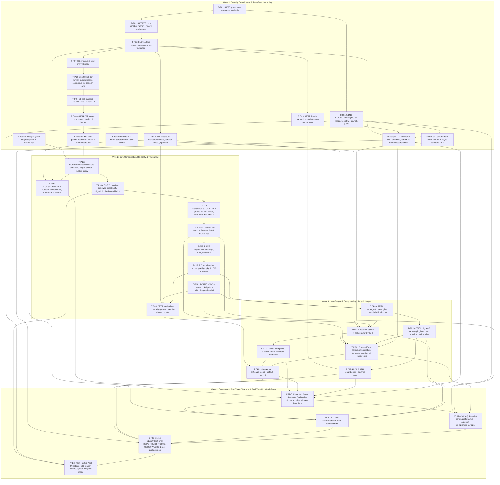

# ADLC v1.13.0 Enhancement & Hardening Resolution Plan

- **Companion Adversarial Audit Report:** [`enhancement.md`](../../enhancement.md)
- **Target Baseline:** `09cae8d82beeb8feb3400cefe6cdc22c7c939424` (`fix/phase0-security-trust-roots`, PR #1402)
- **Lifecycle Phase:** P1 Specification & P2 Task-DAG Blueprint (pre-ticket-minting; see §2.4 for P1 human approval -> ULID ticket creation -> `coldstart` gate sequence)
- **Execution Mode:** Isolated `git worktree` per minted ULID ticket (`AGENTS.md` worktree rule), gated by `npm run preflight` and distinct-vendor `adlc-prosecute record-cross-model` on all `trust-root`-tier diffs

> [!IMPORTANT]
> **Disclosure & Unpushed-Worktree Policy:** [`enhancement.md`](../../enhancement.md) documents defensive code-invariant gaps (`file:line` + contract boundary) with zero weaponized exploit payloads. Both planning files remain uncommitted in `.worktrees/adlc-enhancement-plan` for human review; keep branch `docs/adlc-enhancement-plan` unpushed (local-only) until all 4 Wave-1 CRITICAL regression suites (`packages/core/test/git-no-renames.test.mjs`, `packages/core/test/shell-classifiers.test.mjs`, `packages/fleet/test/mirror-symlink-escape.test.mjs`, `packages/review-calibration/test/sandbox-containment.test.mjs`) exist on `origin/main` (mechanically enforced on PRs by `C-T01`).

---

## 1. Context, Objectives & Scope

This specification decomposes all **41** defects, bottlenecks, duplication clusters, and disconnected feedback loops documented in [`enhancement.md`](../../enhancement.md) (`S1–S15`, `R1–R7`, `P1–P5`, `C1–C9`, `L1–L5`) into **36** right-sized (`S`/`M`), dependency-ordered workunits (`29` Lane A `T-P*` units [`13` in Wave 1: `T-P01`..`T-P10`, `T-P11a`, `T-P11b`, `T-P12`; `9` in Wave 2: `T-P13`, `T-P14a`, `T-P14b`, `T-P15`..`T-P20`; `7` in Wave 3: `T-P21a`, `T-P21b`, `T-P22`..`T-P26`] + `4` Lane B `#141` units [`C-T01`, `C-T02`, `POST-02`, `C-T03`] + `3` Lane C units [`PRE-0`, `POST-01`, `PRE-1`] = `36` total) across the 35 `@adlc/*` workspace packages, `apps/docs`, and 8 plugin packages (`7` agent-harness plugins `adlc-claude-code`, `adlc-codex`, `adlc-copilot`, `adlc-cursor`, `adlc-gemini` [Antigravity `agy` / JetSki `jetski`], `adlc-opencode`, `adlc-pi`, plus `adlc-herdr`). Every workunit is designed to pass all repository CI gates (`test`, `rails-guard`, `mutation-gate`, `check-reviewer-directed-comments`, `scan-findings-ledger`, `guard-findings-ledger-append-only`, `cross-model-gate`, `gate-liveness`, `router-drift`, and `ticket-store-platform`).

### Non-Goals During Hardening Waves
- No incompatible rewrite of the sharded ticket-store JSON schema (`formatVersion: 1` in `.adlc/tickets/.store.json` remains preserved).
- No retroactive rejection of historical `sigVersion !== 2` entries already committed in `.adlc/manifest.jsonl` or `.adlc/manifest.d/*.jsonl`.
- No modification of active frozen ticket rails inside any pull request prior to the protected-base ticket completion ceremony (`PRE-0`).

---

## 2. Governance, Frozen Ticket Rails & Ceremony Architecture

Every workunit in this plan is partitioned across **three repository-enforced lanes** derived directly from `packages/rails-guard/lib/ci/rail-freeze.mjs`, `packages/rails-guard/lib/ci/bootstrap.mjs`, `packages/rails-guard/lib/ci/trust-roots.mjs`, `scripts/rails-guard-ci.mjs`, `CODEOWNERS`, `AGENTS.md:201-208`, and `packages/prosecute/lib/tier.mjs`.

### 2.1 Active Non-Completed Ticket Rails (`14` Tickets, `25` Unique Frozen Paths: `15` Existing on Disk + `10` Reserved Unbuilt Paths)

Per `packages/rails-guard/lib/ci/rail-freeze.mjs:693-698`, the `#141` ceremony lifts only `immutableTrustRoots` and **never** lifts a path declared in an in-flight ticket's `rails[]`. Per `rail-freeze.mjs:402-419`, completing a **railed** ticket requires a push to the default branch (`protectedBasePush === true`). Across the `14` active railed tickets in `.adlc/tickets/`, **all `25` unique paths are off-limits to `Scope:` edits**, partitioned into **`7` built tickets (`14` existing files)** that `PRE-0` completes at Wave 4 and **`7` unbuilt/partially-built backlog tickets (`10` reserved non-existent test paths + `1` existing test file)** that remain open until built (and whose `10` non-existent paths must never be passed to `node --test`):

| Ticket ID | Status on Disk | Frozen `rails[]` Paths (Off-Limits to All PR Edits) |
| --- | --- | --- |
| `T-01KYZ0C7BB3BD36J0MKAA110PV` | Built (`PRE-0` completes) | `packages/gate-manifest/lib/record.mjs` *(exists)* |
| `T-01M0Z3FN7SAS4HAH7CS63YQ0DH` | Built (`PRE-0` completes) | `packages/fleet/lib/env-scrub.mjs`, `packages/fleet/lib/sandbox.mjs`, `scripts/preflight.mjs` *(all exist)* |
| `T-01M0Z3G8MATGSZ0ECB6FAE0R08` | Built (`PRE-0` completes) | `packages/fleet/lib/env-scrub.mjs`, `packages/fleet/lib/sandbox.mjs` *(all exist)* |
| `T-01M4XY1NVDJ5VB0JBHPFGS02WG` | Built (`PRE-0` completes) | `packages/core/test/syntax.test.mjs`, `packages/hollow-test/test/typescript.test.mjs`, `packages/hollow-test/test/invalid-refill.test.mjs`, `packages/review-calibration/test/invalid-plants.test.mjs`, `scripts/test/mutation-gate.test.mjs` *(all exist)* |
| `T-01M5QVXNQKG3Y67KPT5BB1NRC4` | Built (`PRE-0` completes) | `packages/core/test/reason-list.test.mjs`, `packages/runner/test/reason-lines.test.mjs`, `packages/gate-manifest/test/reason-lines.test.mjs`, `packages/spec-lint/test/no-criteria-lines.test.mjs` *(all exist)* |
| `T-01M5X0GAE2S2VPKAZBSFCQ8537` | Built (`PRE-0` completes) | `packages/core/test/prosecutor-record-finding.test.mjs` *(exists)* |
| `T-01M7FQKYYNVGBZXT3Y22FMNFAV` | Built in PR #1402 (`PRE-0` completes) | `packages/fleet/lib/sandbox.mjs`, `packages/gate-manifest/lib/record.mjs` *(all exist)* |
| `T-01KZRQF2QXJXS15BWXA5J22GWR` | Unbuilt backlog (keep open) | `packages/prosecute/test/execution-witnessed.test.mjs` *(reserved, not yet on disk)* |
| `T-01KZRQF304WB9B24HEKQEHQS1D` | Unbuilt backlog (keep open) | `packages/runner/test/acceptance-human-binding.test.mjs` *(reserved, not yet on disk)* |
| `T-01KZRQF38BVY5BQH40KQG4KTS7` | Unbuilt backlog (keep open) | `plugins/adlc-claude-code/hooks/test/handoff-key-scrub.test.mjs`, `plugins/adlc-claude-code/hooks/test/handoff-resolve-trust.test.mjs` *(reserved, not yet on disk)* |
| `T-01KZRQF3GKRX0V9HTQ70QKDFNE` | Unbuilt backlog (keep open) | `plugins/adlc-claude-code/hooks/test/default-enforcing.test.mjs`, `plugins/adlc-claude-code/hooks/test/advisory-optdown.test.mjs` *(reserved, not yet on disk)* |
| `T-01KZRQF3RWQBHSXN3K7VR3B25W` | Partially built (keep open) | `plugins/adlc-claude-code/hooks/test/wrapper-timeout-deny.test.mjs` *(exists)*, `scripts/test/integration-parity-floor.test.mjs` *(reserved, not yet on disk)* |
| `T-01KZRQF4A21KVA65QTDV7YSN8A` | Unbuilt backlog (keep open) | `packages/prosecute/test/spend-capture.test.mjs`, `packages/gate-manifest/test/recall-record.test.mjs` *(reserved, not yet on disk)* |
| `T-01KZXHSQSMJS92XWX3SPTV3GVS` | Unbuilt backlog (keep open) | `packages/rails-guard/test/suppressions-operative.test.mjs` *(reserved, not yet on disk)* |

### 2.2 Immutable Trust Roots, Ceremony Sequencing & Human Two-Party Governance

- **`DEFAULT_IMMUTABLE_TRUST_ROOTS` (`packages/rails-guard/lib/ci/trust-roots.mjs:37-60`):** `.adlc/config.json`, `.adlc/admin.pub`, `.adlc/tickets/.store.json`, `.github/workflows/adlc-rails-guard.yml`, `CODEOWNERS`, `.github/CODEOWNERS`, `docs/CODEOWNERS`, `docs/ci/rails-guard.yml`, `scripts/rails-guard-ci.mjs`, `packages/rails-guard/lib/ci/**`, `packages/rails-guard/bin/rails-guard-ci.mjs`, `packages/rails-guard/lib/trust-root-authorization.mjs`, `packages/rails-guard/bin/rails-guard.mjs`.
- **`REPO_TRUST_ROOTS` (`scripts/rails-guard-ci.mjs:52-79`):** `.github/workflows/ci.yml`, `scripts/check-reviewer-directed-comments.mjs` (+ `.test.mjs`), `scripts/toolkit-floor.json`, `scripts/toolkit-floor-check.mjs` (+ `.test.mjs`), `scripts/preflight.mjs` (+ `.test.mjs`), `package.json` (except ADR-0012 version-only bumps), `.npmrc`, `scripts/test/tmp-fixture-boundary.test.mjs`.
- **No Freeze-Before-Edit Deadlock (`C-T02` vs `C-T03`):**
  - Wave-1 `T-P06` immediately expands `packages/prosecute/lib/tier.mjs` so every PR touching `**/package.json`, any of the 8 plugins, `packages/{core,tickets,hollow-test}`, or CI scripts requires distinct-vendor `cross-model-gate` attestation during Waves 1–3.
  - Wave-1 `C-T02` hardens `#141` (`review.commitId === headOid` + narrow per-file path lift) and freezes `.adlc/lessons/**` and `.adlc/lenses/**` in `REPO_TRUST_ROOTS` + `CODEOWNERS` (paths untouched until `T-P24` reads them from `trustedBase`).
  - Wave-4 `C-T03` runs **after** Waves 1–3 and `POST-01`/`POST-02` finish editing plugins, `packages/{core,tickets}/package.json`, and CI scripts, adding `**/package.json`, all 7 harness plugin enforcement cores, `packages/hook-engine/**`, and required CI scripts to `REPO_TRUST_ROOTS` + `CODEOWNERS` alongside root `package.json` script aliases.
- **Human Two-Party Authorization Rule (`CODEOWNERS:15-31`, `packages/rails-guard/lib/trust-root-authorization.mjs:94-99`):** Autonomous agents and bots never self-authorize `#141` changes. Adding a second trusted human maintainer to `CODEOWNERS` is a **Step 0 governance prerequisite before `C-T01`** so every Lane B PR (`C-T01`, `C-T02`, `POST-02`, `C-T03`) goes through standard PR CI + non-author human `APPROVED` review at `headOid` + `trust-root-change` label. Direct protected-base admin push (`rail-freeze.mjs:748-754`) is **single-owner break-glass only**, permitted **only after** a verification branch passes CI `test`, `mutation-gate`, and `cross-model-gate` (`adlc-prosecute tier-check`) with **exact Git tree-SHA equality (`git rev-parse <verified-branch>^{tree} === git rev-parse HEAD^{tree}`)** recorded in `.adlc/manifest.d/`.
- **Keyed-Forest vs Self-Hosted `"securityMode": "signed"` (`bootstrap.mjs:132-221`):** On GitHub-hosted `ubuntu-latest` runners, `verifySignedRunner` (`bootstrap.mjs:160-221`) fails closed if `.adlc/config.json` sets `"securityMode": "signed"` without a dedicated `adlc-signed` self-hosted runner pool (`RUNNER_ENVIRONMENT === 'self-hosted'`, `ADLC_SIGNED_RUNNER_POOL === '1'`) and an audited `adlc-runner` binary implementing `record --help` and `upgrade --help`. Therefore GitHub-hosted CI enforces HMAC integrity via `.adlc/manifest.d/.store.json` (`"auth": "keyed"`, locked against PR downgrade in `C-T01`) + isolated `cross-model-gate.yml`, while `PRE-1` is gated strictly as an optional self-hosted runner pool deployment milestone.

### 2.3 Three-Lane Execution Model (`29 + 4 + 3 = 36` Units) & Zero Parallel Scope Overlap

Note the repository's two distinct "trust-root" mechanisms: **`#141` immutable path freezes** (`DEFAULT_IMMUTABLE_TRUST_ROOTS` + `REPO_TRUST_ROOTS`, which block PR edits absent human CODEOWNER `#141` authorization) versus **`tier.mjs` cross-model review tiering** (`tier: trust-root` in `packages/prosecute/lib/tier.mjs`, which allows normal PRs provided a distinct-vendor `adlc-prosecute record-cross-model` attestation is committed).

- **Lane A — Unblocked Worktree PRs (`29` units: `13` in Wave 1 + `9` in Wave 2 + `7` in Wave 3):** Touch **zero** active ticket rails and **zero** `#141` immutable paths (`DEFAULT_IMMUTABLE_TRUST_ROOTS` / `REPO_TRUST_ROOTS`). Every pair of workunits whose `Scope:` (including all 8 generated `plugins/adlc-cursor/hooks/*.bundle.mjs` files, `plugins/adlc-cursor/bin/adlc-mcp-wrapper.bundle.mjs`, `plugins/*/generated-*.mjs`, router `SKILL.md`s, `scripts/mutation-gate.mjs`, and `package-lock.json`) overlaps is strictly ordered in `dependsOn` (mechanically verified across all task pairs and Section 5.1 transitive build couplings by **AC5**). Tasks touching `packages/{rails-guard,prosecute,gate-manifest,build-gate,ticket-prune,ticket-sync,core,tickets,hollow-test,hook-engine}/**`, `.github/workflows/**`, `**/package.json`, CI scripts, or plugin enforcement files carry `tier.mjs` cross-model tier **`trust-root`**.
- **Lane B — Human-Authorized `#141` Trust-Root Ceremonies (`4` units: `C-T01`, `C-T02` in Wave 1; `POST-02`, `C-T03` in Wave 4):** Close `S1`, `S2`, `S7`, `S13`, `S15.8` inside Wave 1 (`C-T01`, `C-T02`), and lock down `REPO_TRUST_ROOTS` + `package.json` + `scripts/preflight.mjs` in Wave 4 (`POST-02`, `C-T03`).
- **Lane C — Protected-Base Ceremonies & Post-Thaw Cleanups (`3` units: `PRE-0`, `POST-01`, `PRE-1`):** `PRE-0` depends on all Wave 1–3 terminal sinks (`T-P15`, `T-P23`, `T-P25`, `T-P26`, `C-T02`) and requires **zero open PRs modifying `.adlc/tickets/**` or any of the 7 built tickets' 14 rail paths** before completing those **7 built railed tickets** and unlocking `POST-01` and `POST-02`.

### 2.4 ULID Ticket Minting -> Ticket-Bound P1 Approval -> P2 Coldstart Gate Protocol

Workunit labels (`T-P01`..`T-P26`, `C-T01`..`C-T03`, `POST-01`..`POST-02`) are **specification blueprint identifiers**, not `.adlc/tickets/` shard IDs. Because `spec-lint --record` (`packages/spec-lint/bin/spec-lint.mjs:40-42`), `premortem --record-verdict` (`packages/premortem/lib/run.mjs:29-31`), `spec-approval` (`packages/gate-manifest/lib/spec-approval.mjs:22-107`), and `runner` P1 assertions (`packages/runner/lib/assertions.mjs:544-546`) all bind P1 records **per ticket ID** (`entry.ticket === ticket`), follow this exact sequence before dispatching each wave:
1. **Dynamic Rail Re-Snapshot & Collision-Free ULID Ticket Minting (`adlc ticket create`):**
   - Run `git fetch origin main`, `gh pr list --state open --json number,headRefName`, and `detectTicketStore({ root: process.cwd() }).load()` immediately before minting a wave's tickets so no concurrent PR's ticket ID or rail is collided with.
   - Expand any `{a,b}` brace shorthand in the blueprint's `Scope:` line into plain `@adlc/core` `globMatch`-compatible path/glob strings (`packages/core/lib/glob.mjs:37` treats literal `{...}` as plain characters), and omit `id` in the input JSON so the store mints a fresh ULID (`T-01...`). Within each wave, mint downstream dependents before their prerequisites so prerequisite shards populate `edges: [{ "to": "<dependent-ulid>" }]` without mutating existing tickets:
     `set -a; . ./.env.local; set +a; node packages/cli/bin/adlc.mjs ticket create --input <file> --write --json`.
2. **Ticket-Bound P1 Spec Lint, Premortem & Human `spec-approval` (Per Minted ULID):**
   - Load `.env.local` without argument expansion (`set -a; . ./.env.local; set +a`).
   - Record passing `spec-lint` (`verified: true`) bound to `<minted-ulid>`: `node packages/spec-lint/bin/spec-lint.mjs .adlc/specs/enhancement-resolution-plan.md --record --ticket <minted-ulid>`.
   - Record `premortem` bound to `<minted-ulid>` on the identical spec hash: `node packages/premortem/bin/premortem.mjs .adlc/specs/enhancement-resolution-plan.md --prompt-only --record-verdict <verdict-file> --ticket <minted-ulid>`.
   - After human interrogation (`rounds >= 1`, `questions >= 1`, `unresolved === 0`), compute `SPEC_HASH=$(sha256sum .adlc/specs/enhancement-resolution-plan.md | awk '{print $1}')` and record positional `spec-approval` (`packages/gate-manifest/bin/gate-manifest.mjs:23,63-67`):
     `node packages/cli/bin/adlc.mjs gate-manifest record spec-approval --ticket <minted-ulid> --files .adlc/specs/enhancement-resolution-plan.md --data "{\"verdict\":\"approved\",\"approver\":\"<human-login>\",\"rounds\":1,\"questions\":1,\"sources\":[\"enhancement.md\"],\"unresolved\":0,\"spec_hash\":\"$SPEC_HASH\"}"`.
3. **P2 Coldstart Executability Gate:** Run `set -a; . ./.env.local; set +a; node packages/cli/bin/adlc.mjs coldstart <minted-ulid>` (live mode auto-records per `packages/coldstart/lib/cli-options.mjs:7-20`; or `--prompt-only --record-verdict <verdict-file>`, exit `0`) before creating the isolated P4 builder worktree.

---

## 3. Complete Audit-to-Task Traceability Matrix

Every single one of the **41** items in [`enhancement.md`](../../enhancement.md) (`S1–S15`, `R1–R7`, `P1–P5`, `C1–C9`, `L1–L5`) maps explicitly below:

| Audit ID | Severity | Summary | Lane A Workunit(s) | Lane B / C Ceremony Workunit(s) |
| --- | --- | --- | --- | --- |
| **S1** | CRITICAL | `git mv` rename-detection bypass in `changedFiles` & `gitDiff` | `T-P01` | `C-T01` |
| **S2** | CRITICAL | `ci.yml` / `ticket-store-platform.yml` unblocked lifecycle scripts & untiered nested `package.json` | `T-P06` | `C-T01`, `C-T03` |
| **S3** | CRITICAL | Fleet bare-mirror `lstatSync`/alternates/reflog escape & prompt secret leak | `T-P02` | — |
| **S4** | CRITICAL | `review-calibration` unsandboxed witness host execution & symlink writes | `T-P03` | — |
| **S5** | CRITICAL | `adlc-cursor` Marketplace `ERR_MODULE_NOT_FOUND` across 8 hooks + `failClosed: false` | `T-P04` | — |
| **S6** | CRITICAL | `shell.mjs` subshell / inline-interpreter / `rg --pre` / `git branch -D` & Claude `Bash` gate | `T-P01`, `T-P11a` | — |
| **S7** | CRITICAL | `tier.mjs` missing 7 harness cores/CI scripts & `#141` `commitId` / glob over-lift | `T-P06` | `C-T02`, `C-T03` |
| **S8** | HIGH | Parent-process `require(tsPath)` in `packages/core/lib/syntax.mjs` | `T-P07` | — |
| **S9** | HIGH | Duplicate `forestChainsIntact` & v1 segment signatures on `seq >= 2` | `T-P14a` | — |
| **S10** | HIGH | Local segment truncation + `--carry-forward` laundering revoked verdicts | `T-P05` | — |
| **S11** | HIGH | Static `ADLC_AUTHOR_PROVIDER='anthropic'`, missing vendor-family aliasing | `T-P05` | — |
| **S12** | HIGH | `computeTreeIdentity` directory prefix masking via `provenance.transcript` | `T-P05` | — |
| **S13** | HIGH | Pre-store manifest delete/seed gap, staged-index split, `ledger-guard`, `enable.mjs`, keyed/signed model | `T-P08` | `C-T01`, `PRE-1` |
| **S14** | HIGH | `trusted-binary`, `fleet` home mounts, hook subdir/symlink escapes, MCP key scrub | `T-P09`, `T-P11a`, `T-P11b`, `T-P13` | — |
| **S15** | MEDIUM | `risk-tier`, `runner`, `planReconciliation`, `quartermaster`, `consensus-fix`, `decision-layer`, `parallax`, `spec-lint`, `prosecute` lenses | `T-P09`, `T-P10`, `T-P11b`, `T-P12`, `T-P14a` | `C-T02` |
| **R1** | CRITICAL | `autopilot` `pinToolchain` `node_modules` rejection & `readSet` package mounts | `T-P15` | — |
| **R2** | CRITICAL | `fleet` `READ_POLICY.BOUNDED` missing `readOnlyPaths` & macOS `gates.mjs` crash | `T-P02`, `T-P15` | `POST-01` |
| **R3** | HIGH | `scopesOverlap` leading `**/` bug & `merge-forecast` concrete-file `PARALLEL` bug | `T-P17` | — |
| **R4** | HIGH | Lock theft, 0-byte `owner.json` race, crash wedges & uncalled `heartbeat()` | `T-P13`, `T-P14b`, `T-P15`, `T-P18` | — |
| **R5** | HIGH | Fleet self-commit / Strike-2 `cutTip` ancestry & `autopilot` skipped-gate `pass` | `T-P02`, `T-P15` | — |
| **R6** | HIGH | `hollow-test` missing script mappings (`#657`), `mutate.mjs` blind spots, `behavior-diff` | `T-P16` | — |
| **R7** | HIGH | Runtime bugs across 8 packages/utilities + 7-harness plugin parity | `T-P11a`, `T-P11b`, `T-P14b`, `T-P18`, `T-P19` | — |
| **P1** | HIGH | 58 serial `spawnSync` test runs, redundant mutation baselines, slow-first `preflight` | `T-P16` | `C-T01`, `C-T03`, `POST-02` |
| **P2** | HIGH | `merge-forecast` `O(T^2 * |F|)` file reads & `.worktrees/` walk | `T-P17` | — |
| **P3** | HIGH | `N+1` git/gh spawns in `GitTreeTicketStore.load()`, `backlog-groom`, `rejection-mining` | `T-P14b`, `T-P20` | — |
| **P4** | HIGH | `autopilot` <-> `fleet` `3x` gate amplification, uncached `npm ci`, `15`-strike burn | `T-P15` | — |
| **P5** | MEDIUM | `coldstart --all` `O(T*M)` cache, `appendEntries` `O(M^2)`, async `mcp-server`, `loadOne`, `cluster` | `T-P09`, `T-P13`, `T-P14b`, `T-P20` | — |
| **C1** | MEDIUM | Consolidate 8 file/directory lock implementations onto `@adlc/tickets` + `primitives.mjs` | `T-P13`, `T-P14b`, `T-P18` | — |
| **C2** | MEDIUM | Consolidate 5 atomic file writers onto `@adlc/tickets/lib/durability.mjs` + `writeFileAtomic` | `T-P13`, `T-P14b`, `T-P15`, `T-P18` | — |
| **C3** | MEDIUM | Consolidate 7 `globMatch` copies & fix asymmetric `scopesOverlap` / `touchesAny` callers | `T-P17`, `T-P18`, `T-P21a`, `T-P21b` | — |
| **C4** | MEDIUM | Consolidate 6 `canonicalJson` encoders onto `@adlc/tickets/lib/canonical.mjs` + `ledger.mjs` | `T-P13`, `T-P14b` | — |
| **C5** | MEDIUM | Consolidate 3 secret-value redaction surfaces onto `secret-shapes.mjs` + `primitives.mjs` | `T-P13` | — |
| **C6** | MEDIUM | Consolidate `resolveTrustedBinary` helpers onto `trusted-binary.mjs` (exported on `@adlc/core`) | `T-P13`, `T-P15` | — |
| **C7** | MEDIUM | Resolve `@adlc/core -> @adlc/tickets` reverse leaf duplication via downward leaf exports | `T-P14b` | — |
| **C8** | MEDIUM | Consolidate `SafeSandbox` / `gate-fuzzing` sandbox builders onto `sandbox-runner.mjs` | `T-P03` | `POST-01` |
| **C9** | MEDIUM | Extract `packages/hook-engine` + esbuild bundles across all 7 harness plugins | `T-P21a`, `T-P21b` | `C-T03`, `POST-01` |
| **L1** | MEDIUM | `fleet` structured tool JSONL -> `checkFlail` (`effects.flail`) Strike-2 corrective brief | `T-P22` | — |
| **L2** | MEDIUM | `fleet` `build` telemetry -> `model-router` priors/budgets & `density.mjs` rail hardening | `T-P23` | — |
| **L3** | MEDIUM | P7 `rejection-mining` & `lesson-foundry` outputs -> `trustedBase` lenses/templates/checks & `skill-rot` | `T-P24` | `C-T02`, `POST-02` |
| **L4** | MEDIUM | Universal `onUsage` spend capture across all 8 LLM packages & default `--record` | `T-P25` | — |
| **L5** | LOW | Renumber triple `ADR-0010`s, add `Amended-by` headers on `0001/0002/0003/0007`, sync docs | `T-P26` | — |

---

## 4. Execution Waves & Task Breakdown

Every directed edge `A --> B` in the Mermaid graph below corresponds **1-for-1** with `B` declaring `A` in `dependsOn: [...]`, and **every** pair of tasks sharing overlapping scope paths or Section 5.1 generated outputs is strictly ordered by DAG reachability (mechanically verified by **AC5**):

### 4.1 Wave 1 — Security, Containment & Trust-Root Hardening (`T-P01` – `T-P12`, `C-T01`, `C-T02`)

#### `T-P01` — `S1` + `S6`: Rename-Proof `changedFiles` & Hardened `@adlc/core` Shell Classifier
- **Lane / Tier / Size:** Lane A · `trust-root` (touches `@adlc/core` and regenerates plugin shell helpers per `AGENTS.md:201-208`) · `S` · `dependsOn: []`
- **Scope:** `packages/core/lib/git.mjs`, `packages/core/lib/shell.mjs`, `packages/core/test/git-no-renames.test.mjs`, `packages/core/test/shell-classifiers.test.mjs`, `plugins/adlc-codex/hooks/generated-shell.mjs`, `plugins/adlc-copilot/hooks/generated-shell.mjs`, `plugins/adlc-cursor/lib/mcp-build-metadata.mjs`, `plugins/adlc-cursor/bin/adlc-mcp-wrapper.bundle.mjs`.
- **Frozen Rails Respected:** Leaves `packages/core/test/{syntax,reason-list,prosecutor-record-finding}.test.mjs` untouched and runs them as non-regression checks.
- **Deliverables:**
  1. Add `'--no-renames'` to both `diff` invocations in `packages/core/lib/git.mjs:148-149` so `git mv <rail> <dest>` with `<50%` edits surfaces the deleted source rail path in both `adlc rails-guard` and `scripts/rails-guard-ci.mjs`.
  2. In `packages/core/lib/shell.mjs:127-132,205-231`, classify subshell wrappers (`sh`/`bash`/`dash`/`zsh`/`ksh` `-c`, `eval`, `exec`, `source`, `. <script>`) and inline script flags (`node` `-e`/`-p`/`--eval`/`--print`/`-r`/`--require`/`--import`/`--loader`, `python* -c`, `ruby -e`, `perl`, `awk`, `lua -e`, `php -r`, `deno eval`, `bun -e`) as opaque mutations in `shellHasOpaqueMutation`; add `--pre` and `--pre-glob` to `shellHasWriteOption`; restrict `git branch` in `shellIsPositivelyReadOnly` (`line 208`) to read-only listing flags; remove `node --test` from `shellIsPositivelyReadOnly`; reject leading `GIT_EXTERNAL_DIFF=...` overrides.
  3. Run `node scripts/ticket-readers/generate.mjs` (updating `plugins/adlc-{codex,copilot}/hooks/generated-shell.mjs` per `generate.mjs:53-59`) and `npm run build:cursor-mcp`.
- **Verification:** `node --test packages/core/test/git-no-renames.test.mjs packages/core/test/shell-classifiers.test.mjs packages/core/test/syntax.test.mjs packages/core/test/reason-list.test.mjs scripts/test/ticket-reader-generation.test.mjs scripts/test/ticket-store-boundary.test.mjs`
- **Rollback:** Revert `T-P01` commit.

#### `T-P02` — `S3` + `R2` + `R5`: Fleet Bare-Mirror Containment, `SafeSandbox` Bounded Mounts & Self-Commit Support
- **Lane / Tier / Size:** Lane A · `standard` · `M` · `dependsOn: []`
- **Scope:** `packages/fleet/lib/{git-mirror,live-deps,safe-sandbox,worktrees}.mjs`, `packages/autopilot/lib/gate-repo.mjs`, `packages/fleet/test/{mirror-symlink-escape,bounded-read-mounts,worker-self-commit}.test.mjs`, `packages/autopilot/test/gate-repo-symlink.test.mjs`.
- **Frozen Rails Respected:** Leaves `packages/fleet/lib/{sandbox,env-scrub}.mjs` untouched (implementing bounded read mounts inside `safe-sandbox.mjs` + `live-deps.mjs` until `PRE-0` + `POST-01`). Preserves all `registerSeams(...)` calls in `packages/autopilot/lib/gate-repo.mjs`.
- **Deliverables:**
  1. Add recursive `lstatSync` tree verification (`assertGitDirTreeSafe`) in `packages/fleet/lib/git-mirror.mjs` rejecting symlinks, special files, hardlinks, `objects/info/alternates`, `info/grafts`, and `shallow`; drop `core.logallrefupdates` from `ALLOWED_MIRROR_CONFIG_KEYS` and add `'-c', 'core.logallrefupdates=false'` to `HOST_SAFE_GIT_FLAGS` (`git-mirror.mjs:43-55`) and `HOST_SAFE_GIT` (`gate-repo.mjs:72-80`); verify regular file via `readBoundedRegularFile` / `lstatSync(excludePath).isFile()` in `gate-repo.mjs:97`; redact `e.message` and `fb.detail` via `redactSecrets` (`packages/core/lib/primitives.mjs:164-192`) in `live-deps.mjs:644-655`.
  2. Forward `readOnlyPaths` (`canaryReadOnlyPaths` and `--model-plane-read-only`) in `packages/fleet/lib/live-deps.mjs:335-343` into `SafeSandbox` (`safe-sandbox.mjs`), mounting `/dev`, `/proc`, and isolated `--tmpfs /tmp` under `READ_POLICY.BOUNDED` on `bwrap`.
  3. Update `commitWorker` (`worktrees.mjs:172-186`) to recognize clean self-committed worker branches (`git rev-list --count cutTip..HEAD > 0`), invoke `resetWorktree` on clean-slate retries, and anchor `mirrorFetchBack` ancestry (`git-mirror.mjs:272`) against `cutTip`.
- **Verification:** `node --test packages/fleet/test packages/autopilot/test/gate-repo-symlink.test.mjs && AUTOPILOT_GATE_FULL=1 node --test packages/autopilot/test/spec-coverage.test.mjs`
- **Rollback:** Revert `T-P02` commit.

#### `T-P03` — `S4` + `C8`: Shared Sandboxed Witness Runner & `review-calibration` Containment
- **Lane / Tier / Size:** Lane A · `trust-root` (touches `packages/core/**`) · `M` · `dependsOn: ["T-P01"]`
- **Scope:** `packages/core/lib/sandbox-runner.mjs`, `packages/core/{index.mjs,index.d.ts}`, `packages/gate-fuzzing/lib/{sandbox,witness,loop}.mjs`, `packages/review-calibration/lib/{verify,targets,runner,inflight}.mjs`, `packages/review-calibration/test/sandbox-containment.test.mjs`, `plugins/adlc-cursor/lib/mcp-build-metadata.mjs`, `plugins/adlc-cursor/bin/adlc-mcp-wrapper.bundle.mjs`.
- **Frozen Rails Respected:** Leaves `packages/review-calibration/test/invalid-plants.test.mjs` untouched and runs both it and `packages/hollow-test/test/inflight.test.mjs` in verification.
- **Deliverables:**
  1. Promote `gate-fuzzing`'s cross-platform `buildSandboxPlan` (`bwrap` + `escapeSeatbeltPath` macOS `Seatbelt`, with explicit `readOnlyPaths`, `writablePaths`, and `bindDeps` options), disposable git clone helper, `sanitizeCandidateEnv`, and `allowedCmds` enforcement into `packages/core/lib/sandbox-runner.mjs` (re-exported from `packages/core/index.mjs` and declared in `packages/core/index.d.ts` per `packages/core/test/core.test.mjs:90-98`).
  2. Route `review-calibration` `verifyWitness` (`verify.mjs:35-41,136-164`) and `--review-cmd` through `sandbox-runner.mjs` inside a disposable clone with `ADLC_MANIFEST_KEY` scrubbed and `allowedCmds` enforced.
  3. Enforce `resolveTarget(cwd, p.file)` + `lstatSync` (`!isSymbolicLink()`) inside `loadPlantsFile` (`targets.mjs:149-160`) and `runWithPlants` (`runner.mjs:46`, including under `NO_JOURNAL`).
  4. Enforce `!lstatSync(journalPath).isSymbolicLink()` (`O_NOFOLLOW`) on the journal record writer in `packages/review-calibration/lib/inflight.mjs:88-90` (keeping `writeInflightAtomic` in `packages/core/lib/inflight.mjs:40-84` intact so in-repo symlinked source mutations tested by `packages/hollow-test/test/inflight.test.mjs:276-337` continue to pass), and run `npm run build:cursor-mcp`.
- **Verification:** `node --test packages/core/test/core.test.mjs packages/hollow-test/test/inflight.test.mjs packages/review-calibration/test/invalid-plants.test.mjs packages/review-calibration/test packages/gate-fuzzing/test scripts/test/ticket-store-boundary.test.mjs`
- **Rollback:** Revert `T-P03` commit and rebuild Cursor MCP bundle.

#### `T-P04` — `S5`: Bundle All 8 `adlc-cursor` Hooks with `esbuild` & Enable `failClosed: true` on `preToolUse`
- **Lane / Tier / Size:** Lane A · `trust-root` (touches `plugins/adlc-cursor/hooks/**` per `AGENTS.md:201-208`) · `S` · `dependsOn: ["T-P10"]` *(sequenced after Wave-1 core security tasks `T-P01 -> T-P03 -> T-P05 -> T-P07 -> T-P10` so `T-P05`, `T-P06`, `T-P07`, `T-P10`, and `T-P12` ship without waiting on Cursor hook bundling)*
- **Scope:** `scripts/build-cursor-mcp.mjs`, `scripts/cursor-install-smoke.mjs`, `scripts/mutation-gate.mjs`, `scripts/test/{build-cursor-mcp,cursor-install-smoke,ticket-store-boundary}.test.mjs`, `plugins/adlc-cursor/hooks.json`, `plugins/adlc-cursor/hooks/hooks.json`, `plugins/adlc-cursor/hooks/{adlc-pretool,adlc-audit}.mjs`, `plugins/adlc-cursor/hooks/{adlc-session-start,adlc-pretool,adlc-audit,adlc-shell-advisory,adlc-precompact,adlc-subagent,adlc-stop,adlc-preflight}.bundle.mjs`, `plugins/adlc-cursor/lib/mcp-build-metadata.mjs`, `plugins/adlc-cursor/bin/adlc-mcp-wrapper.bundle.mjs`.
- **Frozen Rails Respected:** Leaves `scripts/test/mutation-gate.test.mjs` untouched and runs it in verification.
- **Deliverables:**
  1. Replace the default computed `importModule = (spec) => import(spec)` loader in `plugins/adlc-cursor/hooks/adlc-pretool.mjs:97-105` and `plugins/adlc-cursor/hooks/adlc-audit.mjs:87,103` with a static literal-specifier map (keeping `importModule` injectable as a test seam) so `esbuild` statically inlines `@adlc/build-gate` and `@adlc/flail-detector`; extend `scripts/build-cursor-mcp.mjs:48-78` to verify version lockstep across all 4 `@adlc/*` dependencies in `plugins/adlc-cursor/package.json:58-63` (`@adlc/core`, `@adlc/tickets`, `@adlc/build-gate`, `@adlc/flail-detector`) and bundle all **8** Cursor hook scripts into self-contained ESM `.bundle.mjs` files, registering builder-verified hook bundles in `scripts/test/ticket-store-boundary.test.mjs` (**both** `isDirectWriterBypass` at `lines 50-75` and `isPointerParseBypass` at `lines 171-211`) and `GENERATED_VERSION_FILES` (`scripts/mutation-gate.mjs:108-112`).
  2. Update **both** `plugins/adlc-cursor/hooks/hooks.json` and root mirror `plugins/adlc-cursor/hooks.json` in lockstep to invoke the `.bundle.mjs` entrypoints and set `"failClosed": true` on `preToolUse` (`line 16`), updating `scripts/cursor-install-smoke.mjs:74-139` accordingly.
  3. Extend `scripts/cursor-install-smoke.mjs` and `scripts/test/cursor-install-smoke.test.mjs` to copy `plugins/adlc-cursor/` to an isolated `/tmp` directory with **zero ancestor `node_modules`** and assert `preToolUse` denies both a frozen rail write and a degraded `ADLC_BUILD_GATE_ENFORCEMENT=1` build-gate invocation without `ERR_MODULE_NOT_FOUND`.
- **Verification:** `npm run build:cursor-mcp && node --test scripts/test/build-cursor-mcp.test.mjs scripts/test/cursor-install-smoke.test.mjs scripts/test/mutation-gate.test.mjs scripts/test/ticket-store-boundary.test.mjs plugins/adlc-cursor/test`
- **Rollback:** Revert `T-P04` commit.

#### `T-P05` — `S10` + `S11` + `S12`: Prosecutor Truncation Chain Walk, Multi-Vendor Family Provenance & Leaf-Only `ignorePaths`
- **Lane / Tier / Size:** Lane A · `trust-root` · `M` · `dependsOn: ["T-P03"]`
- **Scope:** `packages/core/lib/revision.mjs`, `packages/prosecute/lib/{attestation-store,cross-model}.mjs`, `packages/prosecute/bin/adlc-prosecute.mjs`, `.github/workflows/cross-model-gate.yml`, `packages/autopilot/lib/review.mjs`, `packages/prosecute/test/{carry-forward-truncation,vendor-family-provenance,ignore-paths-leaf}.test.mjs`, `plugins/adlc-cursor/lib/mcp-build-metadata.mjs`, `plugins/adlc-cursor/bin/adlc-mcp-wrapper.bundle.mjs`.
- **Frozen Rails Respected:** Does not create or touch reserved backlog paths `packages/prosecute/test/{execution-witnessed,spend-capture}.test.mjs`. `.github/workflows/cross-model-gate.yml` is in `CI_CONTROL_PREFIXES` (`tier.mjs:86`), **not** in `DEFAULT_IMMUTABLE_TRUST_ROOTS` or `REPO_TRUST_ROOTS`.
- **Deliverables:**
  1. **`S10`:** Walk the full `carriedFrom` ancestor chain and matching `changeSetDigest` across `observedEntries` (on `refs/heads/adlc-attestations`) in `assertNoTruncation` (`attestation-store.mjs:86-95`), `crossModelSatisfied` (`cross-model.mjs:392-405`), and `hasCrossModelApproveForRevision` (`cross-model.mjs:505-523`), failing closed when any mirrored ancestor has a superseding `needs-attention` or higher `seq`, and support `--attestation-store` on `record-cross-model --carry-forward` (`adlc-prosecute.mjs:833-852` / `carryForwardCrossModelReview` in `cross-model.mjs:159-300`, keeping `mirror-attestations` **before** `tier-check` in `cross-model-gate.yml:140-166` so valid signed `needs-attention` revocations are always mirrored).
  2. **`S11`:** Canonicalize provider vendor families (`claude`/`anthropic` -> `anthropic`, `codex`/`gpt`/`o1`/`o3`/`o4`/`openai` -> `openai`, `gemini`/`agy`/`google` -> `google`) in `normalizeProvider` (`cross-model.mjs:62-66`); enforce distinct canonical families (`providerFamily !== authorFamily`) bound to any recorded ticket/P4 builder provider; update `.github/workflows/cross-model-gate.yml:174` so `ADLC_AUTHOR_PROVIDER` is passed only when `vars.ADLC_AUTHOR_PROVIDER` is explicitly set (accepting honest `openai`/`google` author attestations); derive `--author-provider` and `--provider` dynamically in `packages/autopilot/lib/review.mjs:200-201`.
  3. **`S12`:** Restrict `isIgnoredPath` (`packages/core/lib/revision.mjs:149-152`) to exact leaf matches (`relPath === ig`) unless an internal trailing-`'/'` directory entry is supplied, confine `--input` / `provenance.transcript` in `adlc-prosecute.mjs:793-826` to regular files (`lstatSync().isFile()`) under `.adlc/tmp/`, `.adlc/evidence/`, `.omo/evidence/`, or outside `cwd`, and run `npm run build:cursor-mcp`.
- **Verification:** `node --test packages/prosecute/test/carry-forward-truncation.test.mjs packages/prosecute/test/vendor-family-provenance.test.mjs packages/prosecute/test/ignore-paths-leaf.test.mjs packages/prosecute/test scripts/test/ticket-store-boundary.test.mjs && AUTOPILOT_GATE_FULL=1 node --test packages/autopilot/test/spec-coverage.test.mjs`
- **Rollback:** Revert `T-P05` commit.

#### `T-P06` — `S2` (Tier + Platform Workflow) + `S7` (Tier): Expand `tier.mjs` to All 7 Harness Cores, Core/Tickets/Hollow-Test, `**/package.json`, `.adlc/{lessons,lenses}/**` & CI Gate Scripts
- **Lane / Tier / Size:** Lane A · `trust-root` · `S` · `dependsOn: ["T-P05"]` *(sequenced after `T-P05` so multi-vendor provenance and leaf `ignorePaths` are live before widening `tier.mjs`)*
- **Scope:** `packages/prosecute/lib/tier.mjs`, `packages/prosecute/test/tier-plugin-and-scripts.test.mjs`, `.github/workflows/ticket-store-platform.yml`.
- **Frozen Rails Respected:** None in scope (`ticket-store-platform.yml` is in `CI_CONTROL_PREFIXES`, not `REPO_TRUST_ROOTS`).
- **Deliverables:**
  1. Replace bare `npm install` at `.github/workflows/ticket-store-platform.yml:27` with `npm ci --ignore-scripts`.
  2. Expand `packages/prosecute/lib/tier.mjs` to classify as `trust-root`:
     - All 7 harness plugin enforcement cores (`plugins/adlc-pi/lib/`, `plugins/adlc-opencode/lib/`, `plugins/adlc-{claude-code,codex,copilot,cursor,gemini}/hooks/`, `plugins/adlc-{cursor,gemini,opencode}/rails-checker.mjs`, `plugins/adlc-cursor/hooks.json`, `plugins/adlc-gemini/hooks.json`, plus `packages/hook-engine/`);
     - Foundational enforcement dependencies `packages/core/`, `packages/tickets/`, and `packages/hollow-test/`;
     - Nested workspace `**/package.json` manifests (excluding ADR-0012 version-only bumps), `.adlc/lessons/`, and `.adlc/lenses/`;
     - Required CI gate scripts `scripts/mutation-gate.mjs`, `scripts/run-tests.mjs`, `scripts/preflight-fast.mjs`, `scripts/build-hooks.mjs`, `scripts/scan-findings-ledger.mjs`, `scripts/guard-findings-ledger-append-only.mjs`, `packages/lesson-foundry/bin/ledger-guard.mjs`, `packages/lesson-foundry/lib/ledger-guard.mjs`, `scripts/gate-liveness.mjs`, and `docs/ci/required-gates.json`.
- **Verification:** `node --test packages/prosecute/test/tier-plugin-and-scripts.test.mjs packages/prosecute/test`
- **Rollback:** Revert `T-P06` commit.

#### `T-P07` — `S8`: Isolate TypeScript Resolution & Probing Inside `syntax-check-typescript.mjs` Worker
- **Lane / Tier / Size:** Lane A · `trust-root` · `S` · `dependsOn: ["T-P05"]` *(transitively after `T-P03` via `T-P05 -> T-P03` so `sanitizeCandidateEnv` in `@adlc/core` is available, and serialized after `T-P05` on `adlc-mcp-wrapper.bundle.mjs`)*
- **Scope:** `packages/core/lib/syntax.mjs`, `packages/core/lib/syntax-check-typescript.mjs`, `packages/core/test/syntax-isolation.test.mjs`, `plugins/adlc-cursor/lib/mcp-build-metadata.mjs`, `plugins/adlc-cursor/bin/adlc-mcp-wrapper.bundle.mjs`.
- **Frozen Rails Respected:** Preserves exact exported signatures (`resolveTypeScript(filePath)`, `syntaxCheckProblem(filePath)`, `checkSyntax`, `checkSyntaxDetail`) expected by frozen `packages/core/test/syntax.test.mjs` without editing `syntax.test.mjs`.
- **Deliverables:**
  1. Replace host-process `createRequire` / `require(path)` inside `inspectTypeScript(filePath)` (`packages/core/lib/syntax.mjs:35-58`) with a child-worker probe (`syntax-check-typescript.mjs --probe <filePath>`) spawned under `sanitizeCandidateEnv(process.env)` (`ADLC_MANIFEST_KEY` stripped) so untrusted candidate `node_modules/typescript` never executes in the parent process, and run `npm run build:cursor-mcp`.
  2. Add `packages/core/test/syntax-isolation.test.mjs` planting a poisoned `node_modules/typescript/index.js` in a temp dir and asserting parent `process.env.ADLC_MANIFEST_KEY` and parent memory remain untouched.
- **Verification:** `node --test packages/core/test/syntax.test.mjs packages/core/test/syntax-isolation.test.mjs scripts/test/ticket-store-boundary.test.mjs`
- **Rollback:** Revert `T-P07` commit.

#### `T-P08` — `S13` (Non-Ceremony Half): Harden `ledger-guard` Against Symlinks/Staged Truncation & Update Stale `enable.mjs` Segment Warning
- **Lane / Tier / Size:** Lane A · `trust-root` · `S` · `dependsOn: []`
- **Scope:** `packages/lesson-foundry/lib/ledger-guard.mjs`, `packages/lesson-foundry/test/ledger-guard-staged-symlink.test.mjs`, `packages/gate-manifest/lib/enable.mjs`, `packages/gate-manifest/test/enable-notice.test.mjs`.
- **Frozen Rails Respected:** Leaves `packages/gate-manifest/lib/record.mjs` and `packages/gate-manifest/test/reason-lines.test.mjs` untouched (and does not touch reserved path `recall-record.test.mjs`).
- **Deliverables:**
  1. In `packages/lesson-foundry/lib/ledger-guard.mjs:19-30,106-137`, reject symlinked `.adlc/findings.jsonl` via `lstatSync().isFile()`, verify **both** staged index (`:0:.adlc/findings.jsonl`) and working-tree bytes against base, and enforce exact byte-prefix append without stripping trailing `\n`.
  2. Update `CI_COVERAGE_WARNING` and `SEGMENTATION_UNDETERMINED_WARNING` in `packages/gate-manifest/lib/enable.mjs:38-57` (and `enable-notice.test.mjs`) to reflect segmented-forest `.adlc/manifest.d/` CI validation shipped in `packages/rails-guard/lib/ci/manifest.mjs`.
- **Verification:** `node --test packages/lesson-foundry/test packages/gate-manifest/test/reason-lines.test.mjs packages/gate-manifest/test`
- **Rollback:** Revert `T-P08` commit.

#### `T-P09` — `S14` + `S15.7` + `P5`: Read-Only Fleet Adapter Config Roots, MCP `ADLC_MANIFEST_KEY` Scrubbing & Async In-Process CLI Dispatch
- **Lane / Tier / Size:** Lane A · `standard` · `M` · `dependsOn: []`
- **Scope:** `packages/fleet/lib/adapters/{agy,jetski,gemini}.mjs`, `packages/fleet/test/adapter-auth-subpaths.test.mjs`, `packages/cli/lib/{mcp-server,dispatch}.mjs`, `packages/cli/test/{mcp-env-scrub,async-mcp}.test.mjs`.
- **Frozen Rails Respected:** None in scope.
- **Deliverables:**
  1. Split `authReadOnlySubpaths` from narrow leaf `authWritableSubpaths` in `packages/fleet/lib/adapters/{agy,jetski}.mjs` so `~/.antigravity` and `~/.jetski` config/hook roots are never mounted writable inside `bwrap`, and verify Gemini CLI `--version` output in `gemini.mjs:49-76`.
  2. Scrub `ADLC_MANIFEST_KEY` from `process.env` and child spawn environments in `packages/cli/lib/mcp-server.mjs`, convert `mcp-server.mjs:191` from blocking `execFileSync` to async `execFile` (`Promise`), and add `--*command` (`--lint-command`, `--typecheck-command`, `--test-command`) to `FORBIDDEN_FLAGS` (`mcp-server.mjs:28-45`, `S15.7`).
  3. Replace the double cold-Node `spawnSync` in `packages/cli/lib/dispatch.mjs:315` with in-process ESM dynamic `import()` for modular subcommands (falling back cleanly where subcommands rely on top-level `process.argv`).
- **Verification:** `node --test packages/fleet/test/adapter-auth-subpaths.test.mjs packages/cli/test`
- **Rollback:** Revert `T-P09` commit.

#### `T-P10` — `S15` + `S13.5`: Secondary Containment Hardening (`risk-tier`, `runner`, `quartermaster`, `consensus-fix`, `decision-layer`)
- **Lane / Tier / Size:** Lane A · `trust-root` (touches `packages/core/lib/risk-tier.mjs` and regenerates plugin risk-tier helpers) · `M` · `dependsOn: ["T-P07"]`
- **Scope:** `packages/core/lib/risk-tier.mjs`, `packages/core/test/risk-tier-hardening.test.mjs`, `packages/runner/bin/adlc.mjs`, `packages/runner/lib/{assertions,acceptance}.mjs`, `packages/runner/test/assertions-hardening.test.mjs`, `packages/quartermaster/lib/{registry-path,load}.mjs`, `packages/quartermaster/test/bounded-registry-read.test.mjs`, `packages/consensus-fix/bin/consensus-fix.mjs`, `packages/consensus-fix/test/apply-rail-safety.test.mjs`, `packages/decision-layer/lib/{pack,record}.mjs`, `packages/decision-layer/lib/adapters/jev.mjs`, `packages/decision-layer/test/jev-url-and-atomic.test.mjs`, `plugins/adlc-codex/hooks/generated-risk-tier.mjs`, `plugins/adlc-copilot/hooks/generated-risk-tier.mjs`, `plugins/adlc-cursor/lib/mcp-build-metadata.mjs`, `plugins/adlc-cursor/bin/adlc-mcp-wrapper.bundle.mjs`.
- **Frozen Rails Respected:** Leaves `packages/runner/test/reason-lines.test.mjs` and `packages/consensus-fix/test/snapshot.test.mjs` untouched and runs both in verification (without touching reserved path `acceptance-human-binding.test.mjs`).
- **Deliverables:**
  1. In `packages/core/lib/risk-tier.mjs:101-152` (`filesOverlapOrUnscoped`, `decideAdversarialReviewNotice`), require `e.data?.verdict === 'approve'` on `adversarial-review` entries and forbid unscoped entries lacking both `e.ticket` and non-empty `e.files` from globally satisfying `hasRecord` across unrelated gated files.
  2. Intersect P4 `--files` with real `changedFiles(baseRef)`, validate non-symlink non-empty structured P6 packet fields, require passing gate verdicts on P1/P2/P5 manifest records in `packages/runner/lib/assertions.mjs`, verify actual git diff / rail invariants in `packages/runner/lib/acceptance.mjs`, and add `--version`, `record`, and `upgrade` subcommand handling to `packages/runner/bin/adlc.mjs` (`bootstrap.mjs:216-221` readiness for `PRE-1`).
  3. Switch `quartermaster/lib/{registry-path,load}.mjs` to `readBoundedRegularFile` (`packages/core/lib/primitives.mjs:270-293`); enforce upfront `resolveTarget(repoRoot, file)` containment and `@adlc/core` active-ticket/trust-root rail rejection (`loadTickets`, `activeTickets`, `globMatch`, `resolveRailPath`, `TICKET_TRUST_ROOT_RAILS`) on `--files` and before `applyWinner` in `packages/consensus-fix/bin/consensus-fix.mjs:72-73,213,256-265` (preserving `snapshot.mjs`'s `writeInflightAtomic` in-repo symlink contract tested by `snapshot.test.mjs:116-145`); add host-allowlist pinning alongside existing `https:` validation on `TYPESAFE_API_URL` (`jev.mjs:35-40`), ancestor `realpathSync` containment (`pack.mjs:211-235`), and ledger-locked `appendRecord` + path-redacted errors (`record.mjs:16,64-66`) in `decision-layer`; run `node scripts/ticket-readers/generate.mjs` (updating `plugins/adlc-{codex,copilot}/hooks/generated-risk-tier.mjs` per `generate.mjs:61-67`) and `npm run build:cursor-mcp`.
- **Verification:** `node --test packages/runner/test/reason-lines.test.mjs packages/runner/test packages/core/test/risk-tier-hardening.test.mjs packages/quartermaster/test packages/consensus-fix/test packages/decision-layer/test scripts/test/ticket-reader-generation.test.mjs scripts/test/ticket-store-boundary.test.mjs`
- **Rollback:** Revert `T-P10` commit.

#### `T-P11a` — `S6` + `S14` + `R7`: Hook Containment & Ancestor/Symlink Parity for `claude-code`, `codex`, `copilot`, and `pi`
- **Lane / Tier / Size:** Lane A · `trust-root` (plugin enforcement cores per `AGENTS.md:201-208`) · `M` · `dependsOn: ["T-P04"]`
- **Scope:** `scripts/ticket-readers/generate.mjs`, `plugins/adlc-claude-code/hooks/{hooks.json,adlc-hook.mjs,generated-shell.mjs}`, `plugins/adlc-claude-code/hooks/test/shell-core-delegate.test.mjs`, `plugins/adlc-codex/hooks/adlc-rails-guard.mjs`, `plugins/adlc-codex/hooks/test/subdir-symlink.test.mjs`, `plugins/adlc-copilot/hooks/{adlc-rails-guard,adlc-build-gate}.mjs`, `plugins/adlc-copilot/hooks/test/subdir-build-gate.test.mjs`, `plugins/adlc-pi/lib/rails-checker.mjs`, `plugins/adlc-pi/test/ancestor-symlink.test.mjs`.
- **Frozen Rails Respected:** Leaves existing `plugins/adlc-claude-code/hooks/test/wrapper-timeout-deny.test.mjs` untouched (and does not touch the 5 reserved non-existent test paths in §2.1, keeping `handoff-{gate,resolve}.mjs` intact until `POST-01`).
- **Deliverables:**
  1. Add `'plugins/adlc-claude-code/hooks/generated-shell.mjs'` to `scripts/ticket-readers/generate.mjs:53-59` (preserving zero `@adlc/*` imports per `scripts/claude-code-plugin-smoke.mjs:398-405`), and wire in-session `Bash` rail gating + upward `enclosingAdlcRoot(process.cwd())` into `plugins/adlc-claude-code/hooks/{hooks.json,adlc-hook.mjs}`.
  2. Add upward `enclosingAdlcRoot(cwd)` discovery and `resolveRailPath` ancestor symlink resolution in `adlc-codex/hooks/adlc-rails-guard.mjs` and `adlc-copilot/hooks/{adlc-rails-guard,adlc-build-gate}.mjs`.
  3. Add ancestor-directory deletion checks (`cand === rail || rail.startsWith(cand + '/')`), symlink-resolved `pathInScope`, and fail-closed unvetted custom-tool handling under active railed tickets in `plugins/adlc-pi/lib/rails-checker.mjs`.
- **Verification:** `node scripts/ticket-readers/generate.mjs && node --test plugins/adlc-claude-code/hooks/test/wrapper-timeout-deny.test.mjs plugins/adlc-claude-code/hooks/test plugins/adlc-codex/hooks/test plugins/adlc-copilot/hooks/test plugins/adlc-copilot/test plugins/adlc-pi/test scripts/test/claude-code-plugin-smoke.test.mjs scripts/test/ticket-reader-generation.test.mjs scripts/test/sync-herdr-mirror.test.mjs`
- **Rollback:** Revert `T-P11a` commit.

#### `T-P11b` — `S14` + `S15.7` + `R7`: Enforcement Defaults, Segmented-Manifest Parity & 7-Harness Router Sync (`gemini`, `opencode`, `cursor`, `copilot`)
- **Lane / Tier / Size:** Lane A · `trust-root` (plugin enforcement cores per `AGENTS.md:201-208`) · `M` · `dependsOn: ["T-P11a"]`
- **Scope:** `plugins/adlc-gemini/{hooks.json,rails-checker.mjs,mcp.json}`, `plugins/adlc-gemini/hooks/{adlc-rails-guard.cjs,adlc-rails-guard.mjs}`, `plugins/adlc-gemini/test/**`, `plugins/adlc-opencode/rails-checker.mjs`, `plugins/adlc-opencode/test/**`, `plugins/adlc-cursor/rails-checker.mjs`, `plugins/adlc-cursor/lib/workspace-resolve.mjs`, `plugins/adlc-cursor/hooks/{adlc-session-start,adlc-stop,adlc-preflight}.mjs`, `plugins/adlc-cursor/hooks/{adlc-session-start,adlc-pretool,adlc-audit,adlc-shell-advisory,adlc-precompact,adlc-subagent,adlc-stop,adlc-preflight}.bundle.mjs`, `plugins/adlc-cursor/lib/mcp-build-metadata.mjs`, `plugins/adlc-cursor/bin/adlc-mcp-wrapper.bundle.mjs`, `plugins/adlc-cursor/test/**`, `scripts/router/{router-model,gen-routers}.mjs`, `scripts/test/router-drift.test.mjs`, `plugins/adlc-claude-code/skills/adlc/SKILL.md`, `plugins/adlc-gemini/skills/adlc/SKILL.md`, `plugins/adlc-codex/skills/adlc/SKILL.md`, `plugins/adlc-copilot/skills/adlc/SKILL.md`, `plugins/adlc-pi/skills/adlc/SKILL.md`, `plugins/adlc-opencode/skill/adlc.md`, `plugins/adlc-cursor/rules/adlc.mdc`.
- **Frozen Rails Respected:** Does not create or touch reserved path `scripts/test/integration-parity-floor.test.mjs`.
- **Deliverables:**
  1. Quote hook command paths in `plugins/adlc-gemini/hooks.json:9,21,33,45`, make `adlc-rails-guard.cjs:7-19` fail **closed** on `PreToolUse` errors regardless of `ADLC_P4_ENFORCEMENT`, flush stdout via `fs.writeSync(1, ...)` before `process.exit(0)`, replace shared `/dev/shm/.adlc` (`lines 67-69`) with a mode-`0700` user-private state directory, and add MCP registration (`plugins/adlc-gemini/mcp.json`) for Gemini / Antigravity (`agy`) / JetSki (`jetski`).
  2. Default `ADLC_P4_ENFORCEMENT` to enforcing (`!== '0'`) across `cursor`, `gemini`, and `opencode` (honoring explicit `ADLC_P4_ENFORCEMENT=0` advisory opt-down), add `.adlc/manifest.d/` detection to `adlc-cursor` and `adlc-opencode` (`adlc-herdr` already supports `.adlc/manifest.d/`), add `/^--[a-z][a-z-]*command$/` alongside `'--apply'` and `/^--[a-z][a-z-]*cmd$/` in `MUTATION_FLAGS` (`adlc-opencode/rails-checker.mjs:810-822`), and rebuild Cursor bundles (`npm run build:cursor-mcp`).
  3. Expand `scripts/router/router-model.mjs`, `gen-routers.mjs`, and `scripts/test/router-drift.test.mjs` from `6` to all `7` shipped agent-harness routers (adding `plugins/adlc-copilot/skills/adlc/SKILL.md` and correcting the Bash write-gate matrix for `claude-code`, `codex`, `pi`, and `opencode`).
- **Verification:** `node scripts/router/gen-routers.mjs && npm run build:cursor-mcp && node --test plugins/adlc-gemini/test plugins/adlc-opencode/test plugins/adlc-cursor/test scripts/test/router-drift.test.mjs scripts/test/sync-herdr-mirror.test.mjs`
- **Rollback:** Revert `T-P11b` commit and re-run codegen scripts.

#### `T-P12` — `S15`: Prosecutor Mandatory Lenses, `parallax` `fence()` Wrapping & `spec-lint` Truncation Guard
- **Lane / Tier / Size:** Lane A · `trust-root` · `S` · `dependsOn: ["T-P05"]`
- **Scope:** `packages/prosecute/lib/run.mjs`, `packages/prosecute/test/mandatory-lenses.test.mjs`, `packages/parallax/lib/prompts.mjs`, `packages/parallax/bin/parallax.mjs`, `packages/parallax/test/fenced-prompts.test.mjs`, `packages/coldstart/bin/coldstart.mjs`, `packages/premortem/bin/premortem.mjs`, `packages/spec-lint/lib/llm.mjs`, `packages/spec-lint/test/truncation-guard.test.mjs`.
- **Frozen Rails Respected:** Leaves `packages/spec-lint/test/no-criteria-lines.test.mjs` and `packages/prosecute/test/{execution-witnessed,spend-capture}.test.mjs` untouched.
- **Deliverables:**
  1. Require `correctness` and `security` lenses whenever `prosecute` records an `approve` gate-manifest verdict (`run.mjs:99-115`), reject symlinked `transcript` sources via `lstatSync` (`run.mjs:405`), and bind recorded `revision` to verified `git rev-parse HEAD` (`run.mjs:599`).
  2. Wrap all untrusted ticket/diff/spec bodies in `packages/parallax/lib/prompts.mjs:61-62,174,206` using `@adlc/core`'s UUID-nonced `fence(label, content, maxChars, opts)` (`packages/core/lib/text.mjs:84-118`).
  3. Refuse silent 8KB spec truncation in `packages/spec-lint/lib/llm.mjs:32` (failing closed unless `--max-bytes` is explicitly raised), and exit `2` in `coldstart`, `premortem`, and `parallax` `--record-verdict` when the recorded verdict is `fail` or `blocked`.
- **Verification:** `node --test packages/prosecute/test packages/parallax/test packages/spec-lint/test scripts/test/prompt-fencing.test.mjs`
- **Rollback:** Revert `T-P12` commit.

---

### 4.2 Wave 2 — Core Consolidation, Reliability & Performance (`T-P13` – `T-P20`)

#### `T-P13` — `C1` + `C2` + `C4` + `C5` + `C6` + `S14.1` + `R4` + `P5`: Harden `@adlc/core` Shared Primitives (`primitives.mjs`, `ledger.mjs`, `secret-shapes.mjs`, `trusted-binary.mjs`, `cluster.mjs`)
- **Lane / Tier / Size:** Lane A · `trust-root` · `M` · `dependsOn: ["T-P08", "T-P11b"]`
- **Scope:** `packages/core/lib/{primitives,ledger,secret-shapes,trusted-binary,cluster}.mjs`, `packages/core/{index.mjs,index.d.ts}`, `packages/lesson-foundry/lib/{ledger-guard,emit}.mjs`, `scripts/scan-findings-ledger.mjs`, `packages/core/test/{primitives-lock,ledger-fast-append,trusted-binary-modes}.test.mjs`, `plugins/adlc-claude-code/hooks/generated-trusted-binary.mjs`, `plugins/adlc-codex/hooks/generated-trusted-binary.mjs`, `plugins/adlc-copilot/hooks/generated-trusted-binary.mjs`, `plugins/adlc-cursor/hooks/{adlc-session-start,adlc-pretool,adlc-audit,adlc-shell-advisory,adlc-precompact,adlc-subagent,adlc-stop,adlc-preflight}.bundle.mjs`, `plugins/adlc-cursor/lib/mcp-build-metadata.mjs`, `plugins/adlc-cursor/bin/adlc-mcp-wrapper.bundle.mjs`.
- **Frozen Rails Respected:** Leaves `packages/core/test/{syntax,reason-list,prosecutor-record-finding}.test.mjs` untouched.
- **Deliverables:**
  1. Harden `acquireDirLock` (and export `withDirLock` + `heartbeat()` on `packages/core/{index.mjs,index.d.ts}`) in `packages/core/lib/primitives.mjs:74-155` using atomic staging rename (`mkdirSync` sibling staging dir + pre-written `owner.json` `{ pid, pidStartTime, hostname, token, createdAt }` -> `renameSync` to `lockDir`), bounded retry/wait options, and liveness checks (`pidAlive` + `procStartTimeOf`) that **never** steal a live same-host lock on age alone.
  2. Fix `isStaleLockOwner` (`packages/core/lib/ledger.mjs:30-36`) so a live same-host PID is never evicted at `60_000ms`, guard `readFileSync` + `parseLedger` in `appendEntries` (`ledger.mjs:173-174`) behind `typeof entriesOrFactory === 'function'` (`O(batch)` instead of `O(M^2)`), and align `canonicalJson` (`ledger.mjs:217-231`) across `undefined` object keys.
  3. Derive `SECRET_REGEX` in `primitives.mjs:25-26` directly from `SECRET_PATTERNS` in `packages/core/lib/secret-shapes.mjs` so `redactSecrets`, `lesson-foundry/lib/ledger-guard.mjs`, and `scripts/scan-findings-ledger.mjs` share one canonical secret-shape table.
  4. Fix `ownershipRejection` in `packages/core/lib/trusted-binary.mjs:33-43` (re-exporting `trusted-binary.mjs` from `packages/core/{index.mjs,index.d.ts}` so `autopilot` imports from root `@adlc/core` without hitting `ERR_PACKAGE_PATH_NOT_EXPORTED`) to check `(file.mode & 0o022) === 0` and directory writability even when `file.uid === selfUid`, delete the duplicate check in `lesson-foundry/lib/emit.mjs:128-130`, add inverted-token candidate pre-filtering to `clusterByTokenSets` (`packages/core/lib/cluster.mjs`), and run `node scripts/ticket-readers/generate.mjs` (updating `plugins/adlc-{claude-code,codex,copilot}/hooks/generated-trusted-binary.mjs` per `generate.mjs:69-76`) + `npm run build:cursor-mcp`.
- **Verification:** `node --test packages/core/test/core.test.mjs packages/core/test/primitives-lock.test.mjs packages/core/test/ledger-fast-append.test.mjs packages/core/test/trusted-binary-modes.test.mjs scripts/test/scan-findings-ledger.test.mjs scripts/test/ticket-reader-generation.test.mjs scripts/test/ticket-store-boundary.test.mjs`
- **Rollback:** Revert `T-P13` commit.

#### `T-P14a` — `S9` + `S15.3`: Downward Forest-Verifier Consolidation in `manifest-primitives.mjs`, Universal `signV2` & `planReconciliation` Invariants
- **Lane / Tier / Size:** Lane A · `trust-root` · `S` · `dependsOn: ["T-P13"]`
- **Scope:** `packages/tickets/lib/{manifest-primitives,manifest-segments,evidence,service}.mjs`, `packages/gate-manifest/lib/{forest,verify}.mjs`, `packages/ticket-sync/lib/reassign.mjs`, `packages/tickets/test/{verify-forest-delegation,sign-v2-all-seq,reconciliation-rails}.test.mjs`, `plugins/adlc-cursor/hooks/{adlc-session-start,adlc-pretool,adlc-audit,adlc-shell-advisory,adlc-precompact,adlc-subagent,adlc-stop,adlc-preflight}.bundle.mjs`, `plugins/adlc-cursor/lib/mcp-build-metadata.mjs`, `plugins/adlc-cursor/bin/adlc-mcp-wrapper.bundle.mjs`.
- **Frozen Rails Respected:** Zero edits to `.adlc/tickets/**`, `packages/gate-manifest/lib/record.mjs`, or `packages/gate-manifest/test/{recall-record,reason-lines}.test.mjs` (and zero new cross-package dependencies or `@adlc/tickets <-> @adlc/gate-manifest` cycles).
- **Deliverables:**
  1. **`S9`:** Consolidate canonical chain, fork-anchor (`resolveAnchor`, `detectAnchorCycle`), and `.store.json` `auth: "keyed"` forest verification downward into `packages/tickets/lib/manifest-primitives.mjs` (which `packages/gate-manifest/lib/forest.mjs:12-23` already imports), delegating both `packages/tickets/lib/manifest-segments.mjs:52-85` and `packages/gate-manifest/lib/{forest,verify}.mjs` to that single implementation; sign all newly written `seq >= 1` segment entries with `signV2` (`sigVersion: 2`) in `packages/tickets/lib/evidence.mjs:179-182` and `packages/ticket-sync/lib/reassign.mjs:136-137` while preserving backward-compatible verification of historical v1 entries.
  2. **`S15.3`:** Enforce `#assertNoManifestRails`, `#assertRailsExist`, and `ticket-mutation` deletion evidence inside `TicketService.planReconciliation` (`packages/tickets/lib/service.mjs:275-309`), and run `npm run build:cursor-mcp`.
- **Verification:** `npm run build:cursor-mcp && node --test packages/tickets/test packages/gate-manifest/test packages/ticket-sync/test scripts/test/workspace-deps-declared.test.mjs scripts/test/ticket-store-boundary.test.mjs`
- **Rollback:** Revert `T-P14a` commit and rebuild Cursor bundles.

#### `T-P14b` — `P3` + `P5` + `R4` + `R7.8` + `C1` + `C2` + `C4` + `C7`: `GitTreeTicketStore` `git cat-file --batch`, `loadOne` & Downward Zero-Dep `@adlc/tickets` Leaf Primitives
- **Lane / Tier / Size:** Lane A · `trust-root` · `M` · `dependsOn: ["T-P14a"]`
- **Scope:** `packages/tickets/package.json`, `package-lock.json`, `packages/tickets/lib/{lock,canonical,durability,transaction,rail-existence,service}.mjs`, `packages/tickets/lib/stores/git-tree.mjs`, `packages/ticket-prune/lib/store.mjs`, `packages/core/lib/{primitives,ledger}.mjs`, `scripts/test/workspace-deps-declared.test.mjs`, `plugins/adlc-cursor/hooks/{adlc-session-start,adlc-pretool,adlc-audit,adlc-shell-advisory,adlc-precompact,adlc-subagent,adlc-stop,adlc-preflight}.bundle.mjs`, `plugins/adlc-cursor/lib/mcp-build-metadata.mjs`, `plugins/adlc-cursor/bin/adlc-mcp-wrapper.bundle.mjs`.
- **Frozen Rails Respected:** Zero edits to `.adlc/tickets/**`, root `package.json`, or `packages/core/test/*.test.mjs`. (`**/package.json` is added to `REPO_TRUST_ROOTS` in Wave-4 `C-T03`, after Waves 2–3 complete.)
- **Deliverables:**
  1. **`P3` + `P5` + `R7.8`:** Replace the `N+1` `this.#show(path)` loop in `GitTreeTicketStore.load()` (`packages/tickets/lib/stores/git-tree.mjs:92-108`) with one `git cat-file --batch` stream; add `loadOne(id)` single-shard lookup and single-pass `ticketHash` memoization in `TicketService`; pre-index git commit touches in `ticket-prune`; switch `git-tree.mjs:46` and `rail-existence.mjs:22` to NUL-safe path splitting.
  2. **`R4` + `C1` + `C2` + `C4` + `C7`:** Keep `@adlc/tickets` strictly zero-dependency (`packages/tickets/package.json` `"exports"` exposing `./lib/{canonical,durability,lock,manifest-primitives}.mjs`), upgrade `packages/tickets/lib/{lock,canonical,durability,transaction}.mjs` with `procStartTimeOf` stale-lock recovery and symlink-safe atomic durability, delegate `packages/core/lib/{primitives,ledger}.mjs` and `packages/ticket-prune/lib/store.mjs` downward to `@adlc/tickets` (eliminating duplicate leaf copies while keeping `@adlc/core -> @adlc/tickets` strictly one-way and `packages/core/test/core.test.mjs` intact), add an explicit acyclicity assertion across all `packages/*` in `scripts/test/workspace-deps-declared.test.mjs`, and run `npm run build:cursor-mcp`.
- **Verification:** `npm run build:cursor-mcp && node --test packages/core/test/core.test.mjs packages/tickets/test packages/ticket-prune/test scripts/test/workspace-deps-declared.test.mjs scripts/test/ticket-store-boundary.test.mjs`
- **Rollback:** Revert `T-P14b` commit and rebuild Cursor bundles.

#### `T-P15` — `R1` + `R2` + `R4` + `R5` + `P4` + `C2` + `C6`: `autopilot` & `fleet` Toolchain Symlink Pinning, Seatbelt Sandbox Support, Strict CI Matrix Gate & Cached Gate `node_modules`
- **Lane / Tier / Size:** Lane A · `standard` · `M` · `dependsOn: ["T-P02", "T-P05", "T-P13"]`
- **Scope:** `packages/autopilot/lib/{tools,fleet-args,gates,ci,round,run,lock,records,status,digest}.mjs`, `packages/autopilot/test/{toolchain-symlinks,seatbelt-gates,ci-matrix-strict}.test.mjs`, `packages/fleet/lib/{bounded-model-plane,extensions}.mjs`, `packages/fleet/test/bounded-tool-trees.test.mjs`.
- **Frozen Rails Respected:** Leaves `packages/fleet/lib/{sandbox,env-scrub}.mjs` untouched, and preserves every `registerSeams(...)` declaration (`fleetArgs.bindToolDirs`, `ci.skippedIsPass`, etc.) tested by `packages/autopilot/test/spec-coverage.test.mjs`.
- **Deliverables:**
  1. **`R1` + `C6`:** Update `pinToolchain` (`tools.mjs:78-91`) to delegate ownership/mode checks to root `@adlc/core` (`trusted-binary.mjs` re-exported in `T-P13`) and reject `node_modules` only on the unresolved `PATH` entry or inside `repoRoot`/`.worktrees`/untrusted project trees while allowing trusted global `<prefix>/lib/node_modules/...` CLI targets (`npm`, `adlc`, `codex`, `adversarial-review`); update `readSet` / `SYSTEM_ROOTS` (`autopilot/lib/fleet-args.mjs:16,43-53`), `SYSTEM_ROOTS` (`fleet/lib/bounded-model-plane.mjs:33`), and `NODE_TOOL_TREE_RE` / `allowedDirs` (`fleet/lib/extensions.mjs:106-111,126`) in lockstep to allow each pinned CLI's resolved package tree under `<prefix>/lib/node_modules/<scope-or-pkg>` (**never** binding `<prefix>/bin` directories so `gh` stays unexposed and `fleetArgs.bindToolDirs` + `checkReadSetInvariant` pass) plus `/bin` and macOS `/System` + `/Library` + `/private/etc`.
  2. **`R2`:** Update `composeGateArgv` and `spawnInGateSandbox` (`packages/autopilot/lib/gates.mjs:114-144`, which currently hardcode `wrapped.indexOf('--chdir')` for `bwrap`) to delegate to root `@adlc/core`'s `buildSandboxPlan` (`sandbox-runner.mjs` re-exported in `T-P03`) supporting both Linux `bwrap` and macOS `Seatbelt`.
  3. **`R4` + `R5` + `C2`:** In `normalizeChecks` (`packages/autopilot/lib/ci.mjs:61-80`), treat `norm === 'skipped'` as `'red'` across **all** `BLOCKING_PREFIXES` (preserving the `ci.skippedIsPass` seam) and require expected matrix leg counts for matrix prefixes (`ticket-store-platform (` at `blockingPrefixOf`, `ci.mjs:51-55`); wire periodic `lock.heartbeat()` in `run.mjs` / `watchCi` (`ci.mjs:134-182`), and migrate `records.mjs`/`status.mjs`/`digest.mjs` onto `writeFileAtomic`/`canonicalJson`.
  4. **`P4`:** Clone/hardlink a lockfile-keyed read-only `node_modules` cache across `autopilot` gate worktrees (`cp -al` / reflink fallback to `npm ci --ignore-scripts`), cap single-dispatch `fleet` `--max-strikes` to `Math.min(3, budget.strikes)`, and skip duplicate `round.mjs` test/prosecute runs when `fleet` already attested the identical `computeTreeIdentity`.
- **Verification:** `node --test packages/autopilot/test packages/fleet/test/bounded-tool-trees.test.mjs && AUTOPILOT_GATE_FULL=1 node --test packages/autopilot/test/spec-coverage.test.mjs`
- **Rollback:** Revert `T-P15` commit.

#### `T-P16` — `R6` + `P1`: Bounded-Parallel `run-tests.mjs`, Fast Zero-Mutant & Single-Baseline `hollow-test`, Strengthened `mutate.mjs`, `behavior-diff` & `preflight-fast.mjs`
- **Lane / Tier / Size:** Lane A · `trust-root` · `M` · `dependsOn: ["T-P14b"]`
- **Scope:** `scripts/run-tests.mjs`, `scripts/mutation-gate.mjs`, `scripts/preflight-fast.mjs`, `scripts/test/run-tests-parallel.test.mjs`, `packages/hollow-test/bin/hollow-test.mjs`, `packages/hollow-test/lib/{gate-plan,runner}.mjs`, `packages/hollow-test/test/script-map-complete.test.mjs`, `packages/core/lib/{mutate,syntax,syntax-check-typescript}.mjs`, `packages/core/test/mutate-operators.test.mjs`, `packages/behavior-diff/lib/{capture,diff}.mjs`, `packages/behavior-diff/test/headers-and-prefix.test.mjs`, `plugins/adlc-cursor/hooks/{adlc-session-start,adlc-pretool,adlc-audit,adlc-shell-advisory,adlc-precompact,adlc-subagent,adlc-stop,adlc-preflight}.bundle.mjs`, `plugins/adlc-cursor/lib/mcp-build-metadata.mjs`, `plugins/adlc-cursor/bin/adlc-mcp-wrapper.bundle.mjs`.
- **Frozen Rails Respected:** Leaves `scripts/preflight.mjs`, `scripts/test/mutation-gate.test.mjs`, `packages/core/test/syntax.test.mjs`, and `packages/hollow-test/test/{typescript,invalid-refill}.test.mjs` untouched and executes all four in verification.
- **Deliverables:**
  1. **`P1` (`run-tests.mjs`):** Replace the 58 serial `spawnSync` calls (`scripts/run-tests.mjs:131-194`) with a bounded async worker pool (`ADLC_TEST_CONCURRENCY` default `Math.min(os.availableParallelism(), 6)`), assign isolated `TMPDIR` per child, buffer per-suite output deterministically, and exclude `packages/autopilot/test/spec-coverage.test.mjs` from pass 1 so it executes once inside `runAutopilotSpecGate`.
  2. **`R6` + `P1` (`hollow-test` & `mutation-gate`):** Map all `scripts/*.mjs` files in `gate-plan.mjs:93-135` (guaranteeing `>= 1` mutant quota per file to eliminate `#657` zero-quota deadlocks), include `plugins/<name>/hooks/test` on plugin root changes, scrub `ADLC_MANIFEST_KEY` via `sanitizeCandidateEnv` in `hollow-test/lib/runner.mjs:188`, generate mutants **before** baseline execution (0-mutant comment/doc diffs finish in `<50ms`), pass `--skip-baseline` from `mutation-gate.mjs` after one baseline pass, run only each file's mapped test command per mutant, and keep one persistent `syntax-check-typescript` stdio worker per `hollow-test` run.
  3. **`R6` (`mutate.mjs` & `behavior-diff`):** Mask string/template literals before regex mutation, add `??` and `if (!expr)` -> `if (expr)` operators, and replace single offset spans (not `/g`) in `packages/core/lib/mutate.mjs`; capture normalized HTTP headers + bounded bodies and full shared-prefix array diffs in `packages/behavior-diff`; rebuild Cursor bundles.
  4. **`P1` (`preflight-fast.mjs`):** Add `scripts/preflight-fast.mjs` running sub-second static gates (`checkToolkitFloor`, `rails-guard-ci`, `scan-findings-ledger`, `guard-findings-ledger-append-only`, and `check-reviewer-directed-comments`) before `run-tests.mjs` and `mutation-gate.mjs`.
- **Verification:** `npm run build:cursor-mcp && node --test scripts/test/run-tests.test.mjs scripts/test/run-tests-completeness.test.mjs scripts/test/run-tests-parallel.test.mjs scripts/test/mutation-gate.test.mjs packages/core/test/syntax.test.mjs packages/core/test/mutate-operators.test.mjs packages/hollow-test/test packages/behavior-diff/test scripts/test/ticket-store-boundary.test.mjs`
- **Rollback:** Revert `T-P16` commit (`ADLC_TEST_CONCURRENCY=1` also forces serial fallback immediately).

#### `T-P17` — `R3` + `P2`: Accurate `scopesOverlap` Leading-Wildcard Matching & `O(|F| + |E|)` Pre-Indexed `merge-forecast`
- **Lane / Tier / Size:** Lane A · `trust-root` (touches `packages/core/lib/tickets.mjs`) · `S` · `dependsOn: ["T-P16"]`
- **Scope:** `packages/core/lib/tickets.mjs`, `packages/core/test/scopes-overlap.test.mjs`, `packages/merge-forecast/lib/signals.mjs`, `packages/merge-forecast/test/scope-index-perf.test.mjs`, `plugins/adlc-cursor/hooks/{adlc-session-start,adlc-pretool,adlc-audit,adlc-shell-advisory,adlc-precompact,adlc-subagent,adlc-stop,adlc-preflight}.bundle.mjs`, `plugins/adlc-cursor/lib/mcp-build-metadata.mjs`, `plugins/adlc-cursor/bin/adlc-mcp-wrapper.bundle.mjs`.
- **Frozen Rails Respected:** None in scope.
- **Deliverables:**
  1. Fix `scopesOverlap` (`packages/core/lib/tickets.mjs:142-156`) to handle leading `**/` globs (`**/*.mjs`), enforce `/` segment boundaries on prefixes (`packages/cli` vs `packages/cli-utils`), and check direct `globMatch` both ways; rebuild Cursor bundles.
  2. Add `.worktrees` and `.claude` to `skipDirs` in `walkTree` (`packages/merge-forecast/lib/signals.mjs:34`), pre-index file imports (`importRadiusIntersects`, `signals.mjs:105-132`) and CodeGraph edges once in `O(|F| + |E|)` outside the ticket-pair loop, and treat any non-empty `index.files(a.scope)` ∩ `index.files(b.scope)` intersection as `hardVeto` (never `PARALLEL`).
- **Verification:** `npm run build:cursor-mcp && node --test packages/core/test/scopes-overlap.test.mjs packages/merge-forecast/test scripts/test/ticket-store-boundary.test.mjs`
- **Rollback:** Revert `T-P17` commit.

#### `T-P18` — `R4` + `R7` + `C1` + `C2` + `C3`: Migrate Remaining Locks & Fix Runtime Bugs in `flail-detector`, `build-gate`, `consensus-fix`, and `context-handoff`
- **Lane / Tier / Size:** Lane A · `trust-root` (`build-gate` is in `ENFORCEMENT_PREFIXES`) · `M` · `dependsOn: ["T-P19"]` *(serialized after the Wave-2 Cursor-bundle chain `T-P13 -> T-P14a -> T-P14b -> T-P16 -> T-P17 -> T-P19` so `npm run build:cursor-mcp` outputs never collide in parallel)*
- **Scope:** `packages/fleet/lib/{lock,status,resume}.mjs`, `packages/backlog-groom/lib/{io,execute}.mjs`, `packages/review-calibration/lib/inflight.mjs`, `packages/flail-detector/lib/{parse-log,signals}.mjs`, `packages/flail-detector/test/relative-scope.test.mjs`, `packages/build-gate/lib/risk.mjs`, `packages/build-gate/bin/build-gate.mjs`, `packages/build-gate/test/glob-order-and-fifo.test.mjs`, `packages/consensus-fix/lib/{snapshot,runner,agreement}.mjs`, `packages/context-handoff/lib/{lock,deny-marker,supervise-runtime,supervise,rollback,adapter}.mjs`, `plugins/adlc-cursor/hooks/{adlc-session-start,adlc-pretool,adlc-audit,adlc-shell-advisory,adlc-precompact,adlc-subagent,adlc-stop,adlc-preflight}.bundle.mjs`, `plugins/adlc-cursor/lib/mcp-build-metadata.mjs`, `plugins/adlc-cursor/bin/adlc-mcp-wrapper.bundle.mjs`.
- **Frozen Rails Respected:** None in scope.
- **Deliverables:**
  1. Migrate `fleet`, `context-handoff`, `backlog-groom`, and `review-calibration` locks/atomic writes onto `@adlc/core` (`acquireDirLock`, `writeFileAtomic`).
  2. Fix `flail-detector` tool-name classification (`parse-log.mjs:66-69,131`), repo-relative `scope` path normalization (`signals.mjs:132-167`), JSON array event splitting, and bounded tail reading.
  3. Fix one-way `touchesAny` matching (`globMatch(g, p) || globMatch(p, g)`) and add `.adlc/manifest.d/**` to manifest risk paths in `packages/build-gate/lib/risk.mjs:23-40,78-79`; in `packages/build-gate/bin/build-gate.mjs:23,139-152`, open `--transcript` with `O_NOFOLLOW` + `fstatSync(fd).isFile()` verification (refusing FIFOs/symlinks), read directly from `fd` up to `MAX_ACTIVE_CONTEXT_BYTES` instead of re-opening by path via `readFileSync(values.transcript)` (`line 148`), update the stale `256 KiB` doc comment at `line 23`, and run `npm run build:cursor-mcp`.
  4. Preserve first-seen file backups in `consensus-fix/lib/snapshot.mjs:58-68`, add timeout/`maxBuffer` in `runner.mjs:52-85`, and allow a single passing candidate to win in `agreement.mjs:103-109` when peers fail tests.
  5. Kill negative process groups (`-child.pid`), cap `--max-continuations`, use `writeFileAtomic` in `rollback.mjs:70`, and preserve bypass grants across read-only probes in `context-handoff`; accept 40–64 hex SHA-1/SHA-256 OIDs and consistent resume demotions in `backlog-groom/lib/{io,execute}.mjs`.
- **Verification:** `npm run build:cursor-mcp && node --test packages/flail-detector/test packages/build-gate/test packages/consensus-fix/test packages/context-handoff/test packages/backlog-groom/test scripts/test/ticket-store-boundary.test.mjs`
- **Rollback:** Revert `T-P18` commit and rebuild Cursor bundles.

#### `T-P19` — `R7`: Fix `model-ratchet`, `review-calibration` Scorer/Judge, `@adlc/preflight` Worktree Branch Isolation & Core/Ticket Utilities
- **Lane / Tier / Size:** Lane A · `trust-root` (touches `packages/core/lib/llm.mjs` and `packages/tickets/lib/edit.mjs`) · `S` · `dependsOn: ["T-P17"]`
- **Scope:** `packages/model-ratchet/lib/{walk,run-review}.mjs`, `packages/model-ratchet/bin/model-ratchet.mjs`, `packages/model-ratchet/test/walk-and-verdict.test.mjs`, `packages/review-calibration/lib/{scorer,judge}.mjs`, `packages/preflight/lib/{checks,runner}.mjs`, `packages/core/lib/llm.mjs`, `packages/rejection-mining/lib/gh.mjs`, `packages/tickets/lib/edit.mjs`, `plugins/adlc-cursor/hooks/{adlc-session-start,adlc-pretool,adlc-audit,adlc-shell-advisory,adlc-precompact,adlc-subagent,adlc-stop,adlc-preflight}.bundle.mjs`, `plugins/adlc-cursor/lib/mcp-build-metadata.mjs`, `plugins/adlc-cursor/bin/adlc-mcp-wrapper.bundle.mjs`.
- **Frozen Rails Respected:** Touches `packages/preflight/lib/**` (NOT root `scripts/preflight.mjs`), and leaves `packages/review-calibration/test/invalid-plants.test.mjs` untouched.
- **Deliverables:**
  1. Use `lstatSync` + skip `.worktrees` in `model-ratchet/lib/walk.mjs:23,76`, pass `result.stdout` (rather than `stderr`-polluted `combinedOutput` at `bin/model-ratchet.mjs:223`) into `parseFindingsFromOutput`, and exclude `https?://` URL schemes in `run-review.mjs:30,54-75,160`.
  2. Normalize repo-relative paths instead of `basename()` in `review-calibration/lib/scorer.mjs:14-18`, and add OpenAI `o1`/`o3`/`o4` prefixes in `judge.mjs:196-200`.
  3. Randomize ephemeral branch names (`preflight-check-${process.pid}-${randomHex}`), enforce command timeouts, and forward `opts.env` in `packages/preflight/lib/{checks,runner}.mjs`.
  4. Use `StringDecoder('utf8')` for streaming SSE chunks in `packages/core/lib/llm.mjs:75`, pin `--repo` in `rejection-mining/lib/gh.mjs:17`, split `$EDITOR` command + flags via a zero-dependency quote-aware helper inside `packages/tickets/lib/edit.mjs:13` (preserving `@adlc/tickets`'s zero-dependency contract), and run `npm run build:cursor-mcp`.
- **Verification:** `npm run build:cursor-mcp && node --test packages/model-ratchet/test packages/review-calibration/test/invalid-plants.test.mjs packages/review-calibration/test packages/preflight/test packages/rejection-mining/test scripts/test/ticket-store-boundary.test.mjs`
- **Rollback:** Revert `T-P19` commit.

#### `T-P20` — `P3` + `P5`: Batch Git/GitHub Queries in `backlog-groom` & `rejection-mining`, Single-Pass `coldstart --all` Cache & Bounded LLM Concurrency
- **Lane / Tier / Size:** Lane A · `standard` · `M` · `dependsOn: ["T-P12", "T-P18", "T-P19"]`
- **Scope:** `packages/backlog-groom/lib/{groom,verify}.mjs`, `packages/rejection-mining/lib/{mine,llm}.mjs`, `packages/coldstart/lib/{cache,gate}.mjs`, `packages/lesson-foundry/lib/llm.mjs`, `packages/review-calibration/lib/runner.mjs`, `packages/coldstart/test/batch-manifest-cache.test.mjs`.
- **Frozen Rails Respected:** None in scope.
- **Deliverables:**
  1. Pre-index git commit touches (`git log --name-only -z`) and HEAD blob paths (`git ls-tree -r -z`) once per `backlog-groom` run (`~15,000` spawns -> `2` spawns).
  2. Replace the `1 + 50` serial `gh pr view` loop in `packages/rejection-mining/lib/mine.mjs:27-29` with one paginated `gh api graphql` query.
  3. Load `.adlc/manifest.jsonl` + `.adlc/manifest.d/*.jsonl` once per `checkAll` invocation in `packages/coldstart/lib/gate.mjs:156-205` (`O(T + M)` instead of `O(T * M)`), and execute independent LLM audits through a bounded semaphore (`concurrency = 4`, configurable) across `coldstart`, `review-calibration`, `lesson-foundry`, and `rejection-mining`.
- **Verification:** `node --test packages/backlog-groom/test packages/rejection-mining/test packages/coldstart/test`
- **Rollback:** Revert `T-P20` commit.

---

### 4.3 Wave 3 — Unified Hook Engine & Closed-Loop ADLC Compounding (`T-P21a` – `T-P26`)

#### `T-P21a` — `C3` + `C9`: Create Shared `packages/hook-engine` Core & `scripts/build-hooks.mjs` `esbuild` Compiler
- **Lane / Tier / Size:** Lane A · `trust-root` · `M` · `dependsOn: ["T-P18", "T-P19"]` *(sequenced after `T-P18` so `build-gate` and `flail-detector` bug fixes are already landed before bundling into `hook-engine`, and after `T-P14b` on `package-lock.json`)*
- **Scope:** `packages/hook-engine/**`, `package-lock.json`, `scripts/build-hooks.mjs`, `scripts/test/build-hooks.test.mjs`.
- **Frozen Rails Respected:** Root `package.json` already covers `"workspaces": ["packages/*", "apps/*"]` (`package.json:7-10`), so adding `packages/hook-engine` updates only `package-lock.json` (`tier.mjs`, not `REPO_TRUST_ROOTS`) with zero edits to existing plugins or frozen hook tests.
- **Deliverables:**
  1. Build and unit-test `packages/hook-engine/lib/{pretool,posttool,stop,session-start,protocol-adapters}.mjs` consolidating `enclosingAdlcRoot`, symlink-resolved `railHit` (with ancestor-directory deletion protection), `@adlc/core` `globMatch` & `shell.mjs`, fixed `build-gate` & `flail-detector`, and segmented `.adlc/manifest.d/` detection across all 7 shipped harness wire protocols (`claude-code`, `codex`, `copilot`, `cursor`, `gemini` [Antigravity `agy` / JetSki `jetski`], `opencode`, `pi`).
  2. Create `scripts/build-hooks.mjs` compiling deterministic zero-dependency ESM/CJS bundles via `esbuild`, verified in `scripts/test/build-hooks.test.mjs` inside a `node_modules`-free temp directory.
- **Verification:** `node scripts/build-hooks.mjs && node --test packages/hook-engine/test scripts/test/build-hooks.test.mjs scripts/test/workspace-deps-declared.test.mjs`
- **Rollback:** Revert `T-P21a` commit.

#### `T-P21b` — `C3` + `C9`: Migrate All 7 Harness Plugins & `generate.mjs` onto `packages/hook-engine` Bundles
- **Lane / Tier / Size:** Lane A · `trust-root` · `M` · `dependsOn: ["T-P21a"]`
- **Scope:** `scripts/ticket-readers/generate.mjs`, `scripts/build-cursor-mcp.mjs`, `scripts/cursor-install-smoke.mjs`, `scripts/mutation-gate.mjs`, `scripts/test/{ticket-reader-generation,ticket-store-boundary,handoff-wiring-drift}.test.mjs`, `plugins/adlc-claude-code/hooks/{adlc-hook,adlc-hook-run}.mjs`, `plugins/adlc-claude-code/hooks/generated-*.mjs`, `plugins/adlc-codex/hooks/**`, `plugins/adlc-copilot/hooks/**`, `plugins/adlc-cursor/{hooks,bin,lib}/**`, `plugins/adlc-cursor/{rails-checker.mjs,generated-active-ticket.mjs,hooks.json}`, `plugins/adlc-gemini/hooks/**`, `plugins/adlc-gemini/{rails-checker.mjs,build-gate-inline.mjs,flail-inline.mjs}`, `plugins/adlc-gemini/generated-*.mjs`, `plugins/adlc-opencode/lib/**`, `plugins/adlc-opencode/{rails-checker.mjs,generated-active-ticket.mjs}`, `plugins/adlc-pi/lib/**`, `plugins/adlc-pi/index.ts`.
- **Frozen Rails Respected:** Leaves existing `plugins/adlc-claude-code/hooks/test/wrapper-timeout-deny.test.mjs` and `scripts/test/mutation-gate.test.mjs` untouched and passing (without touching reserved paths in §2.1); retains `handoff-{gate,resolve}.mjs` shims until `POST-01`.
- **Deliverables:**
  1. Switch all 7 harness plugins (`claude-code`, `codex`, `copilot`, `cursor`, `gemini`, `opencode`, `pi`) to thin protocol entrypoints backed by `scripts/build-hooks.mjs` bundles, turn `scripts/ticket-readers/generate.mjs` into a compatibility delegate to `scripts/build-hooks.mjs`, register all generated hook bundles in `GENERATED_VERSION_FILES` (`scripts/mutation-gate.mjs:108-112`), and update exact-byte bundle provenance exemptions in `scripts/test/ticket-store-boundary.test.mjs` (**both** `isDirectWriterBypass` at `lines 50-75` and `isPointerParseBypass` at `lines 171-211`) plus mode comments in `scripts/test/handoff-wiring-drift.test.mjs`.
  2. Verify Herdr mirror contract via `node --test scripts/test/sync-herdr-mirror.test.mjs` and standalone plugin smoke suites.
- **Verification:** `node scripts/build-hooks.mjs && node --test plugins/adlc-claude-code/hooks/test/wrapper-timeout-deny.test.mjs plugins/adlc-claude-code/hooks/test scripts/test/claude-code-plugin-smoke.test.mjs scripts/test/cursor-install-smoke.test.mjs scripts/test/copilot-live-deny.test.mjs scripts/test/mutation-gate.test.mjs scripts/test/ticket-reader-generation.test.mjs scripts/test/ticket-store-boundary.test.mjs scripts/test/handoff-wiring-drift.test.mjs scripts/test/sync-herdr-mirror.test.mjs`
- **Rollback:** Revert `T-P21b` commit.

#### `T-P22` — `L1`: Feed Structured Tool-Event JSONL Telemetry into `checkFlail` (`effects.flail`) for Strike-2 Corrective Briefs
- **Lane / Tier / Size:** Lane A · `trust-root` (touches `packages/fleet/package.json` per `T-P06` `**/package.json` tiering) · `M` · `dependsOn: ["T-P02", "T-P09", "T-P18", "T-P21a"]` *(serialized after `T-P21a` on `package-lock.json`)*
- **Scope:** `packages/fleet/package.json`, `package-lock.json`, `packages/fleet/lib/{live-deps,gates,scheduler}.mjs`, `packages/fleet/lib/adapters/{agy,claude-code,codex,copilot,cursor,gemini,jetski,opencode,pi}.mjs`, `packages/fleet/test/flail-interception.test.mjs`.
- **Frozen Rails Respected:** Leaves `packages/fleet/lib/{sandbox,env-scrub}.mjs` untouched.
- **Deliverables:**
  1. Declare `"@adlc/flail-detector": "1.13.0"` in `packages/fleet/package.json` (`+ package-lock.json`) so `scripts/test/workspace-deps-declared.test.mjs` passes cleanly, and emit normalized JSONL tool-event transcripts per strike from `fleet` adapter runs into `.adlc/tmp/fleet-transcripts/<ticketId>-strike-<n>.jsonl`.
  2. Update `checkFlail` (`packages/fleet/lib/gates.mjs:127-162`) and `effects.flail` in `packages/fleet/lib/scheduler.mjs:112-119` (keeping `scheduler.mjs` pure over `effects.flail`) so when `flail-detector` signals fire (`repeated-error`, `edit-churn`, `scope-violation`, `size`, `budget`), Strike 2 receives a sanitized anti-flail corrective brief or aborts/escalates early instead of burning remaining strikes.
- **Verification:** `node --test packages/fleet/test/flail-interception.test.mjs packages/fleet/test scripts/test/workspace-deps-declared.test.mjs`
- **Rollback:** Revert `T-P22` commit.

#### `T-P23` — `L2`: Record `fleet` `build` Priors into `model-router`, Harden `density.mjs` Rail Credit & Weight `assign.mjs` Critical-Path Budgets
- **Lane / Tier / Size:** Lane A · `standard` · `M` · `dependsOn: ["T-P22"]`
- **Scope:** `packages/fleet/lib/{scheduler,quartermaster}.mjs`, `packages/model-router/lib/{priors,assign,density}.mjs`, `packages/model-router/test/{priors-manifest-data,density-executable-rails}.test.mjs`.
- **Frozen Rails Respected:** Leaves `packages/gate-manifest/lib/record.mjs` untouched (calls existing `record()` API).
- **Deliverables:**
  1. Emit `gate: 'build'` outcome entries (`{ tier, model, provider, category, firstPass, strikes, durationMs, usage }`) from `packages/fleet/lib/scheduler.mjs` upon ticket build completion, and update `buildPriors` (`packages/model-router/lib/priors.mjs:24-52`) to read both `entry.data` (the `gate-manifest` `record()` shape) and legacy top-level fields while mapping seat `tier` (`'cheap' | 'mid' | 'frontier'`).
  2. Restrict `railDensity` numerator credit in `packages/model-router/lib/density.mjs:48-60` so non-test / non-contract documentation paths (`README.md`, `LICENSE`) cannot inflate `railDensity >= CHEAP_TIER_MIN_DENSITY` (`0.5`) to downgrade multi-file tickets onto `'cheap'`.
  3. Update `resolveBudget` (`packages/model-router/lib/assign.mjs:62-66,108-120`) to incorporate empirical token-spend priors when `>= 3` samples exist (`#272`) and provision critical-path (`float === 0`) `direct` dispatches with at least the regeneration reserve granted to non-critical-path `ladder` tickets.
- **Verification:** `node --test packages/model-router/test packages/quartermaster/test packages/fleet/test`
- **Rollback:** Revert `T-P23` commit.

#### `T-P24` — `L3`: Wire `trustedBase`-Verified P7 `rejection-mining` & `lesson-foundry` Artifacts into `prosecute`, `premortem`, `coldstart`, Sandboxed `preflight-fast`, and Flag-Aware `skill-rot`
- **Lane / Tier / Size:** Lane A · `trust-root` · `M` · `dependsOn: ["T-P12", "T-P16", "T-P21b", "C-T02"]` *(requires `C-T02` so `.adlc/lessons/**` and `.adlc/lenses/**` are trust-root-frozen before any tool consumes them)*
- **Scope:** `packages/core/lib/prosecutor.mjs`, `packages/prosecute/lib/run.mjs`, `packages/prosecute/test/custom-lenses-trusted-base.test.mjs`, `packages/premortem/lib/prompt.mjs`, `packages/coldstart/lib/prompt.mjs`, `packages/skill-rot/lib/{extract-claims,verify-claims}.mjs`, `packages/skill-rot/test/cli-flag-rot.test.mjs`, `scripts/preflight-fast.mjs`, `plugins/adlc-cursor/hooks/{adlc-session-start,adlc-pretool,adlc-audit,adlc-shell-advisory,adlc-precompact,adlc-subagent,adlc-stop,adlc-preflight}.bundle.mjs`, `plugins/adlc-cursor/lib/mcp-build-metadata.mjs`, `plugins/adlc-cursor/bin/adlc-mcp-wrapper.bundle.mjs`.
- **Frozen Rails Respected:** Leaves `scripts/preflight.mjs` untouched until `POST-02`, and leaves `packages/core/test/prosecutor-record-finding.test.mjs` untouched.
- **Deliverables:**
  1. Load `.adlc/lenses/*.md` **strictly from `trustedBase`** (`git show <trustedBase>:.adlc/lenses/<slug>.md`, never untrusted candidate `HEAD` in PR/gate runs) as **additive** custom lenses in `packages/core/lib/prosecutor.mjs:75-88` and `packages/prosecute/lib/run.mjs`, wrapped via `@adlc/core`'s `fence(..., { bias: 'head' })` and never overriding built-in `correctness`/`security`/`contract`/`diff`/`tests` lenses; rebuild Cursor bundles.
  2. Inject `trustedBase`-verified `.adlc/lessons/interrogation-template.md` checklist items (wrapped in `fence(..., { bias: 'head' })`) into `premortem` and `coldstart` prompt builders.
  3. Execute `trustedBase`-committed `.adlc/lessons/check-*.mjs` guards inside `scripts/preflight-fast.mjs` via `packages/core/lib/sandbox-runner.mjs` (read-only repo bind, network denied, `sanitizeCandidateEnv` stripping `ADLC_MANIFEST_KEY` and API keys, 30s timeout, fail-closed on non-zero exit).
  4. Extend `packages/skill-rot/lib/{extract-claims,verify-claims}.mjs` to extract `adlc <subcmd> --<flag>` invocations from `SKILL.md` files and verify every referenced flag exists in the target command's `--help` synopsis.
- **Verification:** `npm run build:cursor-mcp && node --test packages/core/test/prosecutor-record-finding.test.mjs packages/prosecute/test packages/premortem/test packages/coldstart/test packages/skill-rot/test scripts/test/ticket-store-boundary.test.mjs`
- **Rollback:** Revert `T-P24` commit.

#### `T-P25` — `L4`: Universal `onUsage` Spend Accounting Across All 8 Non-Prosecute LLM Packages & Default Manifest Recording
- **Lane / Tier / Size:** Lane A · `trust-root` (touches `packages/core/lib/llm.mjs` and nested `package.json`s) · `M` · `dependsOn: ["T-P20", "T-P23", "T-P24"]` *(serialized after `T-P23` / `T-P22` on `package-lock.json`)*
- **Scope:** `packages/core/lib/llm.mjs`, `packages/spec-lint/{bin/spec-lint.mjs,lib/llm.mjs}`, `packages/coldstart/{bin/coldstart.mjs,lib/gate.mjs}`, `packages/premortem/{bin/premortem.mjs,lib/verdict.mjs}`, `packages/parallax/{bin/parallax.mjs,lib/verdict.mjs}`, `packages/lesson-foundry/{package.json,bin/lesson-foundry.mjs,lib/llm.mjs}`, `packages/rejection-mining/{package.json,bin/rejection-mining.mjs,lib/mine.mjs,lib/llm.mjs}`, `packages/review-calibration/{package.json,bin/review-calibration.mjs,lib/runner.mjs,lib/judge.mjs}`, `packages/consensus-fix/{package.json,bin/consensus-fix.mjs,lib/runner.mjs}`, `packages/merge-forecast/{package.json,bin/merge-forecast.mjs}`, `package-lock.json`, `plugins/adlc-cursor/hooks/{adlc-session-start,adlc-pretool,adlc-audit,adlc-shell-advisory,adlc-precompact,adlc-subagent,adlc-stop,adlc-preflight}.bundle.mjs`, `plugins/adlc-cursor/lib/mcp-build-metadata.mjs`, `plugins/adlc-cursor/bin/adlc-mcp-wrapper.bundle.mjs`.
- **Frozen Rails Respected:** Leaves existing `packages/spec-lint/test/no-criteria-lines.test.mjs` and `packages/review-calibration/test/invalid-plants.test.mjs` untouched and runs both in verification (without touching reserved paths `spend-capture.test.mjs` or `recall-record.test.mjs`).
- **Deliverables:**
  1. Declare `"@adlc/gate-manifest": "1.13.0"` in `packages/{lesson-foundry,rejection-mining,review-calibration,consensus-fix,merge-forecast}/package.json` (`+ package-lock.json`), standardize `{ inputTokens, outputTokens, model, provider, estimatedUsd }` usage callbacks in `packages/core/lib/llm.mjs`, and thread aggregated `usage` metadata into `record()` across all 8 non-prosecute LLM packages (`spec-lint`, `coldstart`, `premortem`, `parallax`, `lesson-foundry`, `rejection-mining`, `review-calibration`, `consensus-fix`).
  2. Auto-enable manifest evidence recording (with `--no-record` opt-out) when an initialized `.adlc/manifest.jsonl` or `.adlc/manifest.d/` store is present: in `premortem` and `parallax` **strictly when `--ticket <id>` is supplied** (preserving `#709` in `premortem/lib/run.mjs:29-31` and `parallax/bin/parallax.mjs:118-120` so unbound P1 records are never written), and in repo-level `merge-forecast` and `review-calibration` by default; run `npm run build:cursor-mcp`.
- **Verification:** `npm run build:cursor-mcp && node --test packages/spec-lint/test/no-criteria-lines.test.mjs packages/review-calibration/test/invalid-plants.test.mjs packages/spec-lint/test packages/premortem/test packages/parallax/test packages/consensus-fix/test packages/merge-forecast/test scripts/test/workspace-deps-declared.test.mjs scripts/test/ticket-store-boundary.test.mjs`
- **Rollback:** Revert `T-P25` commit.

#### `T-P26` — `L5`: Reconcile Triple `ADR-0010` Numbering, Add Supersession Headers & Sync `ADLC.md` / `AGENTS.md` / `CONVENTIONS.md`
- **Lane / Tier / Size:** Lane A · `standard` · `S` · `dependsOn: ["T-P06", "T-P21b"]`
- **Scope:** `docs/adr/0001-codex-native-adlc-integration.md`, `docs/adr/0002-adlc-command-reconciliation.md`, `docs/adr/0003-adlc-claude-code-plugin.md`, `docs/adr/0007-multimodel-adversarial-review.md`, `docs/adr/0010-adlc-fleet-orchestration.md`, `docs/adr/0010-first-party-curl-installer.md`, `docs/adr/0010-sharded-ticket-store.md`, `docs/adr/0017-first-party-curl-installer.md`, `docs/adr/0018-sharded-ticket-store.md`, `docs/adr/README.md`, `ADLC.md`, `AGENTS.md`, `CONVENTIONS.md`, `scripts/test/{docs-truth,core-shared-helpers-docs,ticket-store-docs}.test.mjs`.
- **Frozen Rails Respected:** None in scope.
- **Deliverables:**
  1. Keep `docs/adr/0010-adlc-fleet-orchestration.md` as `0010`, renumber `0010-first-party-curl-installer.md` -> `0017-first-party-curl-installer.md` and `0010-sharded-ticket-store.md` -> `0018-sharded-ticket-store.md`, updating internal links across `docs/` and `scripts/test/ticket-store-docs.test.mjs`.
  2. Add `Amended-by` / `Superseded-by` headers to `0001`, `0002`, `0003`, and `0007` cross-linking sharded `.adlc/tickets/`, segmented `.adlc/manifest.d/`, unified `adlc` CLI + 7-harness `hook-engine`, and multi-vendor family provenance.
  3. Document `sandbox-runner.mjs` and `packages/hook-engine` alongside `@adlc/core` primitives in `CONVENTIONS.md` and `ADLC.md` (preserving all `CONVENTIONS.md` headings asserted by `core-shared-helpers-docs.test.mjs:80-95`).
- **Verification:** `node --test scripts/test/docs-truth.test.mjs scripts/test/docs-release-claims.test.mjs scripts/test/core-shared-helpers-docs.test.mjs scripts/test/ceremony-command-safety.test.mjs scripts/test/ticket-store-docs.test.mjs`
- **Rollback:** Revert `T-P26` commit.

---

### 4.4 Lane B (Human-Authorized Trust-Root Ceremonies) & Lane C (Wave-4 Ceremonies & Post-Thaw Cleanups)

#### `C-T01` — Wave-1 `#141` Ceremony Batch 1 (`S1` + `S2` + `S13` + `P1`): Harden `ci.yml` `--ignore-scripts`, Pre-Store/Keyed `verifyManifest` & Local `rails-guard` Staged-Index Check
- **Lane / Ceremony / Size:** Lane B (Two-party human `#141` PR ceremony per §2.2, or break-glass admin push only after green PR CI + cross-model `tier-check`) · `M` · `dependsOn: ["T-P01"]` *(decoupled from Wave 2 so `S1`, `S2`, and `S13` close inside Wave 1)*
- **Scope:** `.github/workflows/ci.yml`, `packages/rails-guard/lib/ci/{rail-freeze,bootstrap}.mjs`, `packages/rails-guard/bin/rails-guard.mjs`.
- **Deliverables:**
  1. **`S2` + `P1` (`ci.yml`):** Replace bare `npm install` at `.github/workflows/ci.yml:178,210` and bare `npm ci` at `.github/workflows/ci.yml:369` with `npm ci --ignore-scripts` (plus the explicit `npm rebuild` allowlist where needed), and remove the duplicate `copilot-install-smoke.mjs` step at `ci.yml:68` (already run by `npm test`).
  2. **`S13` (`rail-freeze.mjs` & `bootstrap.mjs`):** Run `verifyManifest` even when `!baseHasConfig && STORE_NOT_FOUND` so pre-existing base `.adlc/manifest.jsonl` / `.adlc/manifest.d/*.jsonl` files cannot be deleted or tampered with, forbid downgrading `.adlc/manifest.d/.store.json` `"auth": "keyed"` in any PR even while `.adlc/config.json` is `"unsigned-fallback"`, and check `.adlc/manifest.d/` inside `bootstrap.mjs:79-83`.
  3. **`S1` + `S13` (`bin/rails-guard.mjs`) & Disclosure Branch Hygiene:** Add `'--no-renames'` and `--cached` diff union to `gitDiff(base)` (`line 128`), inspect **both** staged index blob (`:0:<file>`) and working-tree bytes inside `resolveContents` (`lines 206-239`) so a staged `"postinstall"` paired with a working-tree `"version"` bump is never exempted under ADR-0012, and add a machine-checkable step in `.github/workflows/ci.yml` rejecting any PR that adds `enhancement.md` unless all 4 Wave-1 CRITICAL regression suites (`packages/core/test/git-no-renames.test.mjs`, `packages/core/test/shell-classifiers.test.mjs`, `packages/fleet/test/mirror-symlink-escape.test.mjs`, `packages/review-calibration/test/sandbox-containment.test.mjs`) exist on `origin/main`.
- **Verification:** `node --test scripts/test/rails-guard-ci.test.mjs scripts/test/rails-guard-bootstrap-ci.test.mjs packages/rails-guard/test`
- **Rollback:** Human `#141` / protected-base revert commit.

#### `C-T02` — Wave-1 `#141` Ceremony Batch 2 (`S7` + `S15.8` + `L3`): Bind `#141` `review.commitId === headOid`, Narrow Lifted Paths, Freeze `.adlc/{lessons,lenses}/**` & Harden `check-reviewer-directed-comments.mjs`
- **Lane / Ceremony / Size:** Lane B (Two-party human `#141` PR ceremony per §2.2 + distinct-vendor `record-cross-model`) · `M` · `dependsOn: ["T-P05", "T-P06", "C-T01"]`
- **Scope:** `packages/rails-guard/lib/trust-root-authorization.mjs`, `packages/rails-guard/lib/ci/rail-freeze.mjs`, `scripts/rails-guard-ci.mjs`, `CODEOWNERS`, `scripts/check-reviewer-directed-comments.mjs`, `scripts/test/check-reviewer-directed-comments.test.mjs`.
- **Deliverables:**
  1. **`S7` (`#141` Binding & Narrow Lift):** Preserve `commitId: review?.commit_id ?? review?.commitId` in `readPrContext` (`rail-freeze.mjs:724-728`), require `review.commitId === headOid` on `APPROVED` CODEOWNER reviews in `classifyTrustRootAuthorization` (`trust-root-authorization.mjs:94-99`), and exempt **only** the exact authorized `nonExemptChangedRoots` file paths in `enforceTrustRoots` (`rail-freeze.mjs:694-698`) rather than lifting whole directory globs (`packages/rails-guard/lib/ci/**`).
  2. **`L3` (`REPO_TRUST_ROOTS` & `CODEOWNERS` Pre-Freeze):** Add `.adlc/lessons/**` and `.adlc/lenses/**` (plus a second trusted human maintainer login when available per §2.2) to `REPO_TRUST_ROOTS` (`scripts/rails-guard-ci.mjs:52-79`) and `CODEOWNERS` **without** yet freezing plugin/workspace paths edited in Waves 1–3 (`C-T03` locks those down at Wave 4).
  3. **`S15.8` (`check-reviewer-directed-comments.mjs`):** Track multi-line template-literal backtick state across lines (`isInsideStringLiteral` / `classifyLines` at `lines 290-375`) so `/*` inside multi-line JS template literals does not desync comment lexing, and join single-blank-line evasion splits **only** across adjacent code-comment blocks (`!treatEveryLineAsComment`, preserving `.md` paragraph boundaries at `lines 351-358`).
- **Verification:** `node --test scripts/test/check-reviewer-directed-comments.test.mjs scripts/test/rails-guard-ci.test.mjs packages/rails-guard/test`
- **Rollback:** Human `#141` / protected-base revert commit.

#### `PRE-0` — Wave-Boundary Protected-Base Ticket Completion Ceremony (Thaw 7 Built Railed Tickets)
- **Lane / Ceremony / Size:** Lane C (Human protected-base default-branch push per `rail-freeze.mjs:402-419` at the quiesced Wave 3 -> Wave 4 boundary) · `S` · `dependsOn: ["T-P15", "T-P23", "T-P25", "T-P26", "C-T02"]`
- **Explicit Preconditions (Verified Before Running Any Completion):**
  1. All Wave 1–3 workunits (`T-P01`–`T-P26`, `C-T01`, `C-T02`) and PR #1402 (`fix/phase0-security-trust-roots`, carrying `T-01M7FQKYYNVGBZXT3Y22FMNFAV`) are merged into `origin/main`, and **zero open PRs modify `.adlc/tickets/**` or any of the 7 built tickets' 14 rail files** (verified via `gh pr list --state open --json number`), preventing mid-PR ticket-store merge-base drift without stalling unrelated lanes.
  2. On a clean worktree at `origin/main`, verify `existsSync` and `node --test` across all `14` existing rail paths belonging to the **7 built railed tickets** in §2.1 (`T-01KYZ0C7BB3BD36J0MKAA110PV`, `T-01M0Z3FN7SAS4HAH7CS63YQ0DH`, `T-01M0Z3G8MATGSZ0ECB6FAE0R08`, `T-01M4XY1NVDJ5VB0JBHPFGS02WG`, `T-01M5QVXNQKG3Y67KPT5BB1NRC4`, `T-01M5X0GAE2S2VPKAZBSFCQ8537`, `T-01M7FQKYYNVGBZXT3Y22FMNFAV`: the `10` existing `*.test.mjs` rail files plus `packages/fleet/test`, `packages/gate-manifest/test`, and `scripts/test/preflight.test.mjs` for `env-scrub.mjs`, `sandbox.mjs`, `record.mjs`, and `scripts/preflight.mjs`). Leave the **7 unbuilt/partially-built backlog tickets** in §2.1 open (`completed !== true`) until their implementations land.
- **Procedure:**
  1. Load `ADLC_MANIFEST_KEY` without shell argument expansion (`set -a; . ./.env.local; set +a`) and execute `node packages/cli/bin/adlc.mjs ticket complete <id> --write --authorize --json` **only** for the **7 verified built railed tickets** above.
  2. Confirm `git diff origin/main` modifies only `completed: true` on those 7 built ticket shards plus signed `ticket-mutation` segment entries, and push to `main` (`protectedBasePush === true`).
- **Verification:** `npm test`
- **Rollback:** Author new ticket shards declaring replacement rails if any path requires renewed build-time freeze.

#### `POST-01` — Post-Thaw Consolidation (`R2` + `C8` + `C9`: Fold `SafeSandbox` into `sandbox.mjs` & Retire Legacy `handoff-*.mjs` Shims)
- **Lane / Tier / Size:** Lane C (Post-Thaw Worktree PR unlocked after `PRE-0`) · `trust-root` · `S` · `dependsOn: ["PRE-0", "T-P08", "T-P21b", "T-P22"]`
- **Scope:** `packages/fleet/lib/{sandbox,safe-sandbox,live-deps}.mjs`, `plugins/adlc-claude-code/hooks/handoff-{gate,resolve}.mjs`, `plugins/adlc-claude-code/hooks/test/handoff-secret-scrub.test.mjs`, `packages/context-handoff/adapter-test/cc-helper-drift.test.mjs`, `scripts/test/handoff-wiring-drift.test.mjs`.
- **Deliverables:** Fold `escapeSeatbeltPath`, leading-`-` argv guard, and `READ_POLICY.BOUNDED` mounts directly into thawed `packages/fleet/lib/sandbox.mjs` (re-exporting `SafeSandbox = Sandbox` for backward compatibility); retire superseded `handoff-{gate,resolve}.mjs` shims in `adlc-claude-code` and update their existing test callers (`handoff-secret-scrub.test.mjs`, `cc-helper-drift.test.mjs`, `handoff-wiring-drift.test.mjs`) onto `packages/hook-engine` / `@adlc/context-handoff` (leaving the reserved non-existent paths on unbuilt `T-01KZRQF38BVY5BQH40KQG4KTS7` untouched).
- **Verification:** `node --test packages/fleet/test plugins/adlc-claude-code/hooks/test packages/context-handoff/adapter-test/cc-helper-drift.test.mjs scripts/test/handoff-wiring-drift.test.mjs`
- **Rollback:** Revert `POST-01` commit.

#### `POST-02` — Post-Thaw Fast-First `scripts/preflight.mjs` & `autopilot` `EXPECTED_GATES` Lockstep (`P1.3` + `L3.3`)
- **Lane / Ceremony / Size:** Lane B (Two-party human `#141` ceremony, unlocked after `PRE-0` completes `T-01M0Z3FN7SAS4HAH7CS63YQ0DH`'s rail on `scripts/preflight.mjs`) · `S` · `dependsOn: ["PRE-0", "C-T01", "T-P16", "T-P24"]`
- **Scope:** `scripts/preflight.mjs`, `scripts/test/preflight.test.mjs`, `packages/autopilot/lib/gates.mjs`, `packages/autopilot/test/gates.test.mjs`.
- **Deliverables:** Reorder `buildGates()` in `scripts/preflight.mjs:46-79` **and** update `EXPECTED_GATES` (`packages/autopilot/lib/gates.mjs:50-86`) in lockstep so `<2s` static gates (`rail-freeze`, `findings-ledger`, `findings-append-only`, `reviewer-directed-comments`, and `trustedBase`-verified sandboxed `.adlc/lessons/check-*.mjs` guards) execute **before** `tests` and `mutation-gate` without triggering `preflight-order-drift`.
- **Verification:** `node --test scripts/test/preflight.test.mjs packages/autopilot/test/gates.test.mjs && AUTOPILOT_GATE_FULL=1 node --test packages/autopilot/test/spec-coverage.test.mjs && npm run preflight`
- **Rollback:** Human `#141` / protected-base revert commit.

#### `C-T03` — Wave-4 Final Trust-Root Lock-Down & Root `package.json` Aliases (`S2` + `S7` + `P1` + `C9`)
- **Lane / Ceremony / Size:** Lane B (Two-party human `#141` ceremony + distinct-vendor `record-cross-model`) · `S` · `dependsOn: ["C-T02", "T-P25", "T-P26", "POST-01", "POST-02"]`
- **Scope:** `scripts/rails-guard-ci.mjs`, `CODEOWNERS`, `package.json`.
- **Deliverables:**
  1. Add `**/package.json` (preserving ADR-0012 version-only exemption), `packages/hook-engine/**`, all 7 harness plugin enforcement cores (`plugins/adlc-pi/lib/**`, `plugins/adlc-opencode/{lib/**,rails-checker.mjs}`, `plugins/adlc-{claude-code,codex,copilot,cursor,gemini}/hooks/**`, `plugins/adlc-{cursor,gemini}/{hooks.json,rails-checker.mjs}`), `scripts/{mutation-gate,run-tests,preflight-fast,build-hooks,scan-findings-ledger,guard-findings-ledger-append-only,gate-liveness}.mjs`, and `docs/ci/required-gates.json` to `REPO_TRUST_ROOTS` (`scripts/rails-guard-ci.mjs`) and `CODEOWNERS`.
  2. Add `"preflight:fast": "node scripts/preflight-fast.mjs"` and `"build:hooks": "node scripts/build-hooks.mjs"` to root `package.json` `"scripts"`.
- **Verification:** `npm run preflight:fast && npm run build:hooks && node --test scripts/test/rails-guard-ci.test.mjs`
- **Rollback:** Human `#141` / protected-base revert commit.

#### `PRE-1` — Self-Hosted Signed-Runner Pool Cutover Milestone (`S13.5`: `adlc-runner` `--version`/`record`/`upgrade` + `"securityMode": "signed"`)
- **Lane / Ceremony / Size:** Lane C (Protected-base runner ceremony per `bootstrap.mjs:127-221`) · `M` · `dependsOn: ["T-P14a", "C-T01", "C-T03"]`
- **Explicit Preconditions (Must All Pass Before Touching `.adlc/config.json`, or `.adlc/config.json` Remains `"unsigned-fallback"` with `"auth": "keyed"` Forest Enforcement):**
  1. Confirm `T-P10` (transitively landed via `C-T03 -> T-P25 -> ... -> T-P10`) has shipped `--version`, `record`, and `upgrade` subcommand support in `packages/runner/bin/adlc.mjs` so `adlc-runner --version`, `adlc-runner record --help`, and `adlc-runner upgrade --help` all exit `0` (`bootstrap.mjs:216-221`).
  2. Provision the dedicated `adlc-signed` self-hosted runner pool exporting `RUNNER_ENVIRONMENT=self-hosted`, `ADLC_SIGNED_RUNNER_POOL=1`, and `ADLC_RUNNER_PATH` matching `runnerBinarySha256` (`bootstrap.mjs:160-186`).
  3. Verify `verifyForest` passes cleanly across 100% of historical entries in `.adlc/manifest.jsonl` and `.adlc/manifest.d/*.jsonl` under `securityMode: "signed"`.
- **Procedure:** Pin `runnerBinarySha256` and `"securityMode": "signed"` in `.adlc/config.json` via the protected-base runner ceremony.
- **Verification:** `node --test packages/rails-guard/test packages/gate-manifest/test packages/runner/test`
- **Rollback:** Human protected-base revert commit restoring `"securityMode": "unsigned-fallback"` while keeping `.adlc/manifest.d/.store.json` `"auth": "keyed"`.

---

## 5. Phase Checkpoints & Mandatory Build Couplings

### 5.1 Mandatory Artifact Rebuild Rules (Enforced Before Every Commit)
- Touching `packages/core/**`, `packages/tickets/**`, `packages/build-gate/**`, or `packages/flail-detector/**` -> run `npm run build:cursor-mcp` (verified by `scripts/test/ticket-store-boundary.test.mjs`).
- Touching `packages/core/lib/{shell,risk-tier,trusted-binary,glob,railpath}.mjs` -> run `node scripts/ticket-readers/generate.mjs` (or `node scripts/build-hooks.mjs` post-`T-P21b`, verified by `scripts/test/ticket-reader-generation.test.mjs`).
- Touching `scripts/router/router-model.mjs` -> run `node scripts/router/gen-routers.mjs` (verified by `scripts/test/router-drift.test.mjs`).
- Touching `plugins/adlc-herdr/**` -> run `node --test scripts/test/sync-herdr-mirror.test.mjs` (and pass `<external-herdr-dir>` when syncing an external checkout via `scripts/sync-herdr-mirror.mjs`).
- Touching `packages/autopilot/lib/**` -> run `AUTOPILOT_GATE_FULL=1 node --test packages/autopilot/test/spec-coverage.test.mjs`.

### 5.2 Wave Gate Checkpoints
1. **Checkpoint 1 (End of Wave 1 — `T-P01`..`T-P12`, `C-T01`, `C-T02`):** All 7 `CRITICAL` security defects (`S1–S7`) and `HIGH` trust-root/containment gaps (`S8`, `S10–S14`) are closed with zero Wave-2 blockers; `ci.yml` and `ticket-store-platform.yml` run `npm ci --ignore-scripts`; `bin/rails-guard.mjs` checks staged index + `--no-renames`; all 8 Cursor hooks are bundled and pass zero-`node_modules` `/tmp` smoke testing; `#141` binds `review.commitId === headOid` and freezes `.adlc/{lessons,lenses}/**`.
2. **Checkpoint 2 (End of Wave 2 — `T-P13`..`T-P20`):** Workspace dependency graph is verified 100% acyclic (`workspace-deps-declared.test.mjs`) with zero-dep `@adlc/tickets` exporting shared leaf primitives (`canonical.mjs`, `durability.mjs`, `lock.mjs`, `manifest-primitives.mjs`); `S9` universal `signV2` + downward forest verification is live; `npm test` runs in parallel via bounded worker pool; `GitTreeTicketStore.load()` uses `git cat-file --batch`; `autopilot` passes on symlinked `fnm`/`nvm`/Homebrew toolchains and macOS Seatbelt.
3. **Checkpoint 3 (End of Waves 3–4 — `T-P21a`..`T-P26`, `PRE-0`, `POST-01`, `POST-02`, `C-T03`):** All 7 harness plugins run `esbuild`-bundled `packages/hook-engine` hooks; all 5 P4->P6->P7 compounding loops (`flail-detector`, `model-router` `build` priors, `trustedBase`-verified `lesson-foundry` lenses/templates/checks, universal `onUsage`, ADR reconciliation) are active; final `REPO_TRUST_ROOTS` lock-down (`C-T03`) is live.

---

## 6. Premortem Risks & Mitigations

1. **Premature `REPO_TRUST_ROOTS` Freeze Blocking Waves 1–3 (`S2`/`S7` vs Wave 2/3 Edits):**
   - *Failure Mode:* Adding `**/package.json` and plugin directories to `REPO_TRUST_ROOTS` in Wave 1 would force every Wave 2–3 PR (`T-P14b`, `T-P16`, `T-P21b`) through a `#141` human ceremony.
   - *Mitigation:* `T-P06` adds `tier.mjs` cross-model review coverage in Wave 1, `C-T02` freezes `.adlc/{lessons,lenses}/**` in Wave 1, and `C-T03` adds `**/package.json`, plugins, and CI scripts to `REPO_TRUST_ROOTS` in Wave 4 after Waves 1–3 complete.
2. **Candidate-Branch Poisoning via `.adlc/lenses/*.md` or `.adlc/lessons/check-*.mjs` (`T-P24`):**
   - *Failure Mode:* An untrusted PR modifies `.adlc/lenses/custom.md` (prompt injection to suppress P5 findings) or `.adlc/lessons/check-x.mjs` (code execution during `preflight`).
   - *Mitigation:* `C-T02` freezes both `.adlc/lessons/**` and `.adlc/lenses/**` in `REPO_TRUST_ROOTS` + `CODEOWNERS` in Wave 1, and `T-P24` reads `.adlc/lenses/*.md`, `interrogation-template.md`, and `check-*.mjs` strictly from `trustedBase` (`git show <trustedBase>:<path>`) and runs `check-*.mjs` inside `sandbox-runner.mjs` with `ADLC_MANIFEST_KEY` stripped.
3. **Flipping `.adlc/config.json` to `"signed"` on GitHub-Hosted `ubuntu-latest` (`PRE-1`):**
   - *Failure Mode:* `bootstrap.mjs:160-221` (`verifySignedRunner`) immediately fails CI unless `RUNNER_ENVIRONMENT === 'self-hosted'` and `adlc-runner` implements `record`/`upgrade`.
   - *Mitigation:* `C-T01` locks `.adlc/manifest.d/.store.json` `"auth": "keyed"` on GitHub-hosted CI while `PRE-1` is explicitly gated on self-hosted `adlc-signed` runner provisioning + `adlc-runner` subcommand readiness + historical manifest verification.
4. **Mid-Wave `PRE-0` Invalidating Open PR Merge-Base Comparisons:**
   - *Failure Mode:* Pushing `PRE-0` ticket completions to `main` while Lane A PRs are open causes merge-base drift on `.adlc/tickets/`.
   - *Mitigation:* `PRE-0` Precondition 1 requires a clean wave boundary (`0` open PRs).

---

## 7. Acceptance Criteria

### Plan-Time Acceptance Criteria (Executable & Verified Now on This Planning Worktree)

- [ ] **AC1 — Complete Word-Bounded Audit Traceability (`41/41` IDs):** Every single audit identifier (`S1–S15`, `R1–R7`, `P1–P5`, `C1–C9`, `L1–L5`) appears as a standalone word-bounded row `| **<ID>** |` in Section 3 of `.adlc/specs/enhancement-resolution-plan.md`, matches `enhancement.md`, and maps to at least one Section 4 workunit header. Verify: `node --input-type=module -e "import {readFileSync} from 'node:fs'; const enh=readFileSync('enhancement.md','utf8'); const plan=readFileSync('.adlc/specs/enhancement-resolution-plan.md','utf8'); const ids=[...Array.from({length:15},(_,i)=>'S'+(i+1)),...Array.from({length:7},(_,i)=>'R'+(i+1)),...Array.from({length:5},(_,i)=>'P'+(i+1)),...Array.from({length:9},(_,i)=>'C'+(i+1)),...Array.from({length:5},(_,i)=>'L'+(i+1))]; for(const id of ids){ const row=new RegExp('^\\\\| \\\\*\\\\*'+id+'\\\\*\\\\* \\\\|','m'); const hdr=new RegExp('^#### .+\\\\b'+id+'\\\\b','m'); const enhRe=new RegExp('\\\\b'+id+'\\\\b'); if(!enhRe.test(enh)||!row.test(plan)||!hdr.test(plan)){ console.error('Missing:',id); process.exit(1); } }"`
- [ ] **AC2 — Specification Verifiability (`0` Wishes):** This plan contains zero `WISH`-classified acceptance criteria when audited by `@adlc/spec-lint`. Verify: `node packages/spec-lint/bin/spec-lint.mjs .adlc/specs/enhancement-resolution-plan.md`
- [ ] **AC3 — Reviewer-Directed Comment, Byte & Ceremony Hygiene:** Both `enhancement.md` and `.adlc/specs/enhancement-resolution-plan.md` pass repository prose, byte-hygiene, and ceremony-command guards against the resolved base ref with zero violations. Verify: `BASE_REF=$(git rev-parse --verify fix/phase0-security-trust-roots 2>/dev/null || echo origin/main) && node scripts/check-reviewer-directed-comments.mjs "$BASE_REF" && node --test scripts/test/ceremony-command-safety.test.mjs scripts/test/source-hygiene.test.mjs`
- [ ] **AC4 — Dynamic Ticket-Store Rail & Brace-Expanded Trust-Root Scope Isolation:** Every non-completed railed ticket in `detectTicketStore({ root: process.cwd() }).load()` is accounted for in Section 2.1, every non-ceremony PR workunit (`T-P*` and `POST-01`) carries an explicit `Scope:` line, no `T-P*` workunit overlaps any active ticket rail or any `DEFAULT_IMMUTABLE_TRUST_ROOTS` / `REPO_TRUST_ROOTS` entry (and `POST-01` touches zero `#141` paths and only rails thawed by `PRE-0`), and `scripts/rails-guard-ci.mjs` passes cleanly. Verify: `BASE_REF=$(git rev-parse --verify fix/phase0-security-trust-roots 2>/dev/null || echo origin/main) && node --input-type=module -e "import assert from 'node:assert/strict'; import {readFileSync} from 'node:fs'; import {detectTicketStore} from './packages/tickets/index.mjs'; import {globMatch} from './packages/core/lib/glob.mjs'; import {DEFAULT_IMMUTABLE_TRUST_ROOTS} from './packages/rails-guard/lib/ci/trust-roots.mjs'; const expand=(p)=>{ const m=/^(.*?)\\{([^{}]+)\\}(.*)$/.exec(p); if(!m) return [p]; return m[2].split(',').flatMap(x=>expand(m[1]+x.trim()+m[3])); }; const hit=(pat,p)=>pat===p||globMatch(pat,p)||globMatch(p,pat)||(pat.endsWith('/**')&&p.startsWith(pat.slice(0,-2)))||(p.endsWith('/**')&&pat.startsWith(p.slice(0,-2))); const plan=readFileSync('.adlc/specs/enhancement-resolution-plan.md','utf8'); const rgBlock=readFileSync('scripts/rails-guard-ci.mjs','utf8').match(/const REPO_TRUST_ROOTS\\s*=\\s*\\[([\\s\\S]*?)\\];/)[1]; const repoRoots=[...rgBlock.matchAll(/^\\s*'([^']+)'/gm)].map(m=>m[1]); const active=detectTicketStore({root:process.cwd()}).load().mutableTickets().filter(t=>t.completed!==true&&Array.isArray(t.rails)&&t.rails.length>0); for(const t of active) assert.ok(plan.includes(t.id),'Unlisted active ticket: '+t.id); const rails=[...new Set(active.flatMap(t=>t.rails))]; const tr=[...new Set([...DEFAULT_IMMUTABLE_TRUST_ROOTS,...repoRoots])]; for(const b of plan.split(/^#### \`/m).slice(1)){ const id=b.slice(0,b.indexOf('\`')); if(!id.startsWith('T-P')&&id!=='POST-01') continue; const sm=b.match(/^- \\*\\*Scope:\\*\\*\\s*(.+)$/m); assert.ok(sm,'missing Scope on '+id); const toks=[...sm[1].matchAll(/\`([^\`]+)\`/g)].flatMap(m=>expand(m[1])); for(const tok of toks){ if(id.startsWith('T-P')) for(const r of rails) assert.ok(!hit(r,tok),'Rail hit: '+id+' '+tok+' '+r); for(const root of tr) assert.ok(!hit(root,tok),'Trust-root hit: '+id+' '+tok+' '+root); } }" && RAILS_BASE="$BASE_REF" node scripts/rails-guard-ci.mjs "$BASE_REF"`
- [ ] **AC5 — Acyclic Task DAG, 1-for-1 Mermaid Bijection, Disk Existence of Pre-Existing `Scope:` Targets, `generate.mjs` & Cursor Bundle Couplings, and Zero Unordered Scope Collisions:** Every `dependsOn` reference across all `36` workunits (`29 + 4 + 3`) resolves to a defined workunit, the graph is acyclic, the Mermaid edge set equals `dependsOn` 1-for-1, every pre-existing non-glob source path in `Scope:` exists on disk right now, zero `Scope:` token puts `/**` after a filename, all `generate.mjs` and post-`T-P04` Cursor `.bundle.mjs` outputs are declared, and **every** pair of workunits with overlapping brace-expanded `Scope:` paths is strictly ordered by DAG reachability. Verify: `node --input-type=module -e "import assert from 'node:assert/strict'; import {existsSync,readFileSync} from 'node:fs'; import {globMatch} from './packages/core/lib/glob.mjs'; const expand=(p)=>{ const m=/^(.*?)\\{([^{}]+)\\}(.*)$/.exec(p); if(!m) return [p]; return m[2].split(',').flatMap(x=>expand(m[1]+x.trim()+m[3])); }; const overlap=(a,b)=>{ if(a===b||globMatch(a,b)||globMatch(b,a)) return true; const pa=a.split('*')[0].replace(/\\/$/,''), pb=b.split('*')[0].replace(/\\/$/,''); if(pa&&pb&&(pa===pb||pa.startsWith(pb+'/')||pb.startsWith(pa+'/'))) return (a.includes('*')||b.includes('*')||!a.includes('.')||!b.includes('.')); return false; }; const newPaths=new Set(['packages/core/lib/sandbox-runner.mjs','scripts/preflight-fast.mjs','scripts/build-hooks.mjs','plugins/adlc-gemini/mcp.json','plugins/adlc-copilot/skills/adlc/SKILL.md','plugins/adlc-claude-code/hooks/generated-shell.mjs','docs/adr/0017-first-party-curl-installer.md','docs/adr/0018-sharded-ticket-store.md','docs/adr/README.md']); const plan=readFileSync('.adlc/specs/enhancement-resolution-plan.md','utf8'); const blocks=plan.split(/^#### \`/m).slice(1); const toNode=(id)=>id.replace(/-/g,'').toUpperCase(); const ids=new Set(), depEdges=[], deps=new Map(), scopes=new Map(); for(const b of blocks){ const id=b.slice(0,b.indexOf('\`')); ids.add(id); const dm=b.match(/\`dependsOn:\\s*\\[([^\\]]*)\\]\`/); assert.ok(dm,'missing dependsOn on '+id); const list=dm[1].trim()?dm[1].split(',').map(s=>s.trim().replace(/^\"|\"$/g,'')):[]; deps.set(id,list); for(const d of list) depEdges.push(toNode(d)+'-->'+toNode(id)); const sm=b.match(/^- \\*\\*Scope:\\*\\*\\s*(.+)$/m); const sc=sm?[...sm[1].matchAll(/\`([^\`]+)\`/g)].flatMap(m=>expand(m[1])):[]; for(const p of sc){ assert.ok(!/\\.(mjs|cjs|js|ts|json|md)\\/\\*/.test(p),'malformed file/** glob '+p+' in '+id); if(!p.includes('*')&&!p.includes('/test/')&&!p.endsWith('.bundle.mjs')&&!newPaths.has(p)) assert.ok(existsSync(p),'non-existent Scope target '+p+' in '+id); } scopes.set(id,sc); } assert.equal(ids.size,36); for(const [id,list] of deps) for(const d of list) assert.ok(ids.has(d),'unknown dep '+d+' on '+id); const anc=new Map(); const getAnc=(n,vis=new Set())=>{ assert.ok(!vis.has(n),'cycle '+n); if(anc.has(n)) return anc.get(n); vis.add(n); const s=new Set(); for(const d of deps.get(n)){ s.add(d); for(const x of getAnc(d,vis)) s.add(x); } vis.delete(n); anc.set(n,s); return s; }; for(const id of ids) getAnc(id); const mm=[...plan.matchAll(/^\\s*([A-Z0-9]+)\\s*-->\\s*([A-Z0-9]+)\\s*$/gm)].map(m=>m[1]+'-->'+m[2]); assert.deepEqual([...depEdges].sort(),[...mm].sort()); const genMap={'packages/core/lib/shell.mjs':['plugins/adlc-codex/hooks/generated-shell.mjs','plugins/adlc-copilot/hooks/generated-shell.mjs'],'packages/core/lib/risk-tier.mjs':['plugins/adlc-codex/hooks/generated-risk-tier.mjs','plugins/adlc-copilot/hooks/generated-risk-tier.mjs'],'packages/core/lib/trusted-binary.mjs':['plugins/adlc-claude-code/hooks/generated-trusted-binary.mjs','plugins/adlc-codex/hooks/generated-trusted-binary.mjs','plugins/adlc-copilot/hooks/generated-trusted-binary.mjs']}; const cursorHooks=['adlc-session-start','adlc-pretool','adlc-audit','adlc-shell-advisory','adlc-precompact','adlc-subagent','adlc-stop','adlc-preflight'].map(h=>'plugins/adlc-cursor/hooks/'+h+'.bundle.mjs'); for(const id of ids){ const sc=scopes.get(id); if(!sc.length) continue; if(!anc.get(id).has('T-P21b')&&id!=='T-P21b'){ for(const [src,outs] of Object.entries(genMap)) if(sc.includes(src)) for(const o of outs) assert.ok(sc.includes(o),'missing generate.mjs output '+o+' in '+id); } const touchesBundled=sc.some(p=>/^packages\\/(core|tickets|build-gate|flail-detector)\\/(lib|index\\.mjs)/.test(p)); if(touchesBundled&&anc.get(id).has('T-P04')) for(const h of cursorHooks) assert.ok(sc.some(p=>overlap(p,h)),'missing '+h+' in '+id); } const all=[...ids]; for(let i=0;i<all.length;i++) for(let j=i+1;j<all.length;j++){ const u=all[i],v=all[j]; if(anc.get(u).has(v)||anc.get(v).has(u)) continue; for(const sa of scopes.get(u)) for(const sb of scopes.get(v)) if(overlap(sa,sb)) assert.fail('Unordered scope overlap: '+u+' ('+sa+') vs '+v+' ('+sb+')'); }"`

### Execution-Milestone Acceptance Criteria (Verified at Wave Checkpoints During Implementation)

- [ ] **AC6 — Wave 1 Security & Containment Closure (`S1–S8`, `S10–S14`, `C-T01`, `C-T02`):** Dedicated regression suites for rename-proof rails, shell classifiers, bare-mirror symlink containment, `review-calibration` sandboxing, `node_modules`-free Cursor hooks, cross-model truncation/vendor-family checks, `tier.mjs` plugin coverage, and child-isolated TypeScript probing execute and pass alongside `preflight`. Verify: `node --test packages/core/test/git-no-renames.test.mjs packages/core/test/shell-classifiers.test.mjs packages/fleet/test/mirror-symlink-escape.test.mjs packages/review-calibration/test/sandbox-containment.test.mjs scripts/test/cursor-install-smoke.test.mjs packages/prosecute/test/carry-forward-truncation.test.mjs packages/prosecute/test/tier-plugin-and-scripts.test.mjs packages/core/test/syntax-isolation.test.mjs && npm run preflight`
- [ ] **AC7 — Wave 2 Consolidation, Cycle-Free Workspace & Throughput Closure (`S9`, `R1–R7`, `P1–P5`, `C1–C7`):** Workspace dependency graph has zero `@adlc/*` cycles, downward `manifest-primitives.mjs` forest verification and `signV2` suites execute and pass, `scopesOverlap` + `merge-forecast` index suites execute and pass, and parallel `run-tests.mjs` + `preflight` pass cleanly. Verify: `node --test packages/tickets/test/verify-forest-delegation.test.mjs packages/tickets/test/sign-v2-all-seq.test.mjs packages/core/test/scopes-overlap.test.mjs packages/merge-forecast/test/scope-index-perf.test.mjs scripts/test/run-tests-parallel.test.mjs scripts/test/workspace-deps-declared.test.mjs scripts/test/run-tests.test.mjs && npm run preflight`
- [ ] **AC8 — Waves 3–4 Unified Hook Engine, Compounding Loops & Trust-Root Lock-Down Closure (`C9`, `L1–L5`, `C-T03`):** `packages/hook-engine` and `scripts/build-hooks.mjs` compile all 7 harness plugins cleanly, `flail-interception`, `model-router` `build` priors, `trustedBase` custom lenses, `skill-rot` flag checks, and renumbered ADR `0017`/`0018` suites execute and pass, and `preflight:fast` + `preflight` pass cleanly. Verify: `node scripts/build-hooks.mjs && node --test scripts/test/build-hooks.test.mjs packages/fleet/test/flail-interception.test.mjs packages/model-router/test/priors-manifest-data.test.mjs packages/prosecute/test/custom-lenses-trusted-base.test.mjs packages/skill-rot/test/cli-flag-rot.test.mjs scripts/test/docs-truth.test.mjs scripts/test/ticket-store-docs.test.mjs && npm run preflight:fast && npm run preflight`
