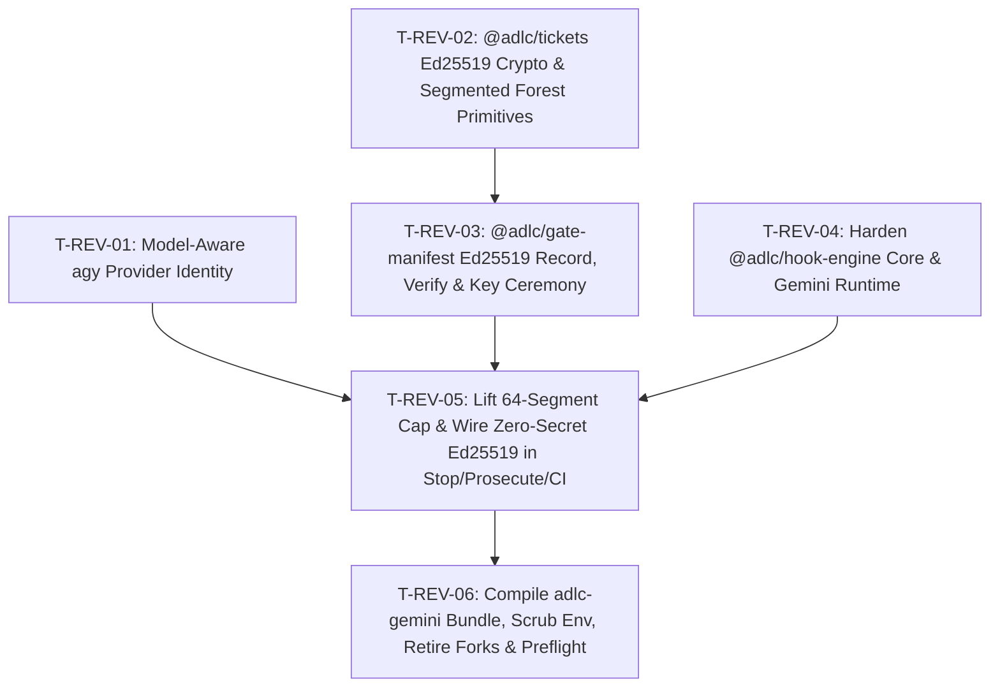

# ADLC Review Proposals Specification (Surgical Wave 0–2 Architecture & Hardening)

## Context & Problem Statement

An adversarial architectural and source-level review of ADLC (`v1.13.0` at `443fe00`, post-#1426) surfaced four core engineering decisions across the 35 workspace packages, 8 plugins, and CI workflows:

1. **Unified `@adlc/gemini` (`agy` / `jetski`) & Model-Aware `agy` Provider Identity**:
   - Google officially transitioned Gemini CLI into **Antigravity CLI (`agy`)** (rebranding extensions as Antigravity plugins), which is why ADLC unified `agy` and `jetski` into `plugins/adlc-gemini` (`@adlc/gemini`). Splitting out a separate `@adlc/antigravity` package or targeting the discontinued `@google/gemini-cli` is explicitly rejected.
   - However, because `agy` routes across multiple model families and `packages/core/lib/llm.mjs` defaults `agy` `mid`/`frontier` tiers to Anthropic Claude 4.6 models (`Claude Sonnet 4.6 (Thinking)`, `Claude Opus 4.6 (Thinking)`), `packages/prosecute/lib/cross-model.mjs` (`normalizeProvider`) has a live security defect: it unconditionally folds `'agy'` and `'antigravity'` to `'google'`, allowing an Anthropic-backed `agy` run to self-approve an `'anthropic'` author.
2. **Retiring `adlc-gemini`'s `6,469` LOC of Inline Forks via `@adlc/hook-engine`**:
   - `plugins/adlc-gemini/flail-inline.mjs` (`resolveTranscriptPath`) hardcodes `~/.gemini/antigravity-cli` and rejects `~/.gemini/jetski` transcripts, causing an infinite `Stop` loop in JetSki.
   - `plugins/adlc-gemini/hooks/adlc-rails-guard.mjs` freezes all pre-existing test files on `Stop`, even when those test files are explicitly in the active ticket's `scope[]` and not in `rails[]`.
   - Neither the inline hook nor `@adlc/hook-engine` implements the full `deny > force_ask > ask > pass` decision lattice documented in `#1426`.
   - `packages/hook-engine/lib/protocol-adapters.mjs` drops `toolCall.{name,args}` payloads, and `packages/hook-engine/lib/stop.mjs` hard-bricks repositories once `.adlc/manifest.d/` exceeds `MAX_MANIFEST_SEGMENTS = 64`.
3. **Asymmetric Ed25519 (`.adlc/admin.pub`) vs Symmetric `ADLC_MANIFEST_KEY`**:
   - Symmetric HMAC-SHA256 forces an impossible choice between placing minting authority (`ADLC_MANIFEST_KEY`) in developer `.env.local` files or breaking local hook/CLI signature verification and fork validation.
4. **Package Surface Stability**:
   - All 35 `@adlc/*` workspace packages and all 8 `plugins/*` directories publish/ship in lockstep (`scripts/release.mjs`) and remain intact; changes are scoped to surgical Wave 0–2 upgrades with zero package/plugin surface churn.

## Resolved Trade-Offs

1. **Workspace & Plugin Surface (Decisions 1 & 2 / Proposals #1 & #4)**: Keep all 35 `packages/*` and unified `@adlc/gemini` (`plugins/adlc-gemini` serving `agy` and `jetski` with `adlc-gemini`, `adlc-agy`, `adlc-antigravity`, `adlc-jetski` bins) intact; drop discontinued `@google/gemini-cli` support completely; fix `agy` provider classification in `packages/core/lib/llm.mjs` and `packages/prosecute/lib/cross-model.mjs` so `agy:<model>` / `antigravity:<model>` / `{ model }` resolves to the true underlying model family (`'anthropic'`, `'google'`, `'openai'`) and bare model-less `'agy'`/`'antigravity'` fails closed on approve/record while remaining revocable (`needs-attention`).
2. **`@adlc/hook-engine` Bundle Consolidation (Decision 3 / Proposal #2)**: Fix `@adlc/hook-engine` first (`toolCall.{name,args}` extraction, `deny > force_ask > ask > pass` lattice, lifting the 64-segment cap in `stop.mjs`, `~/.gemini/jetski` transcript resolution, allowing in-scope non-railed pre-existing test edits on `Stop`, and promoting session/secret/command security guards into `< 400`-line modules) and `esbuild`-compile `plugins/adlc-gemini/hooks/adlc-rails-guard.bundle.mjs` via `scripts/build-hooks.mjs`, deleting `build-gate-inline.mjs`, `flail-inline.mjs`, `core-inline.mjs`, `rails-checker.mjs`, `hooks/adlc-rails-guard.mjs`, and `plugins/adlc-gemini/generated-*.mjs`. Note that `*.bundle.mjs` is automatically excluded from mutation testing by `packages/hollow-test/lib/targets.mjs` (`#1426`) while its source modules under `packages/hook-engine/lib/` are directly unit- and mutation-tested.
3. **Asymmetric Ed25519 Manifest Signing with Package-Scoped Mutation Coverage & Zero-Secret CI Verification (Decision 4 / Proposal #3)**:
   - Split leaf Ed25519 primitives in `@adlc/tickets` (`T-REV-02`, with dedicated `packages/tickets/test/manifest-crypto.test.mjs` so `mutation-gate` kills mutants inside `@adlc/tickets` directly) from `@adlc/gate-manifest` record/segment-writer/verify/ceremony wiring (`T-REV-03`, with `packages/gate-manifest/test/ed25519-manifest.test.mjs`).
   - Use a single-line prefixed Ed25519 private signing key format (`ed25519-priv:<base64-pkcs8-der>`) sourced from `ADLC_MANIFEST_PRIVATE_KEY` (preferred over `ADLC_MANIFEST_KEY` in `getKey()` / `resolveKeyFromEnv()` while preserving explicit-empty `''` fail-closed semantics) so all existing `validateKeyParam(key)` callers thread signing material seamlessly.
   - Re-export all Ed25519 helpers through `@adlc/tickets`'s declared `"exports"` entrypoints (`./lib/manifest-primitives.mjs` and `./lib/key-contract.mjs`) and `@adlc/gate-manifest/lib/sign.mjs` so cross-package imports never trigger `ERR_PACKAGE_PATH_NOT_EXPORTED`.
   - Keep `ADLC_MANIFEST_PRIVATE_KEY` **strictly out of CI verification workflows** (`.github/workflows/cross-model-gate.yml`): `mirror-attestations` and `tier-check` pass `--trusted-dir "$GITHUB_WORKSPACE/.adlc"` to anchor `admin.pub` to the trusted base checkout (never `./_pr/.adlc`) and verify Ed25519 attestations with **zero secrets**.
4. **Immutable CI Trust-Root Compliance**:
   - Existing on-disk trust-root files (`package.json`, `CODEOWNERS`, `.adlc/config.json`, `.github/workflows/ci.yml`, `docs/ci/rails-guard.yml`, `scripts/rails-guard-ci.mjs`, `scripts/preflight.mjs`, `scripts/check-reviewer-directed-comments.mjs`, `scripts/toolkit-floor.json`, `scripts/toolkit-floor-check.mjs`, `packages/rails-guard/lib/ci/trust-roots.mjs`) are declared in every ticket's `Rails` for in-session `PreToolUse` protection.
   - Absent-on-disk CI-frozen paths (`.adlc/admin.pub`, `.npmrc`, `.github/workflows/adlc-rails-guard.yml`) are omitted from ticket `Rails` only because `agb shape` requires declared `Rails` paths to exist in the base tree; they remain strictly forbidden from creation or modification in any ticket worktree and are enforced at commit/gate time by `scripts/rails-guard-ci.mjs` (`npm run preflight`).

## Architecture & Ticket Dependency DAG

## Ticket Breakdown

### Ticket 1: T-REV-01 -- Model-Aware agy Provider Identity in Core and Prosecute

- **Scope**: `packages/core/lib/model-family.mjs`, `packages/core/lib/llm.mjs`, `packages/core/index.mjs`, `packages/core/index.d.ts`, `packages/core/test/llm.test.mjs`, `packages/prosecute/lib/cross-model.mjs`, `packages/prosecute/test/vendor-family-provenance.test.mjs`, `packages/prosecute/test/cross-model-carry-forward.test.mjs`
- **Rails**: `package.json`, `CODEOWNERS`, `.adlc/config.json`, `.github/workflows/ci.yml`, `docs/ci/rails-guard.yml`, `scripts/rails-guard-ci.mjs`, `scripts/preflight.mjs`, `scripts/check-reviewer-directed-comments.mjs`, `scripts/toolkit-floor.json`, `scripts/toolkit-floor-check.mjs`, `packages/rails-guard/lib/ci/trust-roots.mjs`
- **Edges**: None
- **Tier**: frontier
- **Pool Hint**: claude
- **Objectives**:
  - Create `packages/core/lib/model-family.mjs` (< 100 lines, pure, zero runtime dependencies) exporting `inferModelProviderFamily(modelId)` (re-exported from `packages/core/lib/llm.mjs`, `packages/core/index.mjs`, and `packages/core/index.d.ts` so `llm.mjs` does not grow):
    - Normalize `modelId` via NFKC + lowercase + whitespace stripping; map `claude*` / `anthropic*` -> `'anthropic'`, `gemini*` / `gemma*` -> `'google'`, and `gpt*` / `o1*` / `o3*` / `o4*` / `codex*` -> `'openai'`; return `''` for unknown or empty inputs.
  - Update `normalizeProvider(value, { model } = {})` in `packages/prosecute/lib/cross-model.mjs`:
    - Parse composite provider strings `agy:<model>` and `antigravity:<model>` (e.g. `'agy:Claude Sonnet 4.6 (Thinking)'` -> `'anthropic'`, `'agy:Gemini 3.5 Flash (Medium)'` -> `'google'`, `'antigravity:gpt-5.1'` -> `'openai'`) as well as `{ model }` via `inferModelProviderFamily` from `@adlc/core`.
    - Remove the unconditional mapping of bare `'agy'` and `'antigravity'` to `'google'`: bare `'agy'` or `'antigravity'` without a resolvable model family MUST return `''` so `candidateReview` rejects bare `'agy'` approvals as ambiguous and `recordCrossModelReview` throws a clear fail-closed error instructing callers to pass `agy:<model>` or concrete provider family (`anthropic`, `google`, `openai`).
    - Preserve revocation safety in `revocationCandidate` / `crossModelSatisfied`: if an entry has `verdict === 'needs-attention'` with bare `'agy'` or `'antigravity'`, treat it as a valid revocation blocking approvals for that `(revision, [ticket])` tuple so pre-existing bare `'agy'` revocations never fail open.
  - Update `packages/prosecute/test/vendor-family-provenance.test.mjs` and `packages/prosecute/test/cross-model-carry-forward.test.mjs` (neutralizing `ADLC_MANIFEST_KEY: ''` on any `...process.env` CLI spawn per `env-hermeticity-guard.test.mjs`) for `agy:<model>` resolution, bare `'agy'` approval refusal, intra-family rejection (`agy:Claude Opus 4.6 (Thinking)` vs `'anthropic'`), and bare `'agy'` revocation preservation.
- **Acceptance Criteria**:
  - `inferModelProviderFamily('Claude Opus 4.6 (Thinking)') === 'anthropic'`, `inferModelProviderFamily('Gemini 3.5 Flash (Medium)') === 'google'`, `inferModelProviderFamily('gpt-5.1') === 'openai'`, and `inferModelProviderFamily('') === ''`, verified by `node --test packages/core/test/llm.test.mjs`.
  - `normalizeProvider('agy:Claude Sonnet 4.6 (Thinking)') === 'anthropic'`, `normalizeProvider('agy:Gemini 2.5 Pro') === 'google'`, `normalizeProvider('agy') === ''`, `recordCrossModelReview` throws on bare `'agy'` and on `'agy:Claude Sonnet 4.6'` reviewing `authorProvider: 'anthropic'`, and a `needs-attention` entry with bare `provider: 'agy'` still revokes approvals on that revision, verified by `node --test packages/prosecute/test/vendor-family-provenance.test.mjs packages/prosecute/test/cross-model-carry-forward.test.mjs`.
  - Full `packages/core` and `packages/prosecute` suites pass offline: `node --test packages/core/test/*.test.mjs packages/prosecute/test/*.test.mjs`.

### Ticket 2: T-REV-02 -- Leaf Ed25519 Crypto and Segmented Forest Verification in tickets

- **Scope**: `packages/tickets/lib/key-contract.mjs`, `packages/tickets/lib/manifest-crypto.mjs`, `packages/tickets/lib/manifest-primitives.mjs`, `packages/tickets/lib/manifest-segments.mjs`, `packages/tickets/lib/evidence.mjs`, `packages/tickets/test/manifest-crypto.test.mjs`
- **Rails**: `package.json`, `CODEOWNERS`, `.adlc/config.json`, `.github/workflows/ci.yml`, `docs/ci/rails-guard.yml`, `scripts/rails-guard-ci.mjs`, `scripts/preflight.mjs`, `scripts/check-reviewer-directed-comments.mjs`, `scripts/toolkit-floor.json`, `scripts/toolkit-floor-check.mjs`, `packages/rails-guard/lib/ci/trust-roots.mjs`, `packages/tickets/package.json`
- **Edges**: None
- **Tier**: frontier
- **Pool Hint**: gemini
- **Objectives**:
  - Create `packages/tickets/lib/manifest-crypto.mjs` (< 300 lines, zero runtime dependencies, Node 18+ `node:crypto` only):
    - Export `ADMIN_PUB_FILENAME = 'admin.pub'`, `PRIVATE_KEY_ENV = 'ADLC_MANIFEST_PRIVATE_KEY'`, `ED25519_PRIV_PREFIX = 'ed25519-priv:'`, `SIG_ALG_ED25519 = 'ed25519'`.
    - Implement `generateEd25519KeyPair()` returning `{ privateKey, publicKey, keyFingerprint }` where `privateKey` is single-line `ed25519-priv:<base64-pkcs8-der>` (no newlines, compatible with `validateKeyParam`), `publicKey` is canonical SPKI PEM, and `keyFingerprint` is lowercase hex `sha256` of canonical SPKI DER bytes.
    - Implement `isEd25519PrivateKey(key)`, `derivePublicKeyPem(privateKey)`, `signEntryEd25519(privateKey, entry)` (128-char lowercase hex 64-byte signature over `Buffer.from(canonicalEntryBytes(entry), 'utf8')`), `verifyEntryEd25519(publicKeyOrPrivateKey, entry)`, and `readAdminPublicKey(dir)` (`O_RDONLY | O_NOFOLLOW`, `lstatSync` + `fstatSync` regular-file check `<= 4096` bytes on `<dir>/admin.pub`, returning `{ status: 'absent', publicKey: null }`, `{ status: 'ok', publicKey }`, or `{ status: 'error', reason }` — failing closed on symlinks, oversized files, or invalid SPKI keys).
  - Respect `@adlc/tickets`'s strict `"exports"` map without editing `packages/tickets/package.json`:
    - Re-export `PRIVATE_KEY_ENV` and updated `resolveKeyFromEnv(env)` from `packages/tickets/lib/key-contract.mjs`: if `Object.hasOwn(env, 'ADLC_MANIFEST_PRIVATE_KEY')`, return `env.ADLC_MANIFEST_PRIVATE_KEY` when non-empty else `null` (so `ADLC_MANIFEST_PRIVATE_KEY=''` fails closed and never falls back to `ADLC_MANIFEST_KEY`); otherwise resolve `env.ADLC_MANIFEST_KEY`.
    - Re-export `ADMIN_PUB_FILENAME`, `ED25519_PRIV_PREFIX`, `SIG_ALG_ED25519`, `generateEd25519KeyPair`, `isEd25519PrivateKey`, `derivePublicKeyPem`, `signEntryEd25519`, `verifyEntryEd25519`, and `readAdminPublicKey` from `packages/tickets/lib/manifest-primitives.mjs`.
    - Strip `ADLC_MANIFEST_PRIVATE_KEY` alongside `ADLC_MANIFEST_KEY` in `assertSegmentPathCommittable` (`manifest-primitives.mjs`).
  - Wire dual-era Ed25519 + HMAC verification and ticket-evidence signing in `manifest-primitives.mjs`, `manifest-segments.mjs`, and `evidence.mjs`:
    - Update `entrySigValid(key, entry, { publicKey = null } = {})` / `verifyEntrySig`: if `entry?.sigAlg === 'ed25519'`, resolve verifier key from `publicKey` or (when `publicKey === null` and `isEd25519PrivateKey(key)`) `derivePublicKeyPem(key)` and verify Ed25519 (fail closed if neither is available); if `entry?.sigAlg === undefined`, verify HMAC only when `key !== null && !isEd25519PrivateKey(key)` (rejecting unknown `sigAlg` values).
    - In `evidence.mjs` (`recordTicketEvidence` / `recordSegmentedTicketEvidence`), when `isEd25519PrivateKey(key)` is true: verify `derivePublicKeyPem(key)` matches `<dir>/admin.pub` if `<dir>/admin.pub` exists, and stamp `sigVersion: 2` and `sigAlg: 'ed25519'` before signing with `signEntryEd25519`.
    - Update `verifyManifestForest`, `verifyChain`, `resolveOpenSegment`, `forestChainsIntact`, and `readOwnChains` (`manifest-segments.mjs`) to accept optional `publicKey` (defaulting via `readAdminPublicKey(dir)` and failing closed on `status === 'error'`), enforce monotone Ed25519 era across root and anchored segments (rejecting any HMAC/unsigned entry after an `ed25519` entry in the same lineage), and verify pre-Ed25519 hash-chain continuity with `key: null` when `adminPub.publicKey` is present (requiring `>= 1` valid `ed25519` signature on non-empty forests when `requireSignatures === true`).
  - Add exhaustive unit and mutation-killing tests in `packages/tickets/test/manifest-crypto.test.mjs` covering keypair generation, `resolveKeyFromEnv` empty-string fail-closed precedence, `readAdminPublicKey` symlink/size/PEM validation, `entrySigValid`, `verifyManifestForest`, `resolveOpenSegment`, `readOwnChains`, and `recordTicketEvidence` across root + segmented `.adlc/manifest.d/` stores.
- **Acceptance Criteria**:
  - `node --test packages/tickets/test/manifest-crypto.test.mjs` and `node --test packages/tickets/test/*.test.mjs` exit `0` offline with zero temp leaks.
  - Subpath imports `@adlc/tickets/lib/manifest-primitives.mjs` and `@adlc/tickets/lib/key-contract.mjs` expose all new Ed25519 exports without `ERR_PACKAGE_PATH_NOT_EXPORTED`, verified in `packages/tickets/test/manifest-crypto.test.mjs`.
  - `node packages/hollow-test/bin/hollow-test.mjs --base HEAD --test-cmd "node --test packages/tickets/test/manifest-crypto.test.mjs packages/tickets/test/key-contract.test.mjs"` (or targeted mutation check on `packages/tickets/lib/manifest-crypto.mjs`) kills mutants cleanly.

### Ticket 3: T-REV-03 -- Wire Ed25519 Signing, Segment Writer, and Key Ceremony in gate-manifest

- **Scope**: `packages/gate-manifest/lib/sign.mjs`, `packages/gate-manifest/lib/record.mjs`, `packages/gate-manifest/lib/segment-writer.mjs`, `packages/gate-manifest/lib/verify.mjs`, `packages/gate-manifest/lib/enable.mjs`, `packages/gate-manifest/lib/key-ceremony.mjs`, `packages/gate-manifest/bin/gate-manifest.mjs`, `packages/gate-manifest/test/ed25519-manifest.test.mjs`
- **Rails**: `package.json`, `CODEOWNERS`, `.adlc/config.json`, `.github/workflows/ci.yml`, `docs/ci/rails-guard.yml`, `scripts/rails-guard-ci.mjs`, `scripts/preflight.mjs`, `scripts/check-reviewer-directed-comments.mjs`, `scripts/toolkit-floor.json`, `scripts/toolkit-floor-check.mjs`, `packages/rails-guard/lib/ci/trust-roots.mjs`
- **Edges**: `T-REV-02`
- **Tier**: frontier
- **Pool Hint**: gemini
- **Objectives**:
  - Update `packages/gate-manifest/lib/sign.mjs` to delegate `getKey(env)` to `resolveKeyFromEnv(env)` (`ADLC_MANIFEST_PRIVATE_KEY` preferred with explicit-empty fail-closed, else `ADLC_MANIFEST_KEY`), support `ed25519-priv:` keys in `signEntry(key, entry)` and `{ publicKey }` in `verifyEntrySig(key, entry, opts)`, and re-export `ADMIN_PUB_FILENAME`, `PRIVATE_KEY_ENV`, `SIG_ALG_ED25519`, `generateEd25519KeyPair`, `isEd25519PrivateKey`, `derivePublicKeyPem`, `readAdminPublicKey` from `@adlc/tickets/lib/manifest-primitives.mjs` and `@adlc/tickets/lib/key-contract.mjs`.
  - Update `packages/gate-manifest/lib/record.mjs`, `packages/gate-manifest/lib/segment-writer.mjs`, `packages/gate-manifest/lib/verify.mjs`, and `packages/gate-manifest/lib/enable.mjs`:
    - Reserve `'sigAlg'` in `RESERVED_CHAIN_FIELDS` (`record.mjs`).
    - In both `appendManifestEntry` (`record.mjs`) and `appendToSegment` (`segment-writer.mjs`), when `isEd25519PrivateKey(signingKey)` is true: check `<dir>/admin.pub` via `readAdminPublicKey(dir)` (failing closed on corrupt `admin.pub` or private/public key mismatch!), stamp `sigVersion: 2` and `sigAlg: 'ed25519'` before calling `signEntry`, and verify chain integrity cleanly.
    - Pass optional `publicKey` through `verify(dir, { requireSignatures, requireEntries, key, publicKey })` (`verify.mjs`), and delete `ADLC_MANIFEST_PRIVATE_KEY` alongside `ADLC_MANIFEST_KEY` in `enable.mjs` and `sanitizedGitEnv()` (`key-ceremony.mjs`).
  - Extend `packages/gate-manifest/lib/key-ceremony.mjs` and `packages/gate-manifest/bin/gate-manifest.mjs` (`generate-key --ed25519 --output <private-handoff-path> [--public-output <pub-path>] [--json]`):
    - Generate CSPRNG Ed25519 keypair, write `ed25519-priv:<base64>` mode `0600` outside all repo worktrees via `writeKeyHandoffFile` (never printed to stdout/stderr), optionally write SPKI PEM to `--public-output`, and return `{ algorithm: 'ed25519', publicKey, keyFingerprint, output }` in `--json`.
- **Acceptance Criteria**:
  - Monolithic (`manifest.jsonl`) and segmented (`manifest.d/*.jsonl`) chains containing unsigned legacy -> HMAC -> Ed25519 entries recorded via `gate-manifest record` verify via `gate-manifest verify` with `ADLC_MANIFEST_KEY` and `ADLC_MANIFEST_PRIVATE_KEY` both unset when `<dir>/admin.pub` is present, verified by `node --test packages/gate-manifest/test/ed25519-manifest.test.mjs`.
  - `gate-manifest generate-key --ed25519 --output <outside-path> --json` writes a `0600` private key handoff file outside the repo with zero private-key bytes on stdout/stderr, and tampering, post-Ed25519 HMAC/unsigned downgrades, or mismatched private keys exit `2` / throw, verified by `node --test packages/gate-manifest/test/ed25519-manifest.test.mjs`.
  - `node --test packages/gate-manifest/test/*.test.mjs` exits `0`.

### Ticket 4: T-REV-04 -- Harden hook-engine Core and Promote Self-Contained Gemini Hook Modules

- **Scope**: `packages/hook-engine/lib/protocol-adapters.mjs`, `packages/hook-engine/lib/pretool.mjs`, `packages/hook-engine/lib/flail-transcript.mjs`, `packages/hook-engine/lib/session-tracker.mjs`, `packages/hook-engine/lib/command-verify.mjs`, `packages/hook-engine/lib/gemini-guard.mjs`, `packages/hook-engine/lib/cli-gemini.mjs`, `packages/hook-engine/index.mjs`, `packages/hook-engine/test/protocol-adapters.test.mjs`, `packages/hook-engine/test/gemini-guard.test.mjs`
- **Rails**: `package.json`, `CODEOWNERS`, `.adlc/config.json`, `.github/workflows/ci.yml`, `docs/ci/rails-guard.yml`, `scripts/rails-guard-ci.mjs`, `scripts/preflight.mjs`, `scripts/check-reviewer-directed-comments.mjs`, `scripts/toolkit-floor.json`, `scripts/toolkit-floor-check.mjs`, `packages/rails-guard/lib/ci/trust-roots.mjs`
- **Edges**: None
- **Tier**: frontier
- **Pool Hint**: claude
- **Objectives**:
  - Fix `packages/hook-engine/lib/protocol-adapters.mjs` (< 300 lines):
    - Extract nested `toolCall.{name, args}` / `tool_call.{toolName, arguments, params, parameters, input, tool_input}` in `normalizeHookInput()`, map `'preinvocation'` -> `'session-start'`, and extract `workspacePaths` / `workspace_paths` / `workspaceRoots` / `conversationId` / `conversation_id`.
    - Implement the 4-level decision lattice `deny > force_ask > ask > pass` in `formatHookOutput('gemini', event, result)` (`agy >= 1.5.17` / `jetski`):
      - `pretool`: `deny`/`block` -> `{ decision: 'deny', reason, allow_tool: false, deny_reason: reason }`; `force_ask` -> `{ decision: 'force_ask', reason, allow_tool: false }`; `ask` -> `{ decision: 'ask', reason }`; `pass`/`allow` -> `{ decision: 'pass', allow_tool: true }`.
      - `stop`: `deny`/`block`/`continue` -> `{ decision: 'continue', reason }`; otherwise `{ decision: 'stop' }`.
      - `posttool` / `session-start`: `{ hookSpecificOutput: { additionalContext: context } }` when context non-empty else `{}`.
  - Update `packages/hook-engine/lib/pretool.mjs` (< 400 lines):
    - Support PascalCase & URI file keys (`TargetFile`, `AbsolutePath`, `FilePath`, `Path`, `TargetContentPath`, `TargetDir`, `file://` URI decoding) and export `resolveActiveTicketId(root, env)` returning `{ id, conflict, code, message }` via `resolveActiveTicketAgainst` from `@adlc/tickets` (satisfying `packages/tickets/test/pointer.test.mjs` `CONFLICT_ADAPTERS`).
  - Promote and modularize the `plugins/adlc-gemini` inline runtime into clean `< 400`-line modules under `packages/hook-engine/lib/` (never mutating `.adlc/tickets*` directly and delegating ticket/glob/railpath/workspace-root primitives to `@adlc/core` and `@adlc/tickets`):
    1. `flail-transcript.mjs` (< 400 lines): bounded transcript reader (`parseTranscriptRecords`, `parseTranscriptSteps`, `parseTranscriptLines`), error normalization, edit-churn & repeated-error flail tracker (`createFlailTracker`, `analyzeFlail`, `detectEditChurn`, `detectRepeatedErrors`, `flailMessage`, `DEFAULT_FLAIL_THRESHOLD`), and **fixed `resolveTranscriptPath()`** supporting `~/.gemini/antigravity-cli`, `~/.gemini/jetski` (including nested `~/.gemini/jetski/brain/**` paths such as `jetski/brain/v1/.../<cid>/.system_generated/logs/transcript.jsonl`), and env overrides (`ANTIGRAVITY_APP_DATA_DIR`, `JETSKI_APP_DATA_DIR`, `GEMINI_CLI_DATA_DIR`) while rejecting symlinks (`lstatSync`) and `..` traversal.
    2. `session-tracker.mjs` (< 400 lines): persistent HMAC session baseline tracker (`createPersistentTracker`, `checkBuildGate`, `checkFlail`, `resolveSessionId`, `readTranscriptPrefixBounded`, `computePrefixHash`, `readTextFileBounded`), stale-lock judgment/reclamation (`LOCK_TTL_MS`, `judgeStaleLock`, `reclaimJudgedLock`), master/session secret management (`getMasterKeyRaw`, `rotateMasterKey`, `getOrCreateSessionSecret`, `resolveUserHome`), `getTestFilesMap`, `hasDiscoverableTests`, and **fixed pre-existing test verification** (`verifyPreExistingTestFiles`) that **allows** modifying pre-existing test files matching the active ticket's `scope[]` (via `globMatch` from `@adlc/core`, provided they do NOT match `rails[]` or `TRUST_ROOT_RAILS`), while blocking modifications or deletions of out-of-scope or railed pre-existing test files.
    3. `command-verify.mjs` (< 350 lines): `isReadonlyCommand`, `isVerificationCommand`, `extractCommandString`, `classifyTool` (including `call_mcp_tool` read-only inner-tool allowlist and `ask_permission` mediation), `isShellTool`, `hasCommandLineArgs`, `hasCodeExecutionArgs`, `hasMutatingPayloadDeep`, `isCaseInsensitiveFs`, `TRUST_ROOT_RAILS`, `isSecretStatePath`, `isTrustRootOrSecretPath`, `getTrustRootSecretHomes`.
    4. `gemini-guard.mjs` (< 400 lines) & `cli-gemini.mjs` (< 150 lines): `decide`, `preInvocation`, `postToolUse`, `onStop`, `runFromStdin`, `printStatus`, `printDoctor`, `checkRail`, `findAdlcRoot`, `anchorPath`, `extractToolName`, `extractArgs`, `extractFilePaths`, `canonicalizeExisting`, enforcing the `deny > force_ask > ask > pass` lattice (interactive ambiguous shell / out-of-workspace mutations -> `force_ask`, headless `ADLC_HEADLESS=1` -> `deny`, protected `.adlc/**` / `.booster/**` / frozen rails -> `deny`, clean -> `pass` with `allow_tool: true`). Re-export all public functions from `packages/hook-engine/index.mjs` and `cli-gemini.mjs`.
- **Acceptance Criteria**:
  - `normalizeHookInput('agy', { toolCall: { name: 'write_to_file', args: { TargetFile: 'src/a.js' } } })` extracts `toolName: 'write_to_file'` and `toolInput.TargetFile === 'src/a.js'`, and `formatHookOutput('gemini', 'pretool', ...)` emits `deny`, `force_ask`, `ask`, and `pass` (`allow_tool: true`), verified by `node --test packages/hook-engine/test/protocol-adapters.test.mjs`.
  - `resolveTranscriptPath` resolves valid transcripts under `~/.gemini/jetski` (both flat `~/.gemini/jetski/brain/<cid>/...` and nested `~/.gemini/jetski/brain/v1/...`) while rejecting symlinks and outside-root paths, verified by `node --test packages/hook-engine/test/gemini-guard.test.mjs`.
  - `onStop` allows modifying a pre-existing test file covered by the active ticket's `scope[]` (and not in `rails[]`) once verification tests pass after the edit, while blocking edits/deletions to out-of-scope or railed pre-existing test files, verified by `node --test packages/hook-engine/test/gemini-guard.test.mjs`.
  - Every `.mjs` file in `packages/hook-engine/lib/` has `< 400` lines, verified in `packages/hook-engine/test/gemini-guard.test.mjs`.

### Ticket 5: T-REV-05 -- Lift 64-Segment Cap and Wire Zero-Secret Ed25519 in Stop, Prosecute, and CI

- **Scope**: `packages/hook-engine/lib/stop.mjs`, `packages/hook-engine/test/posttool-stop-session.test.mjs`, `packages/hook-engine/test/stop.test.mjs`, `packages/prosecute/lib/cross-model.mjs`, `packages/prosecute/lib/attestation-store.mjs`, `packages/prosecute/lib/run.mjs`, `packages/prosecute/lib/load-env-local.mjs`, `packages/prosecute/bin/adlc-prosecute.mjs`, `packages/prosecute/test/ed25519-cross-model.test.mjs`, `packages/prosecute/test/cross-model-gate-workflow.test.mjs`, `.github/workflows/cross-model-gate.yml`
- **Rails**: `package.json`, `CODEOWNERS`, `.adlc/config.json`, `.github/workflows/ci.yml`, `docs/ci/rails-guard.yml`, `scripts/rails-guard-ci.mjs`, `scripts/preflight.mjs`, `scripts/check-reviewer-directed-comments.mjs`, `scripts/toolkit-floor.json`, `scripts/toolkit-floor-check.mjs`, `packages/rails-guard/lib/ci/trust-roots.mjs`
- **Edges**: `T-REV-01`, `T-REV-03`, `T-REV-04`
- **Tier**: frontier
- **Pool Hint**: gemini
- **Objectives**:
  - Remove the 64-segment brick threshold in `packages/hook-engine/lib/stop.mjs` and update `packages/hook-engine/test/posttool-stop-session.test.mjs`:
    - Raise `MAX_MANIFEST_SEGMENTS` from `64` to `10_000` (paired with `MAX_MANIFEST_TOTAL_BYTES = 64 * 1024 * 1024` across scanned files and `MAX_MANIFEST_LINES = 250_000` bounds) so active repositories with hundreds or thousands of `.adlc/manifest.d/*.jsonl` files never hit a false-positive segment-count failure.
    - Update `packages/hook-engine/test/posttool-stop-session.test.mjs` (lines 125–133) so explicit custom `maxSegments` bound enforcement passes `{ maxSegments: 64 }` while verifying that `>= 65` segments succeed under the new `10_000` default.
  - Wire zero-secret `.adlc/admin.pub` Ed25519 verification into `hasManifestEvidence()` and `evaluateStop()` in `packages/hook-engine/lib/stop.mjs` (using `resolveKeyFromEnv` / `readAdminPublicKey`): when `<root>/.adlc/admin.pub` exists (or `publicKey` is provided), verify the manifest forest and matching gate entries even when `key === null` (`ADLC_MANIFEST_KEY` and `ADLC_MANIFEST_PRIVATE_KEY` unset!), while failing closed when neither `key` nor `<root>/.adlc/admin.pub` is present or when `admin.pub` is corrupt/symlinked.
  - Wire Ed25519 signing and zero-secret `publicKey` / `.adlc/admin.pub` verification throughout `@adlc/prosecute`:
    - `packages/prosecute/lib/load-env-local.mjs`: load `ADLC_MANIFEST_PRIVATE_KEY` (preferentially, respecting presence-based empty-string `ADLC_MANIFEST_PRIVATE_KEY=''` fail-closed semantics and NEVER running in CI or `tier-check`) alongside `ADLC_MANIFEST_KEY` for local `record-cross-model` / `carry-forward` signing convenience.
    - `packages/prosecute/lib/attestation-store.mjs`: thread `{ key = null, publicKey = null }` through `readObservedAttestations(storePath, { key, publicKey })` (returning `[]` ONLY when `!key && !publicKey`), `assertNoTruncation({ prEntries, observedEntries, revision, key, publicKey, ticket })`, and `mirrorObservedAttestations({ prEntries, storePath, key, publicKey })` — failing closed if any `sigAlg === 'ed25519'` store entry fails `publicKey` verification (or if `publicKey` is absent when an `ed25519` entry is in the store) or if any HMAC store entry fails `key` verification when `key` is present, so external store paths (`$GITHUB_WORKSPACE/_attestations/attestations.jsonl`) verify Ed25519 signatures deterministically without needing `.adlc/` to be an ancestor of `storePath`.
    - `packages/prosecute/lib/cross-model.mjs`, `packages/prosecute/lib/run.mjs`, and `packages/prosecute/bin/adlc-prosecute.mjs`: thread `{ key, publicKey }` (defaulting `publicKey` from `readAdminPublicKey(trustedDir ?? dir)`, adding `--trusted-dir <path>` on `tier-check` and `mirror-attestations` so CI anchors `admin.pub` to the trusted base checkout rather than the PR tree) across `hasCrossModelApprove`, `hasCrossModelApproveForRevision`, `evaluateCrossModelRevision`, `manifestChainTrustworthy`, `manifestChainBreakReason`, `recordCrossModelReview`, `carryForwardCrossModelReview`, and `runProsecution`. When `--trusted-dir` is supplied, `admin.pub` MUST be read exclusively from `--trusted-dir` (never falling back to PR-controlled `--dir` if `--trusted-dir/admin.pub` is absent).
  - Harden `.github/workflows/cross-model-gate.yml` and extend `packages/prosecute/test/cross-model-gate-workflow.test.mjs`:
    - Do **NOT** pass `ADLC_MANIFEST_PRIVATE_KEY` to `mirror-attestations` or `tier-check` (keeping minting authority completely out of CI verification).
    - Pass `--trusted-dir "$GITHUB_WORKSPACE/.adlc"` to both `mirror-attestations` and `tier-check` (keeping `--attestation-store "$GITHUB_WORKSPACE/_attestations/attestations.jsonl"` within the `tier-check \` continuation block asserted by `cross-model-gate-workflow.test.mjs`), keeping `ADLC_MANIFEST_KEY: ${{ secrets.ADLC_MANIFEST_KEY }}` only as an optional legacy HMAC fallback.
    - Extend `packages/prosecute/test/cross-model-gate-workflow.test.mjs` to validate workflow structure, step ordering, CLI flag parity (`adlc-prosecute --help` / `parseArgs` options), `--trusted-dir "$GITHUB_WORKSPACE/.adlc"`, and zero `secrets.ADLC_MANIFEST_PRIVATE_KEY` references; neutralize `ADLC_MANIFEST_KEY: ''` in `ed25519-cross-model.test.mjs` spawns per `env-hermeticity-guard.test.mjs`.
- **Acceptance Criteria**:
  - `evaluateStop` and `hasManifestEvidence` succeed on a repository with `200` `.adlc/manifest.d/*.jsonl` segments under the default `10_000` cap, enforce explicit `maxSegments` overrides in `posttool-stop-session.test.mjs`, and verify Ed25519-signed gate evidence with `key: null` when `.adlc/admin.pub` is present, verified by `node --test packages/hook-engine/test/posttool-stop-session.test.mjs packages/hook-engine/test/stop.test.mjs`.
  - `readObservedAttestations`, `mirrorObservedAttestations`, `assertNoTruncation`, and subprocess runs of `adlc-prosecute` (`record-cross-model`, `carry-forward`, `mirror-attestations --trusted-dir`, `tier-check --trusted-dir`, and `runProsecution` `--input`) mint Ed25519 attestations with `ADLC_MANIFEST_PRIVATE_KEY` and verify them with **zero secrets** (`key: null`, external `storePath` outside `.adlc/`, and `ADLC_MANIFEST_KEY` / `ADLC_MANIFEST_PRIVATE_KEY` both unset/empty) via trusted `admin.pub`, while rejecting PR-forged `./_pr/.adlc/admin.pub`, bare `'agy'` approvals, and truncated revocations, verified by `node --test packages/prosecute/test/ed25519-cross-model.test.mjs`.
  - `node --test packages/prosecute/test/cross-model-gate-workflow.test.mjs packages/hook-engine/test/*.test.mjs packages/prosecute/test/*.test.mjs` exits `0`.

### Ticket 6: T-REV-06 -- Compile adlc-gemini Bundle, Scrub Private Key Env, Retire Inline Forks, and Pass Preflight

- **Scope**: `scripts/build-hooks.mjs`, `scripts/run-tests.mjs`, `scripts/ticket-readers/generate.mjs`, `scripts/gemini-install-smoke.mjs`, `scripts/test/run-tests.test.mjs`, `scripts/test/ticket-reader-generation.test.mjs`, `scripts/test/ticket-store-boundary.test.mjs`, `scripts/test/hook-spawn-timeout-drift.test.mjs`, `packages/tickets/test/pointer.test.mjs`, `packages/prosecute/lib/tier.mjs`, `packages/prosecute/test/tier-plugin-and-scripts.test.mjs`, `plugins/adlc-gemini/**`
- **Rails**: `package.json`, `CODEOWNERS`, `.adlc/config.json`, `.github/workflows/ci.yml`, `docs/ci/rails-guard.yml`, `scripts/rails-guard-ci.mjs`, `scripts/preflight.mjs`, `scripts/check-reviewer-directed-comments.mjs`, `scripts/toolkit-floor.json`, `scripts/toolkit-floor-check.mjs`, `packages/rails-guard/lib/ci/trust-roots.mjs`
- **Edges**: `T-REV-05`
- **Tier**: frontier
- **Pool Hint**: claude
- **Objectives**:
  - Scrub `ADLC_MANIFEST_PRIVATE_KEY` in `scripts/run-tests.mjs`: add `'ADLC_MANIFEST_PRIVATE_KEY'` to both `PRESERVE_EMPTY` and `SCRUBBED_ENV_VARS` (mirroring `'ADLC_MANIFEST_KEY'` so ambient private keys never leak into or alter test segments while an explicit empty `''` is preserved), and assert this in `scripts/test/run-tests.test.mjs`.
  - Register `plugins/adlc-gemini/hooks/adlc-rails-guard.bundle.mjs` (entry: `packages/hook-engine/lib/cli-gemini.mjs`, format `'esm'`) in `DEFAULT_HOOK_TARGETS` inside `scripts/build-hooks.mjs`, run `node scripts/build-hooks.mjs` to emit the standalone Node >=18 bundle, and add `['hook-bundle drift', 'node scripts/build-hooks.mjs --check']` to `SEGMENTS` in `scripts/run-tests.mjs`.
  - Delete `plugins/adlc-gemini`'s `6,469` LOC of duplicate inline and generated files:
    - Remove `plugins/adlc-gemini/build-gate-inline.mjs`, `plugins/adlc-gemini/flail-inline.mjs`, `plugins/adlc-gemini/core-inline.mjs`, `plugins/adlc-gemini/rails-checker.mjs`, `plugins/adlc-gemini/hooks/adlc-rails-guard.mjs`, `plugins/adlc-gemini/generated-active-ticket.mjs`, `plugins/adlc-gemini/generated-glob-match.mjs`, `plugins/adlc-gemini/generated-railpath.mjs`, `plugins/adlc-gemini/generated-ticket-reader.mjs`, and `plugins/adlc-gemini/generated-workspace-root.mjs`.
    - Update `plugins/adlc-gemini/hooks/adlc-rails-guard.cjs` to dynamically `import('./adlc-rails-guard.bundle.mjs')` and invoke `main()`, and update `plugins/adlc-gemini/package.json` `"files"` allowlist to ship `hooks/` (`adlc-rails-guard.cjs` + `adlc-rails-guard.bundle.mjs`) without referencing deleted inline/generated files.
  - Upgrade `plugins/adlc-gemini/test/` against the compiled bundle:
    - Add `plugins/adlc-gemini/test/helpers/run-hook.mjs` (bounded spawn helper exporting `resolveSpawnOptions` and `HOOK_TIMEOUT_MS`), convert all raw Node spawns in `plugins/adlc-gemini/test/{build-gate,lifecycle-hooks,packaging,shim}.test.mjs` to use `helpers/run-hook.mjs`, and remove those 4 entries from `PENDING_CONVERSION` in `scripts/test/hook-spawn-timeout-drift.test.mjs`.
    - Repoint `plugins/adlc-gemini/test/*.test.mjs` imports from the deleted inline/generated files to `../hooks/adlc-rails-guard.bundle.mjs` (and `@adlc/tickets` / `@adlc/core` in dev-only test helpers where needed), updating assertions for the `deny > force_ask > ask > pass` (`decision: 'pass', allow_tool: true`) lattice, `~/.gemini/jetski` transcript resolution, and allowing in-scope non-railed pre-existing test edits on `Stop`.
  - Align repo-wide generators and contract tests atomically:
    - Remove `plugins/adlc-gemini/generated-*.mjs` from `scripts/ticket-readers/generate.mjs` and `scripts/test/ticket-reader-generation.test.mjs`.
    - Update `packages/tickets/test/pointer.test.mjs`: remove `'plugins/adlc-gemini/generated-active-ticket.mjs'` from `GENERATED_READERS` and repoint `'adlc-gemini'` in `CONFLICT_ADAPTERS` to `'packages/hook-engine/lib/pretool.mjs'` (`resolveActiveTicketId`).
    - Update `scripts/test/ticket-store-boundary.test.mjs`: remove `'plugins/adlc-gemini/build-gate-inline.mjs'` from `APPROVED` and exempt byte-verified `buildHooks({ root, write: false })` bundles via `isVerifiedHookEngineBundle` (mirroring `isVerifiedCursorMcpBundle` and naming `node scripts/build-hooks.mjs` if stale).
    - Update `scripts/gemini-install-smoke.mjs` to verify `hooks/adlc-rails-guard.bundle.mjs` + `hooks/adlc-rails-guard.cjs` self-containment (only `node:` / relative imports; zero `@adlc/*` or third-party runtime imports) and `allow_tool: false` / `allow_tool: true` wire behavior.
    - Update `packages/prosecute/lib/tier.mjs` and `packages/prosecute/test/tier-plugin-and-scripts.test.mjs` to remove the deleted `'plugins/adlc-gemini/rails-checker.mjs'` exact-file entry while keeping `'plugins/adlc-gemini/hooks/'` and `'plugins/adlc-gemini/hooks.json'` tiered.
- **Acceptance Criteria**:
  - `plugins/adlc-gemini/{build-gate-inline,flail-inline,core-inline,rails-checker}.mjs` and `plugins/adlc-gemini/generated-*.mjs` no longer exist on disk.
  - `node scripts/build-hooks.mjs --check`, `node scripts/ticket-readers/generate.mjs --check`, and `node scripts/gemini-install-smoke.mjs .` all exit `0`.
  - `npm run preflight -- --base origin/main` (`node scripts/preflight.mjs --base origin/main`) passes all CI PR-blocking gates (full workspace test suite, `rails-guard-ci` rail-freeze & ticket-store immutability, `mutation-gate`, `findings-ledger`, `findings-append-only`, and `reviewer-directed-comments`) with exit `0`.
